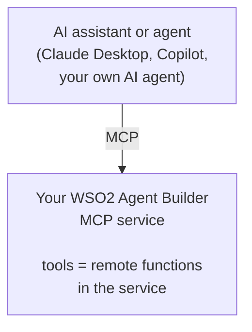
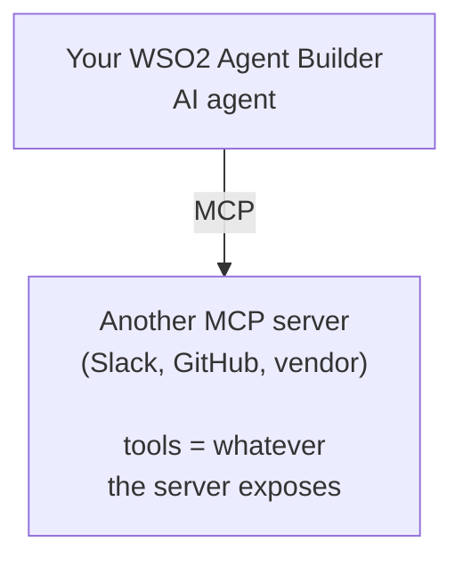

# MCP Integration

The **Model Context Protocol** (MCP) is an open standard that lets AI assistants discover and call tools exposed by external servers. See the [MCP specification](https://modelcontextprotocol.io) for the protocol details.

With WSO2 Agent Builder, you can build both sides of MCP: an **MCP server** (an MCP service that exposes your tools to AI assistants) and an **MCP client** (an agent that uses tools from other MCP servers).

## Features at a glance

| Feature | What it is | Where you find it |
|---|---|---|
| [Exposing a service as MCP](exposing-as-mcp.md) | Build an MCP service in WSO2 Agent Builder. Set its port and base path, add tools, and configure each tool's name, description, and parameters. | Project home page > **Add MCP Server**. |
| [Consuming MCP from an agent](consuming-mcp-from-agent.md) | Add an MCP server as a tool source for an AI agent, optionally limited to specific tools. | Agent canvas > **Add Tool** > **Use MCP Server** > **Connect Manually**. |

## When to use MCP

| Use MCP when... | Look elsewhere when... |
|---|---|
| You want your tools reusable by Claude Desktop, GitHub Copilot, or any other MCP client. | Only your own agents will consume the tools. Local function tools work fine. |
| You want to consume tools published by community or vendor MCP servers. | The tools live behind a normal HTTP API and a connector already covers them. |
| You want one standard entry point between AI clients and your tools, where you can apply authentication and logging. | The tools are internal and short-lived. |

## How the two sides fit together

*Exposing as MCP*

*Consuming MCP from an agent*

You can do both in the same project. A single project might expose a few tools (your CRM lookups) over MCP for outside assistants while its agents use Slack and GitHub MCP servers.

## Where to find MCP in WSO2 Agent Builder

MCP features appear in three places: the project home page, the MCP Service editor, and the agent canvas.

| Surface | What it does | Created where |
|---|---|---|
| **MCP Service** | An entry point that publishes tools over MCP. Listed under **Entry Points** in the project sidebar. | Project home page > **Add MCP Server** |
| **`mcp:StreamableHttpListener`** | The listener an MCP service runs on. Created when you add the first MCP service, and reusable across services. | MCP Service editor > **Configure** > **Attached Listeners** > `mcpListener` |
| **`mcp:StreamableHttpService` and `mcp:StreamableHttpAdvancedService`** | The service body. `mcp:StreamableHttpService` derives tools from `remote function`s and is what the MCP Service editor creates. `mcp:StreamableHttpAdvancedService` lets you implement `onListTools` and `onCallTool` for dynamic tool sets, and is written in code. | Inside the MCP Service editor |
| **Add Tool - Use MCP Server panel** | Connects an agent to a remote MCP server. Generates a toolkit class that implements `ai:McpBaseToolKit` and pulls tools from the server. | Agent canvas > **Add Tool** > **Use MCP Server** |
| **New Tool Configuration panel** | Per-tool editor inside an MCP service. Sets name, description, parameters, and return type. | MCP Service editor > **+ Add Tool** |

## Transport

MCP services in WSO2 Agent Builder use the **Streamable HTTP** transport. The listener exposes a single endpoint (for example, `http://localhost:8080/mcp`), and clients send every request to it, including tool listings and tool calls.

Because the transport is HTTP, the listener accepts any `http:ListenerConfiguration` option, including TLS, request limits, and timeouts. See [Listener configuration](exposing-as-mcp.md#listener-configuration).

## Common pitfalls

| Symptom | Likely cause | Fix |
|---|---|---|
| MCP client connects but sees no tools. | The `mcp:StreamableHttpService` has no `remote function`s yet, or no tools were added through the editor. | Select **+ Add Tool** in the MCP Service editor. |
| Client gets HTTP 404. | Wrong URL. Base path or listener port mismatch. | Check the listener port (**Configure** > **Attached Listeners** > `mcpListener` in the MCP Service editor) and the service base path (`/mcp` by default). |
| Tool call returns `Invalid parameters: ...`. | The arguments sent by the client do not match the tool's parameter types, so the framework rejects the call before invoking the tool. | Loosen the parameter type if it is too strict, or sharpen the parameter description so the model sends the right shape. |
| Agent picks the wrong MCP tool. | Tool descriptions are too generic or overlap. | Tighten each tool's first sentence. State *what* and *when*. See [Writing a good tool description](exposing-as-mcp.md#writing-a-good-tool-description). |
| Agent prompt becomes large after adding an MCP server. | The server advertises many tools and **Tools to Include** is set to `All`. | Filter **Tools to Include** to just the names you need. See [Filtering tools](consuming-mcp-from-agent.md#filtering-tools). |
| An agent's calls to an MCP server time out. | The toolkit's default 30-second timeout is too short for slow tools. | In the agent's **Edit MCP Server** panel, increase **Timeout** under **Advanced Configurations**. |

## What's next

- **[Exposing a service as MCP](exposing-as-mcp.md)** — expose your tools as an MCP server.
- **[Consuming MCP from an agent](consuming-mcp-from-agent.md)** — let your agent use tools from any MCP server.
- **[MCP specification](https://modelcontextprotocol.io)** — the protocol spec.
