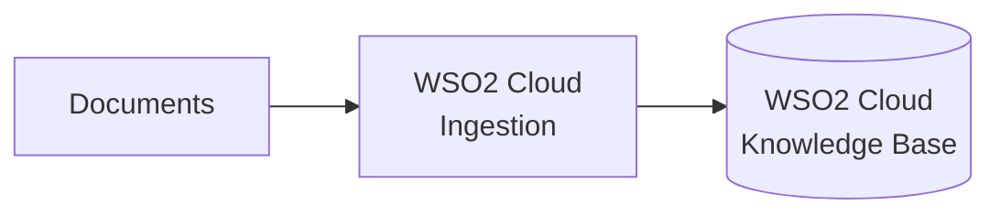

# RAG Ingestion

For the recommended RAG workflow, create and populate a knowledge base in WSO2 Cloud. WSO2 Cloud manages document ingestion and indexing, while your WSO2 Integrator project connects to the resulting knowledge base to retrieve content at runtime.

This separation keeps ingestion out of the query integration and lets you update the indexed content in WSO2 Cloud without rebuilding or redeploying the integration.

:::info Prerequisites

- Access to a WSO2 Cloud organization and project.
- Documents that you want to use to ground the RAG responses.

## Create and populate the knowledge base in WSO2 Cloud

Follow [Ingest documents into a knowledge base in WSO2 Cloud](product://saas/manage/cloud/rag-ingestion/ingestion) to:

1. Create a knowledge base in your WSO2 Cloud project.
2. Add the documents or data source that you want the knowledge base to index.
3. Start ingestion and wait until the content is ready to query.

Keep the knowledge base in the same WSO2 Cloud project that you select in WSO2 Integrator. The editor uses that project context to discover the available knowledge bases and supply their connection details securely.

Document ingestion is performed in WSO2 Cloud. You do not need to build a separate automation with a data loader, embedding provider, vector store, or `Ingest` action for this workflow.

## Keep the knowledge base up to date

When source content changes, update or re-ingest it from WSO2 Cloud. The query integration continues to use the same knowledge base connection and does not need to change unless you replace the knowledge base itself.

## What's next

- **[RAG query with an agent](rag-query.md)** — expose retrieval as an agent tool and generate grounded responses.
- **[Knowledge Bases](../ai-building-blocks/knowledge-bases.md#wso2-cloud-knowledge-base)** — configure the WSO2 Cloud Knowledge Base connection and retrieval settings.
