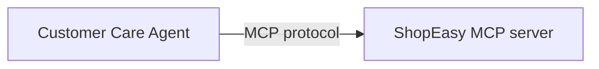

# Build a Customer Care Agent with MCP

## What you'll build



A customer care agent that connects to a ShopEasy MCP server and answers product availability, order status, and return questions over a chat API.

This tutorial shows how to build an agent that uses an external MCP server through an MCP toolkit. You don't build the MCP server here; you run a provided sample instead. Your job is to connect the agent to it, write the system prompt, and expose a chat endpoint.

The agent receives customer messages over HTTP, reasons about which tool to call, invokes the MCP server, and returns a natural language answer.

:::info Prerequisites
- A model provider for the agent. This tutorial uses the **Default WSO2 Model Provider**. For other options, see [Model providers for LLMs](../../develop-and-test/integration-artifacts/ai-integrations/ai-building-blocks/model-providers.md).
- The **ShopEasy MCP server** running locally. Clone the repo and follow its README to start it: [github.com/wso2/integration-samples](https://github.com/wso2/integration-samples/tree/main/integrator-default-profile/samples/customer-care-agent/mcp).

## Step 1: Create and configure the agent

1. Open WSO2 Agent Builder and create or open your project.
2. On the project home page, under **Or start from scratch**, select **Add Agent**.
3. In the **Add Agent** dialog, under **Create New**, select **Create Agent**.

<ThemedImage
    alt="The Add Agent dialog with Create Agent, Create Durable Agent, and Create Agent Definition under Create New, and a Pre-built Agents section with All, Project, and Organization filters and a search box"
    sources={{
        light: useBaseUrl('/img/genai/tutorials/customer-care-agent-mcp-v5.1/01-create-agent-1-v1.0.png'),
        dark: useBaseUrl('/img/genai/tutorials/customer-care-agent-mcp-v5.1/01-create-agent-1-v1.0.png'),
    }}
/>

4. In the **Create Agent** form, set:
   - **Role** to `Customer Support Agent`.
   - **Instructions** to:

```
You are a helpful customer support agent for ShopEasy, an online retailer.
Help customers with product availability, order tracking, and return requests.
Always use the available tools to look up accurate information. Never guess.
Keep responses friendly and concise. Include relevant IDs (order ID, return ID) in your responses.
```

   - **Model** to **Default WSO2 Model Provider**.

<ThemedImage
    alt="The Create Agent form with Role set to Customer Support Agent, the ShopEasy instructions in Instructions, and Model set to Default WSO2 Model Provider"
    sources={{
        light: useBaseUrl('/img/genai/tutorials/customer-care-agent-mcp-v5.1/02-create-agent-2-v1.0.png'),
        dark: useBaseUrl('/img/genai/tutorials/customer-care-agent-mcp-v5.1/02-create-agent-2-v1.0.png'),
    }}
/>

5. Leave the fields under **Advanced Configurations** (**Maximum Iterations**, **Verbose**, **Tool Loading Strategy**, **Execute Tool Calls In Parallel**, and **Agent Credential**) at their defaults.

:::info Why leave Maximum Iterations at its default?
`INFER_TOOL_COUNT` resolves to `max(number of tools, 10)`: at least 10 reasoning-action cycles, or more if the agent has more tools available. Once the MCP toolkit is attached in Step 2, this default already gives the agent enough room to reason, call a tool, and respond, without needing a manual override.

6. Set **Agent Name** to `CustomerCareAgent`.
7. Select **Create Agent**.

<ThemedImage
    alt="The lower part of the Create Agent form with Verbose (False), Tool Loading Strategy (NO_FILTER), Execute Tool Calls In Parallel (True), and Agent Credential at their defaults, Agent Name set to CustomerCareAgent, and the Create Agent button"
    sources={{
        light: useBaseUrl('/img/genai/tutorials/customer-care-agent-mcp-v5.1/03-create-agent-3-v1.0.png'),
        dark: useBaseUrl('/img/genai/tutorials/customer-care-agent-mcp-v5.1/03-create-agent-3-v1.0.png'),
    }}
/>

WSO2 Agent Builder adds the `CustomerCareAgent` agent under **Agents** and opens the agent canvas, where the **AI Agent** node connects to the default WSO2 model provider.

8. Select **Add Trigger** to the left of the **AI Agent** node.
9. In the **Add Trigger** dialog, under **Chat Channels**, select **Agent Chat**.
10. Leave **Service Path** as `/customer-care-agent` and select **Create**.

The **Agent Chat** trigger connects to the **AI Agent** node, and an **AI Agent Services - /customer-care-agent** entry point with a `chat` resource appears under **Entry Points**. The **AI Agent** node has a **+ Add Memory** button and an **Add Tool** button at its bottom-right corner.

<ThemedImage
    alt="The CustomerCareAgent canvas with the /customer-care-agent Agent Chat trigger connected to the AI Agent node, which connects to the Default WSO2 Model Provider and shows Add Memory, Add Trigger, and Add Tool. The sidebar lists AI Agent Services - /customer-care-agent with a chat resource under Entry Points."
    sources={{
        light: useBaseUrl('/img/genai/tutorials/customer-care-agent-mcp-v5.1/04-create-agent-4-v1.0.png'),
        dark: useBaseUrl('/img/genai/tutorials/customer-care-agent-mcp-v5.1/04-create-agent-4-v1.0.png'),
    }}
/>

## Step 2: Add the MCP server as a tool

### 2.1 Select the tool type

Select **Add Tool** at the bottom-right corner of the **AI Agent** node. The **Add Tool** panel opens, listing **Use Connection**, **Use Function**, **Use Agent**, **Use MCP Server**, **Use Knowledge Base**, and **Create Custom Tool**. Select **Use MCP Server**.

<ThemedImage
    alt="The Add Tool panel listing Use Connection, Use Function, Use Agent, Use MCP Server (highlighted), Use Knowledge Base, and Create Custom Tool, each with a short description"
    sources={{
        light: useBaseUrl('/img/genai/tutorials/customer-care-agent-mcp-v5.1/05-add-mcp-1-v1.0.png'),
        dark: useBaseUrl('/img/genai/tutorials/customer-care-agent-mcp-v5.1/05-add-mcp-1-v1.0.png'),
    }}
/>

### 2.2 Configure the server URL

1. Select **Connect Manually**. (The other option, **WSO2 Agent Manager**, lists MCP servers that your organization added to WSO2 Agent Manager.)
2. Set **Server Url** to `http://localhost:8080/mcp`.
3. Leave **Requires Authentication** off.

<ThemedImage
    alt="The Add Tool - Use MCP Server panel with Server Url set to http://localhost:8080/mcp, Requires Authentication unchecked, Tools to Include set to All, a collapsed Advanced Configurations section, and Result set to aiMcpbasetoolkit"
    sources={{
        light: useBaseUrl('/img/genai/tutorials/customer-care-agent-mcp-v5.1/06-add-mcp-2-v1.0.png'),
        dark: useBaseUrl('/img/genai/tutorials/customer-care-agent-mcp-v5.1/06-add-mcp-2-v1.0.png'),
    }}
/>

The panel also shows **Tools to Include** (defaults to **All**) and a collapsed **Advanced Configurations** section. It holds **Info** (the MCP client identity sent to the server) and HTTP client options such as timeout, redirects, pooling, caching, compression, circuit breaker, retries, and TLS. Leave these at their defaults for this tutorial.

4. Leave **Result** as the default `aiMcpbasetoolkit` and select **Save**.

The MCP toolkit appears as `aiMcpbasetoolkit` attached to the agent node, connected by a dashed line, and a `McpToolKit` type is added under **Types** in the sidebar. The agent discovers the available tools from the server at startup.

<ThemedImage
    alt="The completed agent canvas with the Agent Chat trigger, the AI Agent node connected to the Default WSO2 Model Provider, and aiMcpbasetoolkit attached to the AI Agent node by a dashed line"
    sources={{
        light: useBaseUrl('/img/genai/tutorials/customer-care-agent-mcp-v5.1/07-add-mcp-3-v1.0.png'),
        dark: useBaseUrl('/img/genai/tutorials/customer-care-agent-mcp-v5.1/07-add-mcp-3-v1.0.png'),
    }}
/>

## Step 3: Run and test

Make sure the ShopEasy MCP server is running, then select **Run**. WSO2 Agent Builder compiles and starts the service, with progress shown in the integrated terminal.

<ThemedImage
    alt="The chat resource flow with Start, an agent:run node for CustomerCareAgent with an Open Agent button, and Return, above the integrated terminal showing bal run compiling customer_care and Running executable"
    sources={{
        light: useBaseUrl('/img/genai/tutorials/customer-care-agent-mcp-v5.1/08-run-and-test-v1.0.png'),
        dark: useBaseUrl('/img/genai/tutorials/customer-care-agent-mcp-v5.1/08-run-and-test-v1.0.png'),
    }}
/>

Once it's running, open the `chat` resource under **Entry Points** > **AI Agent Services**. Its flow shows **Start**, an `agent:run` node (with an **Open Agent** link back to the `CustomerCareAgent` canvas), and **Return**. Select **Chat** in the toolbar (next to **Tracing**) to open the **Agent Chat** panel. Type your message in the input field and press **Enter** to send it.

When the service starts, a pop-up also offers to test it with the Try It client. Selecting **Test** there opens the same **Agent Chat** panel.

Try the following messages to exercise all three tools:

- *"Do you have any wireless headphones in stock?"*
- *"What is the status of my order ORD-042?"*
- *"I want to return ORD-001. The item arrived damaged."*

<ThemedImage
    alt="The chat resource next to the Agent Chat panel, where the agent answers that SoundPro X200 Wireless Headphones are in stock, that order ORD-042 is out for delivery, and that the return for ORD-001 is accepted with return ID RET-001"
    sources={{
        light: useBaseUrl('/img/genai/tutorials/customer-care-agent-mcp-v5.1/09-run-and-test-v1.0.png'),
        dark: useBaseUrl('/img/genai/tutorials/customer-care-agent-mcp-v5.1/09-run-and-test-v1.0.png'),
    }}
/>

**`connections.bal`** creates the MCP toolkit:

```ballerina
final McpToolKit aiMcpbasetoolkit = check new ("http://localhost:8080/mcp");
```

The model provider is initialized inline with `ai:getDefaultModelProvider()` in `agents.bal`, so no separate connection is needed for the default WSO2 model provider.

**`agents.bal`** defines the agent and the toolkit class:

```ballerina
import ballerina/ai;
import ballerina/mcp;

final ai:Agent CustomerCareAgent = check new (
    systemPrompt = {
        role: string `Customer Support Agent`,
        instructions: string `You are a helpful customer support agent for ShopEasy, an online retailer.
Help customers with product availability, order tracking, and return requests.
Always use the available tools to look up accurate information. Never guess.
Keep responses friendly and concise. Include relevant IDs (order ID, return ID) in your responses.`
    }, model = check ai:getDefaultModelProvider(), tools = [aiMcpbasetoolkit]
);

isolated class McpToolKit {
    *ai:McpBaseToolKit;
    private final mcp:StreamableHttpClient mcpClient;
    private final readonly & ai:ToolConfig[] tools;

    public isolated function init(string serverUrl, mcp:Implementation info = {name: "MCP", version: "1.0.0"},
            *mcp:StreamableHttpClientTransportConfig config) returns ai:Error? {
        do {
            self.mcpClient = check new mcp:StreamableHttpClient(serverUrl, config);
            self.tools = check ai:getPermittedMcpToolConfigs(self.mcpClient, info, self.callTool).cloneReadOnly();
        } on fail error e {
            return error ai:Error("Failed to initialize MCP toolkit", e);
        }
    }

    public isolated function getTools() returns ai:ToolConfig[] => self.tools;

    @ai:AgentTool
    public isolated function callTool(mcp:CallToolParams params) returns mcp:CallToolResult|error {
        return self.mcpClient->callTool(params);
    }
}
```

**`main.bal`** defines the chat service:

```ballerina
import ballerina/ai;
import ballerina/http;

listener ai:Listener agentChatListener = new (listenOn = check http:getDefaultListener());

service /customer\-care\-agent on agentChatListener {
    resource function post chat(@http:Payload ai:ChatReqMessage request)
            returns ai:ChatRespMessage|error {
        string stringResult = check CustomerCareAgent.run(request.message, sessionId = request.sessionId);
        return {message: stringResult};
    }
}
```

To run and test the agent, follow the same steps in the **Visual Designer** tab under [Step 3: Run and test](#step-3-run-and-test).

## What you built

- Connected an agent to a live MCP server through an MCP toolkit
- Let the agent discover three tools (`searchProducts`, `getOrderStatus`, `submitReturnRequest`) at startup, with no hardcoded tool definitions
- Exposed the agent as an HTTP chat service with session-scoped memory

## What's next

- [Exposing a service as an MCP server](../../develop-and-test/integration-artifacts/ai-integrations/mcp/exposing-as-mcp.md) — Build your own MCP server like the one used in this tutorial
- [Consuming MCP from an agent](../../develop-and-test/integration-artifacts/ai-integrations/mcp/consuming-mcp-from-agent.md) — Reference for the MCP toolkit options
- [Adding memory to an agent](../../develop-and-test/integration-artifacts/ai-integrations/agents/memory.md) — Persist conversation history across sessions
- [AI agent observability](../../develop-and-test/integration-artifacts/ai-integrations/agents/observability.md) — Trace tool calls and monitor agent performance
