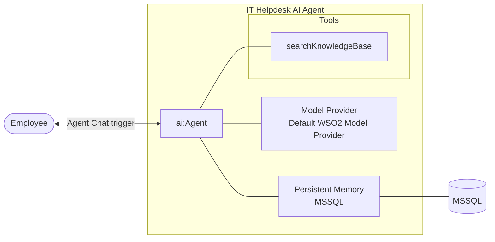

# Building an IT Helpdesk AI Agent with Persistent Memory

## What you will build

In this tutorial, you will build an IT helpdesk AI agent in WSO2 Agent Builder that assists employees with technical support issues and remembers conversations across service restarts using persistent MSSQL-backed memory.

The agent responds to employee questions through an **Agent Chat** trigger, searches an internal knowledge base for troubleshooting guidance, and keeps its conversation history in an MSSQL database using `ballerinax/ai.memory.mssql`.

Because the chat history is persisted in a database, employees can continue a conversation using the same session ID without repeating information they already shared, even after the integration restarts.

## What you will learn

In this tutorial, you will learn how to:

- Create an AI agent with a custom tool in WSO2 Agent Builder
- Store connection details as configurable values
- Persist conversation history across service restarts using MSSQL-backed memory
- Expose the agent through an **Agent Chat** trigger and keep employee-specific conversations using a session ID

## Prerequisites

Before getting started, ensure that the following requirements are met:

- WSO2 Agent Builder is installed.
- An MSSQL database is reachable (host, port, user, password). Create the chat messages table ahead of time:

  ```sql
  CREATE TABLE ChatMessages (
      Id INT IDENTITY(1,1) PRIMARY KEY,
      MessageKey NVARCHAR(100) NOT NULL,
      MessageRole NVARCHAR(20) NOT NULL CHECK (MessageRole IN ('user', 'system', 'assistant', 'function')),
      MessageJson NVARCHAR(MAX) NOT NULL,
      CreatedAt DATETIME2 NOT NULL DEFAULT SYSDATETIME()
  );
  ```

  If you plan to use human-in-the-loop, also create the checkpoint table. See [Memory](../../develop-and-test/integration-artifacts/ai-integrations/agents/memory.md) for the schemas.

:::tip Local MSSQL for testing
To try this tutorial locally, you can run SQL Server in Docker:

```bash
docker run -d --name helpdesk-mssql -e ACCEPT_EULA=Y -e MSSQL_SA_PASSWORD='<password>' \
  -p 1433:1433 mcr.microsoft.com/mssql/server:2022-latest
```

Then create a database (for example `helpdesk`) and the `ChatMessages` table in it.

## Architecture



## Build the integration

In this section, you will create the agentic integration and configure the AI agent for the IT helpdesk system.

### Step 1: Create the agentic integration

1. Open WSO2 Agent Builder and select **Create** under **Start Building your Agent**.
2. Set **Project name** to `IT-Helpdesk` and choose a **Location**.
3. Under **What do you want to build?**, keep **Agentic Integration** selected.
4. Set **Agentic integration name** to `ITHelpdesk`.
5. Select **Create Agentic Integration**.

<ThemedImage
    alt="Create a Project form with Project name set to IT-Helpdesk, the Agentic Integration option selected, and Agentic integration name set to ITHelpdesk"
    sources={{
        light: useBaseUrl('/img/genai/tutorials/it-helpdesk-chatbot-v1.0/01-create-project-v1.0.png'),
        dark: useBaseUrl('/img/genai/tutorials/it-helpdesk-chatbot-v1.0/01-create-project-v1.0.png'),
    }}
/>

The integration opens with the WSO2 Agent Builder Copilot. Skip it for this tutorial and build the integration manually.

<ThemedImage
    alt="ITHelpdesk integration home page showing the WSO2 Agent Builder Copilot prompt and the Add Agent and Add MCP Server buttons under Or start from scratch"
    sources={{
        light: useBaseUrl('/img/genai/tutorials/it-helpdesk-chatbot-v1.0/02-integration-home-v1.0.png'),
        dark: useBaseUrl('/img/genai/tutorials/it-helpdesk-chatbot-v1.0/02-integration-home-v1.0.png'),
    }}
/>

### Step 2: Define the data type and knowledge base

Define the `KbArticle` type in `types.bal`:

```ballerina
type KbArticle record {|
    string articleId;
    string title;
    string content;
    string category;
    string[] tags;
    float relevanceScore;
|};
```

Add the knowledge base articles in a new file, for example `kb_articles.bal`:

```ballerina
final KbArticle[] & readonly kbArticles = [
    {
        articleId: "KB-101",
        title: "VPN Troubleshooting",
        content: "Restart the VPN client and reconnect.",
        category: "network",
        tags: ["vpn"],
        relevanceScore: 0.95
    },
    {
        articleId: "KB-102",
        title: "Password Reset",
        content: "Use the self-service password reset portal.",
        category: "account",
        tags: ["password"],
        relevanceScore: 0.9
    }
];
```

The tool you add in Step 4 searches `kbArticles` by matching `tags` against the employee's query, and returns the `content` of the highest-`relevanceScore` match.

### Step 3: Create the agent

1. Under **Or start from scratch**, select **Add Agent**, then select **Create Agent** under **Create New**.

<ThemedImage
    alt="Add Agent dialog showing the Create Agent, Create Durable Agent, and Create Agent Definition options"
    sources={{
        light: useBaseUrl('/img/genai/tutorials/it-helpdesk-chatbot-v1.0/03-add-agent-v1.0.png'),
        dark: useBaseUrl('/img/genai/tutorials/it-helpdesk-chatbot-v1.0/03-add-agent-v1.0.png'),
    }}
/>

2. On the **Create Agent** form, set:
   - **Role** to `itHelpDesk`.
   - **Instructions** to:

     ```
     You are an IT Helpdesk Assistant.

     Rules:
       - ALWAYS call searchKnowledgeBase first.
       - ONLY use information returned by tools.
       - Do NOT generate additional troubleshooting steps.
       - Keep responses short.
       - Remember previous conversations.
     ```

   - **Model** as **Default WSO2 Model Provider**.

<ThemedImage
    alt="Create Agent form with Role set to itHelpDesk, the helpdesk instructions filled in, and Model set to Default WSO2 Model Provider"
    sources={{
        light: useBaseUrl('/img/genai/tutorials/it-helpdesk-chatbot-v1.0/04-create-agent-v1.0.png'),
        dark: useBaseUrl('/img/genai/tutorials/it-helpdesk-chatbot-v1.0/04-create-agent-v1.0.png'),
    }}
/>

3. Scroll down, set **Agent Name** to `itHelpDeskAgent`, and select **Create Agent**.

The agent canvas opens. The **AI Agent** node is connected to the model provider, with **Add Trigger** on its left, **+ Add Memory** inside it, and **Add Tool** at its bottom-right corner.

<ThemedImage
    alt="AI Agent canvas for itHelpDeskAgent connected to the Default WSO2 Model Provider, with Add Trigger, Add Memory, and Add Tool options"
    sources={{
        light: useBaseUrl('/img/genai/tutorials/it-helpdesk-chatbot-v1.0/05-ai-agent-canvas-v1.0.png'),
        dark: useBaseUrl('/img/genai/tutorials/it-helpdesk-chatbot-v1.0/05-ai-agent-canvas-v1.0.png'),
    }}
/>

```ballerina
# agents.bal
import ballerina/ai;

final ai:Agent itHelpDeskAgent = check new (
    systemPrompt = {
        role: string `itHelpDesk`,
        instructions: string `You are an IT Helpdesk Assistant.

Rules:
  - ALWAYS call searchKnowledgeBase first.
  - ONLY use information returned by tools.
  - Do NOT generate additional troubleshooting steps.
  - Keep responses short.
  - Remember previous conversations.`
    }, model = check ai:getDefaultModelProvider(), tools = []
);
```

### Step 4: Add a tool to the agent

1. Select **Add Tool** on the **AI Agent** node, then select **Create Custom Tool**.

<ThemedImage
    alt="Add Tool panel listing Use Connection, Use Function, Use Agent, Use MCP Server, Use Knowledge Base, and Create Custom Tool"
    sources={{
        light: useBaseUrl('/img/genai/tutorials/it-helpdesk-chatbot-v1.0/06-add-tool-panel-v1.0.png'),
        dark: useBaseUrl('/img/genai/tutorials/it-helpdesk-chatbot-v1.0/06-add-tool-panel-v1.0.png'),
    }}
/>

2. Set:
   - **Name** to `searchKnowledgeBase`.
   - **Description** to `Searches the IT knowledge base for troubleshooting guidance`.
   - A parameter of **Type** `string` and **Name** `query`.
   - **Return Type** to `string`.
3. Leave **Requires Approval** unchecked and select **Create Tool**.

<ThemedImage
    alt="Create Custom Tool form with Name searchKnowledgeBase, a string query parameter, and Return Type string"
    sources={{
        light: useBaseUrl('/img/genai/tutorials/it-helpdesk-chatbot-v1.0/07-create-custom-tool-v1.0.png'),
        dark: useBaseUrl('/img/genai/tutorials/it-helpdesk-chatbot-v1.0/07-create-custom-tool-v1.0.png'),
    }}
/>

4. The tool now shows as a node connected to the agent. Select it to open its flow, and build the logic shown below: normalize the query, declare a `bestMatch` variable, loop over `kbArticles` and their `tags` to find the highest-`relevanceScore` match, then return its `content`, or fall back to a "no matching article" return. You can also paste the function body from the **Ballerina Code** tab into the source view (`</>`).

<ThemedImage
    alt="Agent Tool searchKnowledgeBase flow: declaring normalizedQuery and bestMatch, looping over kbArticles and their tags to update bestMatch, then returning bestMatch.content or a fallback message"
    sources={{
        light: useBaseUrl('/img/genai/tutorials/it-helpdesk-chatbot-v1.0/08-tool-logic-flow-v1.0.png'),
        dark: useBaseUrl('/img/genai/tutorials/it-helpdesk-chatbot-v1.0/08-tool-logic-flow-v1.0.png'),
    }}
/>

New tools open with a placeholder **Panic** node (`error("not implemented")`). Replace it with your logic so it isn't left in the flow.

```ballerina
# agents.bal
# Searches the IT knowledge base for troubleshooting guidance
# + query - The employee question or issue
# + return - Matching troubleshooting guidance from the knowledge base
@ai:AgentTool
isolated function searchKnowledgeBase(string query) returns string {
    string normalizedQuery = query.toLowerAscii();
    KbArticle? bestMatch = ();
    foreach KbArticle article in kbArticles {
        foreach string tag in article.tags {
            if normalizedQuery.includes(tag) && (bestMatch is () || article.relevanceScore > bestMatch.relevanceScore) {
                bestMatch = article;
            }
        }
    }
    if bestMatch is KbArticle {
        return bestMatch.content;
    }
    return "No matching knowledge base article found.";
}
```

### Step 5: Add persistent memory to the agent

#### Add the connection details as configurables

1. In the project explorer, hover over **Configurations** and select **+**. The **Add Configurable Variable** panel opens.
2. Add the following configurables one at a time. Leave **Default Value** empty so each value is required, and select **Save**:

   | Variable Name | Variable Type |
   |---|---|
   | `host` | `string` |
   | `user` | `string` |
   | `password` | `string` |
   | `database` | `string` |
   | `port` | `int` |

<ThemedImage
    alt="Add Configurable Variable panel with Variable Name host and Variable Type string"
    sources={{
        light: useBaseUrl('/img/genai/tutorials/it-helpdesk-chatbot-v1.0/11-add-configurable-v1.0.png'),
        dark: useBaseUrl('/img/genai/tutorials/it-helpdesk-chatbot-v1.0/11-add-configurable-v1.0.png'),
    }}
/>

3. On the **Configurable Variables** page, enter the values for your MSSQL database. WSO2 Agent Builder saves them to `Config.toml`.

<ThemedImage
    alt="Configurable Variables page listing host, user, password, database, and port with values entered"
    sources={{
        light: useBaseUrl('/img/genai/tutorials/it-helpdesk-chatbot-v1.0/12-configurable-values-v1.0.png'),
        dark: useBaseUrl('/img/genai/tutorials/it-helpdesk-chatbot-v1.0/12-configurable-values-v1.0.png'),
    }}
/>

#### Create the MSSQL memory store

1. Open the **itHelpDeskAgent** canvas and select **+ Add Memory** on the **AI Agent** node. The **Configure Memory** panel opens with **Select Memory** set to **Short Term Memory**.

<ThemedImage
    alt="Configure Memory panel with Select Memory set to Short Term Memory and no memory store created yet"
    sources={{
        light: useBaseUrl('/img/genai/tutorials/it-helpdesk-chatbot-v1.0/09-configure-memory-v1.0.png'),
        dark: useBaseUrl('/img/genai/tutorials/it-helpdesk-chatbot-v1.0/09-configure-memory-v1.0.png'),
    }}
/>

2. Select **+ Create New Memory Store**, then select **MSSQL Short Term Memory Store**.

<ThemedImage
    alt="Select Memory Store panel listing In Memory, Amazon DynamoDB, MSSQL, PostgreSQL, Redis, and SQLite short-term memory stores"
    sources={{
        light: useBaseUrl('/img/genai/tutorials/it-helpdesk-chatbot-v1.0/10-select-memory-store-v1.0.png'),
        dark: useBaseUrl('/img/genai/tutorials/it-helpdesk-chatbot-v1.0/10-select-memory-store-v1.0.png'),
    }}
/>

3. Switch **MS SQL Client** to **Expression** and set it to:

   ```ballerina
   check new (host, user, password, database, port)
   ```

   Leave **Max Messages Per Key**, **Cache Config**, **Table Name** (`ChatMessages`), and **Checkpoint Table Name** at their defaults.

<ThemedImage
    alt="Create Memory Store panel for MSSQL with MS SQL Client set to check new (host, user, password, database, port)"
    sources={{
        light: useBaseUrl('/img/genai/tutorials/it-helpdesk-chatbot-v1.0/13-create-mssql-memory-store-v1.0.png'),
        dark: useBaseUrl('/img/genai/tutorials/it-helpdesk-chatbot-v1.0/13-create-mssql-memory-store-v1.0.png'),
    }}
/>

4. Leave **Memory Store Name** at its default (`mssqlShorttermmemorystore`). **Result Type** is fixed to `mssql:ShortTermMemoryStore`. Select **Save**.

<ThemedImage
    alt="Bottom of the Create Memory Store panel with Memory Store Name mssqlShorttermmemorystore and Result Type mssql:ShortTermMemoryStore"
    sources={{
        light: useBaseUrl('/img/genai/tutorials/it-helpdesk-chatbot-v1.0/14-memory-store-name-v1.0.png'),
        dark: useBaseUrl('/img/genai/tutorials/it-helpdesk-chatbot-v1.0/14-memory-store-name-v1.0.png'),
    }}
/>

5. Back in the **Configure Memory** panel, the new store is selected under **Store**. Leave **Memory Name** at its default (`aiShorttermmemory`) and select **Save**.

<ThemedImage
    alt="Configure Memory panel with Store set to mssqlShorttermmemorystore and Memory Name aiShorttermmemory"
    sources={{
        light: useBaseUrl('/img/genai/tutorials/it-helpdesk-chatbot-v1.0/15-configure-memory-store-selected-v1.0.png'),
        dark: useBaseUrl('/img/genai/tutorials/it-helpdesk-chatbot-v1.0/15-configure-memory-store-selected-v1.0.png'),
    }}
/>

The **AI Agent** node now shows a **Memory** section (**ShortTermMemory**), alongside the model provider and the `searchKnowledgeBase` tool.

<ThemedImage
    alt="AI Agent node for itHelpDeskAgent with a Memory ShortTermMemory section, connected to the model provider and the searchKnowledgeBase tool"
    sources={{
        light: useBaseUrl('/img/genai/tutorials/it-helpdesk-chatbot-v1.0/16-agent-with-memory-v1.0.png'),
        dark: useBaseUrl('/img/genai/tutorials/it-helpdesk-chatbot-v1.0/16-agent-with-memory-v1.0.png'),
    }}
/>

**`config.bal`**: configurable values for the MSSQL connection.

```ballerina
configurable string host = ?;
configurable string user = ?;
configurable string password = ?;
configurable string database = ?;
configurable int port = ?;
```

**`Config.toml`**: the values for your database.

```toml
[<org>.ithelpdesk]
host = "<hostName>"
user = "<userName>"
password = "<password>"
database = "<databaseName>"
port = 1433
```

Add the MSSQL-backed memory store to `agents.bal` and wire it into the agent:

```ballerina
# agents.bal
import ballerina/ai;
import ballerinax/ai.memory.mssql;

final ai:Agent itHelpDeskAgent = check new (
    systemPrompt = {
        role: string `itHelpDesk`,
        instructions: string `You are an IT Helpdesk Assistant.

Rules:
  - ALWAYS call searchKnowledgeBase first.
  - ONLY use information returned by tools.
  - Do NOT generate additional troubleshooting steps.
  - Keep responses short.
  - Remember previous conversations.`
    }, model = check ai:getDefaultModelProvider(), tools = [searchKnowledgeBase], memory = aiShorttermmemory
);

// searchKnowledgeBase tool from Step 4

final mssql:ShortTermMemoryStore mssqlShorttermmemorystore = check new (check new (host, user, password, database, port));
final ai:ShortTermMemory aiShorttermmemory = check new (mssqlShorttermmemorystore);
```

### Step 6: Expose the agent through an Agent Chat trigger

1. Select **Add Trigger** on the left of the **AI Agent** node, then select **Agent Chat** under **Chat Channels**.

<ThemedImage
    alt="Add Trigger dialog with Agent Chat highlighted under Chat Channels"
    sources={{
        light: useBaseUrl('/img/genai/tutorials/it-helpdesk-chatbot-v1.0/17-add-trigger-v1.0.png'),
        dark: useBaseUrl('/img/genai/tutorials/it-helpdesk-chatbot-v1.0/17-add-trigger-v1.0.png'),
    }}
/>

2. Set **Service Path** to `/it-helpdesk` and select **Create**.

<ThemedImage
    alt="Agent Chat trigger form with Service Path set to /it-helpdesk"
    sources={{
        light: useBaseUrl('/img/genai/tutorials/it-helpdesk-chatbot-v1.0/18-agent-chat-trigger-v1.0.png'),
        dark: useBaseUrl('/img/genai/tutorials/it-helpdesk-chatbot-v1.0/18-agent-chat-trigger-v1.0.png'),
    }}
/>

This creates an **AI Agent Services - /it-helpdesk** entry point with a `chat` resource. The canvas shows the complete agent: the **/it-helpdesk Agent Chat** trigger, the memory, the model provider, and the `searchKnowledgeBase` tool.

<ThemedImage
    alt="Complete itHelpDeskAgent canvas with the /it-helpdesk Agent Chat trigger, ShortTermMemory, the Default WSO2 Model Provider, and the searchKnowledgeBase tool"
    sources={{
        light: useBaseUrl('/img/genai/tutorials/it-helpdesk-chatbot-v1.0/19-complete-agent-v1.0.png'),
        dark: useBaseUrl('/img/genai/tutorials/it-helpdesk-chatbot-v1.0/19-complete-agent-v1.0.png'),
    }}
/>

```ballerina
# main.bal
import ballerina/ai;
import ballerina/http;

listener ai:Listener agentChatListener = new (listenOn = check http:getDefaultListener());

service /it\-helpdesk on agentChatListener {
    resource function post chat(@http:Payload ai:ChatReqMessage request)
            returns ai:ChatRespMessage|error {
        string stringResult = check itHelpDeskAgent.run(request.message, sessionId = request.sessionId);
        return {message: stringResult};
    }
}
```

### Step 7: Run and test the integration

1. Select **Run Integration**. WSO2 Agent Builder compiles and starts the integration, with progress shown in the integrated terminal.
2. Under **Entry Points**, expand **AI Agent Services - /it-helpdesk**, select the `chat` resource, and then select **Chat** to open the **Agent Chat** panel. Try the conversation below to exercise the tool and confirm the agent remembers earlier turns in the same session:

- *"My VPN is not working"*
- *"I already restarted it"*
- *"Any other suggestions?"*

<ThemedImage
    alt="Chat Agent Service resource flow alongside the Agent Chat panel showing the VPN troubleshooting conversation"
    sources={{
        light: useBaseUrl('/img/genai/tutorials/it-helpdesk-chatbot-v1.0/20-run-and-test-v1.0.png'),
        dark: useBaseUrl('/img/genai/tutorials/it-helpdesk-chatbot-v1.0/20-run-and-test-v1.0.png'),
    }}
/>

3. To prove that memory survives a service restart, you need the session ID the Chat panel uses. Select the **ⓘ** icon at the top-left of the **Agent Chat** panel. It shows the **Session ID** and **Chat Endpoint** for the current conversation.

<ThemedImage
    alt="Agent Chat panel's info popover showing the Session ID, the Chat Endpoint http://localhost:9090/it-helpdesk/chat, and Tracing Disabled"
    sources={{
        light: useBaseUrl('/img/genai/tutorials/it-helpdesk-chatbot-v1.0/21-session-id-v1.0.png'),
        dark: useBaseUrl('/img/genai/tutorials/it-helpdesk-chatbot-v1.0/21-session-id-v1.0.png'),
    }}
/>

4. Stop the integration, then run it again. Once it's back up, ask *"Do you remember my issue?"* in the same **Agent Chat** panel, which still uses the same session ID.

<ThemedImage
    alt="Agent Chat panel after the restart, with the agent answering that the VPN is not working and that the VPN client was already restarted"
    sources={{
        light: useBaseUrl('/img/genai/tutorials/it-helpdesk-chatbot-v1.0/22-memory-after-restart-v1.0.png'),
        dark: useBaseUrl('/img/genai/tutorials/it-helpdesk-chatbot-v1.0/22-memory-after-restart-v1.0.png'),
    }}
/>

You can also send the request with `curl`, using the session ID from the info popover:

```bash
curl -X POST http://localhost:9090/it-helpdesk/chat \
  -H "Content-Type: application/json" \
  -d '{"sessionId": "<your session ID>", "message": "Do you remember my issue?"}'
```

The response confirms that the agent remembers the VPN issue and that you'd already restarted the client. This proves the conversation history survived the restart, because it's persisted in MSSQL rather than held in process memory.

1. Run the integration.
2. Ask a question as an employee:

<TabItem value="bash" label="Curl Command" default>

```bash
curl -X POST http://localhost:9090/it-helpdesk/chat \
  -H "Content-Type: application/json" \
  -d '{
        "sessionId": "EMP-1001",
        "message": "My VPN is not working"
      }'
```

```json
{
  "message":"Try restarting your VPN client and then reconnecting."
}
```

3. Continue the conversation using the same session ID:

```bash
curl -X POST http://localhost:9090/it-helpdesk/chat \
  -H "Content-Type: application/json" \
  -d '{
        "sessionId":"EMP-1001",
        "message":"I already restarted it"
      }'
```

```json
{
  "message":"Since restarting the VPN client didn't work, please provide more details about the issue for further assistance."
}
```

4. Continue the conversation again using the same session ID:

```bash
curl -X POST http://localhost:9090/it-helpdesk/chat \
  -H "Content-Type: application/json" \
  -d '{
        "sessionId":"EMP-1001",
        "message":"Any other suggestions?"
      }'
```

```json
{
  "message":"The only information available suggests restarting the VPN client and reconnecting. If that hasn't resolved the issue, please check your internet connection or consider contacting your network administrator."
}
```

5. Restart the service and reconnect using the same session ID:

```bash
curl -X POST http://localhost:9090/it-helpdesk/chat \
  -H "Content-Type: application/json" \
  -d '{
        "sessionId":"EMP-1001",
        "message":"Do you remember my issue?"
      }'
```

```json
{
  "message":"Yes, your VPN is not working, and you've already restarted the client."
}
```

The AI agent remembers previous conversations because the conversation history is stored in persistent MSSQL-backed memory and retrieved using the same session ID.
