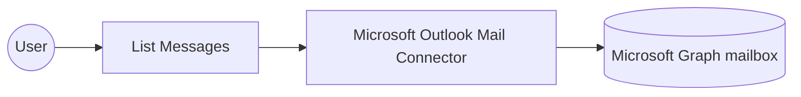

# Example

## What you'll build

This integration connects to Microsoft Outlook Mail through Microsoft Graph and lists the messages in the signed-in user's mailbox. An automation entry point runs the operation once and logs the returned message list.

**Operations used:**
- **List Messages** : Lists the messages in the signed-in user's mailbox

## Architecture

## Prerequisites

- A Microsoft 365 account with an Outlook mailbox.
- An application registered in Microsoft Entra ID with the delegated Microsoft Graph **Mail.Read** (or **Mail.ReadWrite**) and **offline_access** permissions, and its client ID and client secret.
- An OAuth 2.0 refresh token for that application.

## Setting up the Microsoft Outlook Mail integration

> **New to WSO2 Integrator?** Follow the [Create a New Integration](product://integrator/develop-and-test/create-workspace) guide to set up your integration first, then return here to add the connector.

## Adding the Microsoft Outlook Mail connector

### Step 1: Open the connector palette

Hover over **Connections** in the project tree and select **Add Connection** (**+**).

<ThemedImage
    alt="Microsoft Outlook Mail connector palette open before selection"
    sources={{
        light: useBaseUrl('/img/connectors/catalog/communication/microsoft.outlook.mail/ballerinax_microsoft_outlook_mail_screenshot_01_palette.png'),
        dark: useBaseUrl('/img/connectors/catalog/communication/microsoft.outlook.mail/ballerinax_microsoft_outlook_mail_screenshot_01_palette.png'),
    }}
/>

### Step 2: Select the Microsoft Outlook Mail connector

1. Enter `microsoft.outlook.mail` in the search field.
2. Select the **Microsoft Outlook Mail** connector card.

## Configuring the Microsoft Outlook Mail connection

### Step 3: Bind the connection parameters to configurable variables

Bind each connection field to a configurable variable. Use the **Configurables** tab of the field's helper panel to create each configurable.

- **Config** : Connection settings, with the OAuth 2.0 refresh token configuration for Microsoft Entra ID set in the `auth` record. Switch the field to **Expression** and enter `{auth: {clientId: mailClientId, clientSecret: mailClientSecret, refreshToken: mailRefreshToken, refreshUrl: mailRefreshUrl}}`.
- **Service Url** : Set it to the `mailServiceUrl` configurable.

<ThemedImage
    alt="Microsoft Outlook Mail connection form with all parameters bound before saving"
    sources={{
        light: useBaseUrl('/img/connectors/catalog/communication/microsoft.outlook.mail/ballerinax_microsoft_outlook_mail_screenshot_02_connection_form.png'),
        dark: useBaseUrl('/img/connectors/catalog/communication/microsoft.outlook.mail/ballerinax_microsoft_outlook_mail_screenshot_02_connection_form.png'),
    }}
/>

### Step 4: Save the connection

Select **Save Connection** and verify that **mailClient** appears under **Connections** in the project tree and on the design canvas.

<ThemedImage
    alt="Microsoft Outlook Mail connection visible after saving"
    sources={{
        light: useBaseUrl('/img/connectors/catalog/communication/microsoft.outlook.mail/ballerinax_microsoft_outlook_mail_screenshot_03_connections_list.png'),
        dark: useBaseUrl('/img/connectors/catalog/communication/microsoft.outlook.mail/ballerinax_microsoft_outlook_mail_screenshot_03_connections_list.png'),
    }}
/>

### Step 5: Set actual values for your configurables

1. Select **Configurations** at the bottom of the project tree.
2. Enter a value for each configurable listed below before you run the integration.

- **mailClientId** (`string`) : Application (client) ID of the registered application.
- **mailClientSecret** (`string`) : Client secret of the registered application.
- **mailRefreshToken** (`string`) : OAuth 2.0 refresh token issued for the Microsoft Graph scopes.
- **mailRefreshUrl** (`string`) : Token endpoint, such as `https://login.microsoftonline.com/common/oauth2/v2.0/token`.
- **mailServiceUrl** (`string`) : Microsoft Graph base URL. Defaults to `https://graph.microsoft.com/v1.0`.

## Configuring the Microsoft Outlook Mail List Messages operation

### Step 6: Add an automation entry point

1. Select **Add Artifact** on the design canvas.
2. Select **Automation**.
3. Select **Create** to accept the settings.

### Step 7: Expand the connection and configure the List Messages operation

1. Select the **+** between **Start** and **Error Handler** in the automation flow.
2. Expand **mailClient** under **Connections** to display its operations.

<ThemedImage
    alt="Microsoft Outlook Mail connection expanded to display operations before selection"
    sources={{
        light: useBaseUrl('/img/connectors/catalog/communication/microsoft.outlook.mail/ballerinax_microsoft_outlook_mail_screenshot_04_operations_panel.png'),
        dark: useBaseUrl('/img/connectors/catalog/communication/microsoft.outlook.mail/ballerinax_microsoft_outlook_mail_screenshot_04_operations_panel.png'),
    }}
/>

3. Select **List Messages**. The operation has no required parameters.

- **Result** : Set it to `messages`, the variable that stores the returned message list.

<ThemedImage
    alt="Microsoft Outlook Mail List Messages operation with all values entered before saving"
    sources={{
        light: useBaseUrl('/img/connectors/catalog/communication/microsoft.outlook.mail/ballerinax_microsoft_outlook_mail_screenshot_05_operation_form.png'),
        dark: useBaseUrl('/img/connectors/catalog/communication/microsoft.outlook.mail/ballerinax_microsoft_outlook_mail_screenshot_05_operation_form.png'),
    }}
/>

4. Select **Save**.

### Step 8: Log the List Messages result

1. Select the **+** below the **List Messages** node.
2. Under **Logging**, select **Log Info**.
3. Switch **Msg** to **Expression**, enter `messages.toString()`, and select **Save**.

<ThemedImage
    alt="Completed Microsoft Outlook Mail flow with the configured operation"
    sources={{
        light: useBaseUrl('/img/connectors/catalog/communication/microsoft.outlook.mail/ballerinax_microsoft_outlook_mail_screenshot_06_completed_flow.png'),
        dark: useBaseUrl('/img/connectors/catalog/communication/microsoft.outlook.mail/ballerinax_microsoft_outlook_mail_screenshot_06_completed_flow.png'),
    }}
/>

## Try it yourself

Try this sample in WSO2 Integration Platform.

[View source on GitHub](https://github.com/wso2/integration-samples/tree/main/integrator-default-profile/connectors/microsoft.outlook.mail_connector_sample)

## More code examples

The `Microsoft Outlook Mail` connector provides practical examples illustrating usage in various scenarios. Explore these [examples](https://github.com/ballerina-platform/module-ballerinax-microsoft.outlook.mail/tree/main/examples), covering the following use cases:

1. [Automated email notifications](https://github.com/ballerina-platform/module-ballerinax-microsoft.outlook.mail/tree/main/examples/automated-email-notifications) - Automates weekly project status report distribution. Creates a dedicated mail folder, drafts an HTML-formatted report email with an attachment, sends the draft, and lists recent sent messages to confirm delivery.
2. [Email inbox management](https://github.com/ballerina-platform/module-ballerinax-microsoft.outlook.mail/tree/main/examples/email-inbox-management) - Implements a customer support inbox triage workflow. Lists unread messages, fetches message details, marks messages as read after review, creates an organized folder for processed tickets, and deletes spam or resolved messages.
