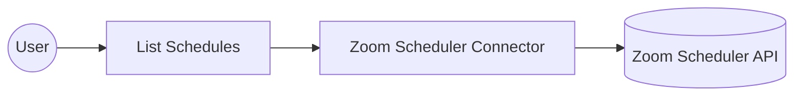

# Example

## What you'll build

This integration connects to Zoom Scheduler and lists the schedules of a Zoom user. An automation entry point runs the operation once and logs the returned schedules.

**Operations used:**
- **List Schedules** : Lists the schedules of the authorized Zoom user

## Architecture

## Prerequisites

- A Zoom account with access to Zoom Scheduler.
- A general (user-managed) app in the Zoom App Marketplace with the Zoom Scheduler scopes, and its client ID and client secret.
- An OAuth 2.0 refresh token issued for that app.

## Setting up the Zoom Scheduler integration

> **New to WSO2 Integrator?** Follow the [Create a New Integration](product://integrator/develop-and-test/create-workspace) guide to set up your integration first, then return here to add the connector.

## Adding the Zoom Scheduler connector

### Step 1: Open the connector palette

Hover over **Connections** in the project tree and select **Add Connection** (**+**).

<ThemedImage
    alt="Zoom Scheduler connector palette open before selection"
    sources={{
        light: useBaseUrl('/img/connectors/catalog/communication/zoom.scheduler/ballerinax_zoom_scheduler_screenshot_01_palette.png'),
        dark: useBaseUrl('/img/connectors/catalog/communication/zoom.scheduler/ballerinax_zoom_scheduler_screenshot_01_palette.png'),
    }}
/>

### Step 2: Select the Zoom Scheduler connector

1. Enter `zoom.scheduler` in the search field.
2. Select the **Zoom Scheduler** connector card.

## Configuring the Zoom Scheduler connection

### Step 3: Bind the connection parameters to configurable variables

Bind each connection field to a configurable variable. Use the **Configurables** tab of the field's helper panel to create each configurable.

- **Config** : Connection settings, with the OAuth 2.0 refresh token configuration for Zoom set in the `auth` record. Switch the field to **Expression** and enter `{auth: {clientId: schedulerClientId, clientSecret: schedulerClientSecret, refreshToken: schedulerRefreshToken, refreshUrl: schedulerRefreshUrl}}`.
- **Service Url** : Set it to the `schedulerServiceUrl` configurable.

<ThemedImage
    alt="Zoom Scheduler connection form with all parameters bound before saving"
    sources={{
        light: useBaseUrl('/img/connectors/catalog/communication/zoom.scheduler/ballerinax_zoom_scheduler_screenshot_02_connection_form.png'),
        dark: useBaseUrl('/img/connectors/catalog/communication/zoom.scheduler/ballerinax_zoom_scheduler_screenshot_02_connection_form.png'),
    }}
/>

### Step 4: Save the connection

Select **Save Connection** and verify that **schedulerClient** appears under **Connections** in the project tree and on the design canvas.

<ThemedImage
    alt="Zoom Scheduler connection visible after saving"
    sources={{
        light: useBaseUrl('/img/connectors/catalog/communication/zoom.scheduler/ballerinax_zoom_scheduler_screenshot_03_connections_list.png'),
        dark: useBaseUrl('/img/connectors/catalog/communication/zoom.scheduler/ballerinax_zoom_scheduler_screenshot_03_connections_list.png'),
    }}
/>

### Step 5: Set actual values for your configurables

1. Select **Configurations** at the bottom of the project tree.
2. Enter a value for each configurable listed below before you run the integration.

- **schedulerServiceUrl** (`string`) : Zoom Scheduler API base URL. Defaults to `https://api.zoom.us/v2/scheduler`.
- **schedulerClientId** (`string`) : Client ID of the Zoom app.
- **schedulerClientSecret** (`string`) : Client secret of the Zoom app.
- **schedulerRefreshToken** (`string`) : OAuth 2.0 refresh token issued for the Zoom app.
- **schedulerRefreshUrl** (`string`) : Zoom token endpoint. Defaults to `https://zoom.us/oauth/token`.

## Configuring the Zoom Scheduler List Schedules operation

### Step 6: Add an automation entry point

1. Select **Add Artifact** on the design canvas.
2. Select **Automation**.
3. Select **Create** to accept the settings.

### Step 7: Expand the connection and configure the List Schedules operation

1. Select the **+** between **Start** and **Error Handler** in the automation flow.
2. Expand **schedulerClient** under **Connections** to display its operations.

<ThemedImage
    alt="Zoom Scheduler connection expanded to display operations before selection"
    sources={{
        light: useBaseUrl('/img/connectors/catalog/communication/zoom.scheduler/ballerinax_zoom_scheduler_screenshot_04_operations_panel.png'),
        dark: useBaseUrl('/img/connectors/catalog/communication/zoom.scheduler/ballerinax_zoom_scheduler_screenshot_04_operations_panel.png'),
    }}
/>

3. Select **List Schedules**. The operation has no required parameters.

- **Result** : Set it to `schedules`, the variable that stores the returned schedules.

<ThemedImage
    alt="Zoom Scheduler List Schedules operation with all values entered before saving"
    sources={{
        light: useBaseUrl('/img/connectors/catalog/communication/zoom.scheduler/ballerinax_zoom_scheduler_screenshot_05_operation_form.png'),
        dark: useBaseUrl('/img/connectors/catalog/communication/zoom.scheduler/ballerinax_zoom_scheduler_screenshot_05_operation_form.png'),
    }}
/>

4. Select **Save**.

### Step 8: Log the List Schedules result

1. Select the **+** below the **List Schedules** node.
2. Under **Logging**, select **Log Info**.
3. Switch **Msg** to **Expression**, enter `schedules.toString()`, and select **Save**.

<ThemedImage
    alt="Completed Zoom Scheduler flow with the configured operation"
    sources={{
        light: useBaseUrl('/img/connectors/catalog/communication/zoom.scheduler/ballerinax_zoom_scheduler_screenshot_06_completed_flow.png'),
        dark: useBaseUrl('/img/connectors/catalog/communication/zoom.scheduler/ballerinax_zoom_scheduler_screenshot_06_completed_flow.png'),
    }}
/>

## Try it yourself

Try this sample in WSO2 Integration Platform.

[View source on GitHub](https://github.com/wso2/integration-samples/tree/main/integrator-default-profile/connectors/zoom.scheduler_connector_sample)

## More code examples

The Zoom Scheduler connector provides practical examples illustrating usage in various scenarios. Explore these [examples](https://github.com/ballerina-platform/module-ballerinax-zoom.scheduler/tree/main/examples/), covering the following use cases:

1. [Schedule slot booking](https://github.com/ballerina-platform/module-ballerinax-zoom.scheduler/tree/main/examples/schedule_slot_booking) - Create a booking page, find the first open slot in a time window, book it for an invitee and issue a single-use scheduling link.
2. [Availability hours review](https://github.com/ballerina-platform/module-ballerinax-zoom.scheduler/tree/main/examples/availability_hours_review) - Review a user's availabilities across all pages, create missing working hours and compare booking analytics with the previous period.
