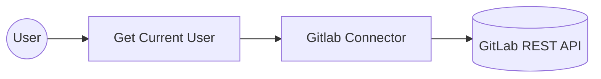

# Example

## What you'll build

This integration connects to GitLab and retrieves the profile of the user who owns the access token. An automation entry point runs the operation once and logs the returned user details.

**Operations used:**
- **Get Current User** : Retrieves the details of the authenticated user

## Architecture

## Prerequisites

- A GitLab account on GitLab.com or on a self-managed GitLab instance.
- A personal access token with the `read_api` or `api` scope.

## Setting up the Gitlab integration

> **New to WSO2 Integrator?** Follow the [Create a New Integration](product://integrator/develop-and-test/create-workspace) guide to set up your integration first, then return here to add the connector.

## Adding the Gitlab connector

### Step 1: Open the connector palette

Hover over **Connections** in the project tree and select **Add Connection** (**+**).

<ThemedImage
    alt="Gitlab connector palette open before selection"
    sources={{
        light: useBaseUrl('/img/connectors/catalog/developer-tools/gitlab/ballerinax_gitlab_screenshot_01_palette.png'),
        dark: useBaseUrl('/img/connectors/catalog/developer-tools/gitlab/ballerinax_gitlab_screenshot_01_palette.png'),
    }}
/>

### Step 2: Select the Gitlab connector

1. Enter `gitlab` in the search field.
2. Select the **GitLab** connector card.

## Configuring the Gitlab connection

### Step 3: Bind the connection parameters to configurable variables

Bind each connection field to a configurable variable. Use the **Configurables** tab of the field's helper panel to create each configurable.

- **Config** : Connection settings, with the personal access token sent in the `PRIVATE-TOKEN` header. Switch the field to **Expression** and enter `{auth: {privateToken: gitlabToken}}`.
- **Service Url** : Set it to the `gitlabServiceUrl` configurable.

<ThemedImage
    alt="Gitlab connection form with all parameters bound before saving"
    sources={{
        light: useBaseUrl('/img/connectors/catalog/developer-tools/gitlab/ballerinax_gitlab_screenshot_02_connection_form.png'),
        dark: useBaseUrl('/img/connectors/catalog/developer-tools/gitlab/ballerinax_gitlab_screenshot_02_connection_form.png'),
    }}
/>

### Step 4: Save the connection

Select **Save Connection** and verify that **gitlabClient** appears under **Connections** in the project tree and on the design canvas.

<ThemedImage
    alt="Gitlab connection visible after saving"
    sources={{
        light: useBaseUrl('/img/connectors/catalog/developer-tools/gitlab/ballerinax_gitlab_screenshot_03_connections_list.png'),
        dark: useBaseUrl('/img/connectors/catalog/developer-tools/gitlab/ballerinax_gitlab_screenshot_03_connections_list.png'),
    }}
/>

### Step 5: Set actual values for your configurables

1. Select **Configurations** at the bottom of the project tree.
2. Enter a value for each configurable listed below before you run the integration.

- **gitlabServiceUrl** (`string`) : GitLab REST API base URL. Defaults to `https://gitlab.com/api/v4`; use `https://<your-gitlab-host>/api/v4` for a self-managed instance.
- **gitlabToken** (`string`) : GitLab personal, project or group access token.

## Configuring the Gitlab Get Current User operation

### Step 6: Add an automation entry point

1. Select **Add Artifact** on the design canvas.
2. Select **Automation**.
3. Select **Create** to accept the settings.

### Step 7: Expand the connection and configure the Get Current User operation

1. Select the **+** between **Start** and **Error Handler** in the automation flow.
2. Expand **gitlabClient** under **Connections** to display its operations.

<ThemedImage
    alt="Gitlab connection expanded to display operations before selection"
    sources={{
        light: useBaseUrl('/img/connectors/catalog/developer-tools/gitlab/ballerinax_gitlab_screenshot_04_operations_panel.png'),
        dark: useBaseUrl('/img/connectors/catalog/developer-tools/gitlab/ballerinax_gitlab_screenshot_04_operations_panel.png'),
    }}
/>

3. Select **Get Current User**. The operation has no required parameters.

- **Result** : Set it to `currentUser`, the variable that stores the returned user details.

<ThemedImage
    alt="Gitlab Get Current User operation with all values entered before saving"
    sources={{
        light: useBaseUrl('/img/connectors/catalog/developer-tools/gitlab/ballerinax_gitlab_screenshot_05_operation_form.png'),
        dark: useBaseUrl('/img/connectors/catalog/developer-tools/gitlab/ballerinax_gitlab_screenshot_05_operation_form.png'),
    }}
/>

4. Select **Save**.

### Step 8: Log the Get Current User result

1. Select the **+** below the **Get Current User** node.
2. Under **Logging**, select **Log Info**.
3. Switch **Msg** to **Expression**, enter `currentUser.toString()`, and select **Save**.

<ThemedImage
    alt="Completed Gitlab flow with the configured operation"
    sources={{
        light: useBaseUrl('/img/connectors/catalog/developer-tools/gitlab/ballerinax_gitlab_screenshot_06_completed_flow.png'),
        dark: useBaseUrl('/img/connectors/catalog/developer-tools/gitlab/ballerinax_gitlab_screenshot_06_completed_flow.png'),
    }}
/>

## Try it yourself

Try this sample in WSO2 Integration Platform.

[View source on GitHub](https://github.com/wso2/integration-samples/tree/main/integrator-default-profile/connectors/gitlab_connector_sample)

## More code examples

The GitLab connector provides practical examples illustrating usage in various scenarios. Explore these [examples](https://github.com/ballerina-platform/module-ballerinax-gitlab/tree/main/examples/), covering the following use cases:

1. [Unassigned issue triage](https://github.com/ballerina-platform/module-ballerinax-gitlab/tree/main/examples/unassigned_issue_triage) - Find every open issue with no assignee and mark it for triage with a label, creating the label if the project does not have it.
2. [Release notes from merged merge requests](https://github.com/ballerina-platform/module-ballerinax-gitlab/tree/main/examples/merged_release_notes) - Collect the merge requests merged into the default branch since the last release, draft notes crediting authors and reviewers, and publish the release.
