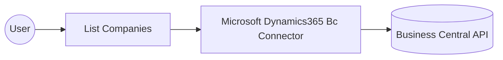

# Example

## What you'll build

This integration connects to Microsoft Dynamics 365 Business Central and lists the companies in a Business Central environment. An automation entry point runs the operation once and logs the returned companies.

**Operations used:**
- **List Companies** : Returns a list of companies

## Architecture

## Prerequisites

- A Business Central environment and a work or school user account with access to it.
- An application registered in Microsoft Entra ID with the delegated `Financials.ReadWrite.All` permission for Dynamics 365 Business Central, and its client ID and client secret.
- An OAuth 2.0 refresh token issued for that application, and the ID of the Microsoft Entra tenant.

## Setting up the Microsoft Dynamics365 Bc integration

> **New to WSO2 Integrator?** Follow the [Create a New Integration](product://integrator/develop-and-test/create-workspace) guide to set up your integration first, then return here to add the connector.

## Adding the Microsoft Dynamics365 Bc connector

### Step 1: Open the connector palette

Hover over **Connections** in the project tree and select **Add Connection** (**+**).

<ThemedImage
    alt="Microsoft Dynamics365 Bc connector palette open before selection"
    sources={{
        light: useBaseUrl('/img/connectors/catalog/erp-business/microsoft.dynamics365.bc/ballerinax_microsoft_dynamics365_bc_screenshot_01_palette.png'),
        dark: useBaseUrl('/img/connectors/catalog/erp-business/microsoft.dynamics365.bc/ballerinax_microsoft_dynamics365_bc_screenshot_01_palette.png'),
    }}
/>

### Step 2: Select the Microsoft Dynamics365 Bc connector

1. Enter `dynamics365.bc` in the search field.
2. Select the **Bc** connector card (`ballerinax / microsoft.dynamics365.bc`).

## Configuring the Microsoft Dynamics365 Bc connection

### Step 3: Bind the connection parameters to configurable variables

Bind each connection field to a configurable variable. Use the **Configurables** tab of the field's helper panel to create each configurable.

- **Config** : Connection settings, with the OAuth 2.0 refresh token configuration for Microsoft Entra ID set in the `auth` record. Switch the field to **Expression** and enter `{auth: {clientId: bcClientId, clientSecret: bcClientSecret, refreshToken: bcRefreshToken, refreshUrl: bcRefreshUrl, scopes: ["https://api.businesscentral.dynamics.com/Financials.ReadWrite.All", "offline_access"]}}`.
- **Service Url** : Set it to the `bcServiceUrl` configurable.

<ThemedImage
    alt="Microsoft Dynamics365 Bc connection form with all parameters bound before saving"
    sources={{
        light: useBaseUrl('/img/connectors/catalog/erp-business/microsoft.dynamics365.bc/ballerinax_microsoft_dynamics365_bc_screenshot_02_connection_form.png'),
        dark: useBaseUrl('/img/connectors/catalog/erp-business/microsoft.dynamics365.bc/ballerinax_microsoft_dynamics365_bc_screenshot_02_connection_form.png'),
    }}
/>

### Step 4: Save the connection

Select **Save Connection** and verify that **bcClient** appears under **Connections** in the project tree and on the design canvas.

<ThemedImage
    alt="Microsoft Dynamics365 Bc connection visible after saving"
    sources={{
        light: useBaseUrl('/img/connectors/catalog/erp-business/microsoft.dynamics365.bc/ballerinax_microsoft_dynamics365_bc_screenshot_03_connections_list.png'),
        dark: useBaseUrl('/img/connectors/catalog/erp-business/microsoft.dynamics365.bc/ballerinax_microsoft_dynamics365_bc_screenshot_03_connections_list.png'),
    }}
/>

### Step 5: Set actual values for your configurables

1. Select **Configurations** at the bottom of the project tree.
2. Enter a value for each configurable listed below before you run the integration.

- **bcServiceUrl** (`string`) : Business Central API base URL for the environment. Defaults to `https://api.businesscentral.dynamics.com/v2.0/production/api/v1.0`; replace `production` with a sandbox name to target a sandbox.
- **bcClientId** (`string`) : Application (client) ID of the Microsoft Entra application.
- **bcClientSecret** (`string`) : Client secret of the Microsoft Entra application.
- **bcRefreshToken** (`string`) : OAuth 2.0 refresh token issued for the application.
- **bcRefreshUrl** (`string`) : Token endpoint of your tenant, `https://login.microsoftonline.com/<tenant-id>/oauth2/v2.0/token`.

## Configuring the Microsoft Dynamics365 Bc List Companies operation

### Step 6: Add an automation entry point

1. Select **Add Artifact** on the design canvas.
2. Select **Automation**.
3. Select **Create** to accept the settings.

### Step 7: Expand the connection and configure the List Companies operation

1. Select the **+** between **Start** and **Error Handler** in the automation flow.
2. Expand **bcClient** under **Connections** to display its operations.

<ThemedImage
    alt="Microsoft Dynamics365 Bc connection expanded to display operations before selection"
    sources={{
        light: useBaseUrl('/img/connectors/catalog/erp-business/microsoft.dynamics365.bc/ballerinax_microsoft_dynamics365_bc_screenshot_04_operations_panel.png'),
        dark: useBaseUrl('/img/connectors/catalog/erp-business/microsoft.dynamics365.bc/ballerinax_microsoft_dynamics365_bc_screenshot_04_operations_panel.png'),
    }}
/>

3. Select **List Companies**. The operation has no required parameters.

- **Result** : Set it to `companies`, the variable that stores the returned companies.

<ThemedImage
    alt="Microsoft Dynamics365 Bc List Companies operation with all values entered before saving"
    sources={{
        light: useBaseUrl('/img/connectors/catalog/erp-business/microsoft.dynamics365.bc/ballerinax_microsoft_dynamics365_bc_screenshot_05_operation_form.png'),
        dark: useBaseUrl('/img/connectors/catalog/erp-business/microsoft.dynamics365.bc/ballerinax_microsoft_dynamics365_bc_screenshot_05_operation_form.png'),
    }}
/>

4. Select **Save**.

### Step 8: Log the List Companies result

1. Select the **+** below the **List Companies** node.
2. Under **Logging**, select **Log Info**.
3. Switch **Msg** to **Expression**, enter `companies.toString()`, and select **Save**.

<ThemedImage
    alt="Completed Microsoft Dynamics365 Bc flow with the configured operation"
    sources={{
        light: useBaseUrl('/img/connectors/catalog/erp-business/microsoft.dynamics365.bc/ballerinax_microsoft_dynamics365_bc_screenshot_06_completed_flow.png'),
        dark: useBaseUrl('/img/connectors/catalog/erp-business/microsoft.dynamics365.bc/ballerinax_microsoft_dynamics365_bc_screenshot_06_completed_flow.png'),
    }}
/>

## Try it yourself

Try this sample in WSO2 Integration Platform.

[View source on GitHub](https://github.com/wso2/integration-samples/tree/main/integrator-default-profile/connectors/microsoft.dynamics365.bc_connector_sample)

## More code examples

The Microsoft Dynamics365 Bc connector provides practical examples illustrating usage in various scenarios. Explore these [examples](https://github.com/ballerina-platform/module-ballerinax-microsoft.dynamics365.bc/tree/main/examples/), covering the following use cases:

1. [Customer invoice workflow](https://github.com/ballerina-platform/module-ballerinax-microsoft.dynamics365.bc/tree/main/examples/customer_invoice_workflow) - Onboard a customer, raise a sales invoice with a line, and post it to the general ledger.
2. [Item catalog management](https://github.com/ballerina-platform/module-ballerinax-microsoft.dynamics365.bc/tree/main/examples/item_catalog_management) - Review the item catalog, register a new stocked item, and correct its price with an `If-Match` guarded update.
3. [Sales order processing](https://github.com/ballerina-platform/module-ballerinax-microsoft.dynamics365.bc/tree/main/examples/sales_order_processing) - Open a sales order for an existing customer and read back the lines that belong to it.
4. [Financial ledger review](https://github.com/ballerina-platform/module-ballerinax-microsoft.dynamics365.bc/tree/main/examples/financial_ledger_review) - Take a month-end snapshot of the chart of accounts, the bank accounts, and the posted ledger entries.
