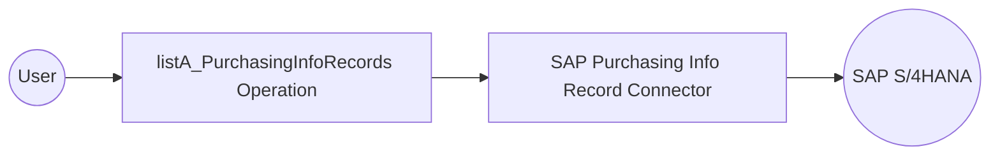

# Example

## What you'll build

Build an integration workflow that connects to an SAP S/4HANA system and retrieves purchasing info records. The workflow calls the Purchasing Info Record (A2X) API and logs the result as JSON.

**Operations used:**
- **listA_PurchasingInfoRecords** : Reads purchasing info records (supplier and material) from the SAP S/4HANA system, returning the first 10 results

## Architecture

## Prerequisites

- Access to an SAP S/4HANA Cloud system with a communication user assigned to the communication arrangement this connector needs (see the [Setup Guide](setup-guide.md))

## Setting up the SAP Purchasing Info Record integration

> **New to WSO2 Integrator?** Follow the [Create a New Integration](product://integrator/develop-and-test/create-workspace) guide to set up your integration first, then return here to add the connector.

## Adding the SAP Purchasing Info Record connector

### Step 1: Open the connector palette and search for the connector

Select **Add Artifact**, then select **Connection** to open the connector palette. Search for `api_inforecord_process_srv` and select the **Api_inforecord_process_srv** connector card.

<ThemedImage
    alt="Add Connection palette open with the search field before any selection"
    sources={{
        light: useBaseUrl('/img/connectors/catalog/erp-business/sap.s4hana.api_inforecord_process_srv/sap_s4hana_apiinforecordprocesssrv_screenshot_01_palette.png'),
        dark: useBaseUrl('/img/connectors/catalog/erp-business/sap.s4hana.api_inforecord_process_srv/sap_s4hana_apiinforecordprocesssrv_screenshot_01_palette.png'),
    }}
/>

## Configuring the SAP Purchasing Info Record connection

### Step 2: Fill in the connection parameters

Enter the connection parameters, binding each field to a configurable variable:

- **Config** : `ConnectionConfig` record with Basic Authentication credentials; switch to **Expression** and enter `{auth: {username: sapS4HanaUsername, password: sapS4HanaPassword}}`
- **Hostname** : SAP S/4HANA API hostname; bind to the `sapS4HanaHostname` configurable variable
- **Connection Name** : Keep the default `apiInforecordProcessSrvClient`

<ThemedImage
    alt="SAP Purchasing Info Record connection form filled with configurable variables before saving"
    sources={{
        light: useBaseUrl('/img/connectors/catalog/erp-business/sap.s4hana.api_inforecord_process_srv/sap_s4hana_apiinforecordprocesssrv_screenshot_02_connection_form.png'),
        dark: useBaseUrl('/img/connectors/catalog/erp-business/sap.s4hana.api_inforecord_process_srv/sap_s4hana_apiinforecordprocesssrv_screenshot_02_connection_form.png'),
    }}
/>

### Step 3: Save the connection

Select **Save Connection**. The connection appears under **Connections** in the project tree and on the design canvas.

<ThemedImage
    alt="Design canvas showing the saved apiInforecordProcessSrvClient connection"
    sources={{
        light: useBaseUrl('/img/connectors/catalog/erp-business/sap.s4hana.api_inforecord_process_srv/sap_s4hana_apiinforecordprocesssrv_screenshot_03_connection_saved.png'),
        dark: useBaseUrl('/img/connectors/catalog/erp-business/sap.s4hana.api_inforecord_process_srv/sap_s4hana_apiinforecordprocesssrv_screenshot_03_connection_saved.png'),
    }}
/>

### Step 4: Set actual values for your configurables

1. In the left panel, select **Configurations**.
2. Set a value for each configurable listed below:

- **sapS4HanaHostname** (string) : The API hostname of your SAP S/4HANA Cloud system, for example, `my123456-api.s4hana.cloud.sap`
- **sapS4HanaUsername** (string) : The communication user name
- **sapS4HanaPassword** (string) : The communication user password

## Configuring the SAP Purchasing Info Record listA_PurchasingInfoRecords operation

### Step 5: Add an automation entry point

Select **Add Artifact**, then select **Automation** and select **Create** to add the automation entry point to the canvas.

### Step 6: Select and configure the listA_PurchasingInfoRecords operation

1. On the automation canvas, select the **+** button to add a step.
2. Expand the **apiInforecordProcessSrvClient** connection under **Connections**.

<ThemedImage
    alt="apiInforecordProcessSrvClient connection expanded in the node panel showing the available operations"
    sources={{
        light: useBaseUrl('/img/connectors/catalog/erp-business/sap.s4hana.api_inforecord_process_srv/sap_s4hana_apiinforecordprocesssrv_screenshot_04_operations.png'),
        dark: useBaseUrl('/img/connectors/catalog/erp-business/sap.s4hana.api_inforecord_process_srv/sap_s4hana_apiinforecordprocesssrv_screenshot_04_operations.png'),
    }}
/>

3. Select **List A Purchasing Info Records** (`listA_PurchasingInfoRecords`) and configure it:

- **$top** : Under **Advanced Configurations**, set to `10` to limit the results to the first 10 records
- **Result** : Set the result variable name to `result`

<ThemedImage
    alt="listA_PurchasingInfoRecords operation form with $top set to 10"
    sources={{
        light: useBaseUrl('/img/connectors/catalog/erp-business/sap.s4hana.api_inforecord_process_srv/sap_s4hana_apiinforecordprocesssrv_screenshot_05_operation_form.png'),
        dark: useBaseUrl('/img/connectors/catalog/erp-business/sap.s4hana.api_inforecord_process_srv/sap_s4hana_apiinforecordprocesssrv_screenshot_05_operation_form.png'),
    }}
/>

4. Select **Save** to add the operation to the flow, then add a **Log Info** step after it that logs `result.toJsonString()` in **Expression** mode.

<ThemedImage
    alt="Completed automation flow with the listA_PurchasingInfoRecords operation and a log step"
    sources={{
        light: useBaseUrl('/img/connectors/catalog/erp-business/sap.s4hana.api_inforecord_process_srv/sap_s4hana_apiinforecordprocesssrv_screenshot_06_completed_flow.png'),
        dark: useBaseUrl('/img/connectors/catalog/erp-business/sap.s4hana.api_inforecord_process_srv/sap_s4hana_apiinforecordprocesssrv_screenshot_06_completed_flow.png'),
    }}
/>

## Try it yourself

Try this sample in WSO2 Integration Platform.

[View source on GitHub](https://github.com/wso2/integration-samples/tree/main/integrator-default-profile/connectors/sap.s4hana.api_inforecord_process_srv_connector_sample)
