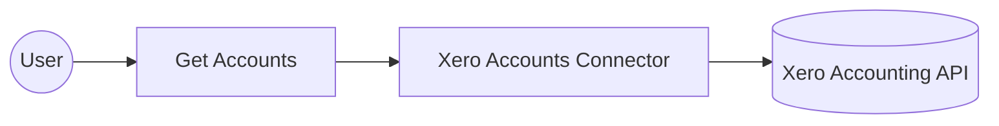

# Example

## What you'll build

This integration connects to the Xero Accounting API and retrieves the chart of accounts of a Xero organisation. An automation entry point runs the operation once and logs the returned accounts.

**Operations used:**
- **Get Accounts** : Retrieves the full chart of accounts

## Architecture

## Prerequisites

- A Xero account with an organisation (a demo company is enough).
- An app registered in the Xero developer portal, and its client ID and client secret.
- An OAuth 2.0 refresh token issued with the `offline_access` and `accounting.settings` scopes.
- The tenant ID of the Xero organisation to work with.

## Setting up the Xero Accounts integration

> **New to WSO2 Integrator?** Follow the [Create a New Integration](product://integrator/develop-and-test/create-workspace) guide to set up your integration first, then return here to add the connector.

## Adding the Xero Accounts connector

### Step 1: Open the connector palette

Hover over **Connections** in the project tree and select **Add Connection** (**+**).

<ThemedImage
    alt="Xero Accounts connector palette open before selection"
    sources={{
        light: useBaseUrl('/img/connectors/catalog/finance-accounting/xero.accounts/ballerinax_xero_accounts_screenshot_01_palette.png'),
        dark: useBaseUrl('/img/connectors/catalog/finance-accounting/xero.accounts/ballerinax_xero_accounts_screenshot_01_palette.png'),
    }}
/>

### Step 2: Select the Xero Accounts connector

1. Enter `xero.accounts` in the search field.
2. Select the **Xero Accounts** connector card.

## Configuring the Xero Accounts connection

### Step 3: Bind the connection parameters to configurable variables

Bind each connection field to a configurable variable. Use the **Configurables** tab of the field's helper panel to create each configurable.

- **Config** : Connection settings, with the OAuth 2.0 refresh token configuration for Xero set in the `auth` record. Switch the field to **Expression** and enter `{auth: {clientId: accountsClientId, clientSecret: accountsClientSecret, refreshToken: accountsRefreshToken, refreshUrl: accountsRefreshUrl}}`.
- **Service Url** : Set it to the `accountsServiceUrl` configurable.

<ThemedImage
    alt="Xero Accounts connection form with all parameters bound before saving"
    sources={{
        light: useBaseUrl('/img/connectors/catalog/finance-accounting/xero.accounts/ballerinax_xero_accounts_screenshot_02_connection_form.png'),
        dark: useBaseUrl('/img/connectors/catalog/finance-accounting/xero.accounts/ballerinax_xero_accounts_screenshot_02_connection_form.png'),
    }}
/>

### Step 4: Save the connection

Select **Save Connection** and verify that **accountsClient** appears under **Connections** in the project tree and on the design canvas.

<ThemedImage
    alt="Xero Accounts connection visible after saving"
    sources={{
        light: useBaseUrl('/img/connectors/catalog/finance-accounting/xero.accounts/ballerinax_xero_accounts_screenshot_03_connections_list.png'),
        dark: useBaseUrl('/img/connectors/catalog/finance-accounting/xero.accounts/ballerinax_xero_accounts_screenshot_03_connections_list.png'),
    }}
/>

### Step 5: Set actual values for your configurables

1. Select **Configurations** at the bottom of the project tree.
2. Enter a value for each configurable listed below before you run the integration.

- **accountsServiceUrl** (`string`) : Xero Accounting API base URL. Defaults to `https://api.xero.com/api.xro/2.0`.
- **accountsClientId** (`string`) : Client ID of the Xero app.
- **accountsClientSecret** (`string`) : Client secret of the Xero app.
- **accountsRefreshToken** (`string`) : OAuth 2.0 refresh token issued for the Xero app.
- **accountsRefreshUrl** (`string`) : Xero token endpoint. Defaults to `https://identity.xero.com/connect/token`.
- **accountsTenantId** (`string`) : Tenant ID of the Xero organisation.

## Configuring the Xero Accounts Get Accounts operation

### Step 6: Add an automation entry point

1. Select **Add Artifact** on the design canvas.
2. Select **Automation**.
3. Select **Create** to accept the settings.

### Step 7: Expand the connection and configure the Get Accounts operation

1. Select the **+** between **Start** and **Error Handler** in the automation flow.
2. Expand **accountsClient** under **Connections** to display its operations.

<ThemedImage
    alt="Xero Accounts connection expanded to display operations before selection"
    sources={{
        light: useBaseUrl('/img/connectors/catalog/finance-accounting/xero.accounts/ballerinax_xero_accounts_screenshot_04_operations_panel.png'),
        dark: useBaseUrl('/img/connectors/catalog/finance-accounting/xero.accounts/ballerinax_xero_accounts_screenshot_04_operations_panel.png'),
    }}
/>

3. Select **Get Accounts** and enter its required values.

- **Headers** : Switch the field to **Expression**, create the `accountsTenantId` configurable from the helper panel, and enter `{xeroTenantId: accountsTenantId}`.
- **Result** : Set it to `chartOfAccounts`, the variable that stores the returned accounts.

<ThemedImage
    alt="Xero Accounts Get Accounts operation with all values entered before saving"
    sources={{
        light: useBaseUrl('/img/connectors/catalog/finance-accounting/xero.accounts/ballerinax_xero_accounts_screenshot_05_operation_form.png'),
        dark: useBaseUrl('/img/connectors/catalog/finance-accounting/xero.accounts/ballerinax_xero_accounts_screenshot_05_operation_form.png'),
    }}
/>

4. Select **Save**.

### Step 8: Log the Get Accounts result

1. Select the **+** below the **Get Accounts** node.
2. Under **Logging**, select **Log Info**.
3. Switch **Msg** to **Expression**, enter `chartOfAccounts.toString()`, and select **Save**.

<ThemedImage
    alt="Completed Xero Accounts flow with the configured operation"
    sources={{
        light: useBaseUrl('/img/connectors/catalog/finance-accounting/xero.accounts/ballerinax_xero_accounts_screenshot_06_completed_flow.png'),
        dark: useBaseUrl('/img/connectors/catalog/finance-accounting/xero.accounts/ballerinax_xero_accounts_screenshot_06_completed_flow.png'),
    }}
/>

## Try it yourself

Try this sample in WSO2 Integration Platform.

[View source on GitHub](https://github.com/wso2/integration-samples/tree/main/integrator-default-profile/connectors/xero.accounts_connector_sample)

## More code examples

The Xero Accounts connector provides practical examples illustrating usage in various scenarios. Explore these [examples](https://github.com/ballerina-platform/module-ballerinax-xero.accounts/tree/main/examples/), covering the following use cases:

1. [Customer invoice billing](https://github.com/ballerina-platform/module-ballerinax-xero.accounts/tree/main/examples/customer_invoice_billing) - Creates a customer contact, raises an approved sales invoice, optionally emails it and checks the amount due.
2. [Invoice payment recording](https://github.com/ballerina-platform/module-ballerinax-xero.accounts/tree/main/examples/invoice_payment_recording) - Records a payment against a sales invoice, attaches a remittance note and prints the payment's audit history.
3. [Supplier batch payment run](https://github.com/ballerina-platform/module-ballerinax-xero.accounts/tree/main/examples/supplier_batch_payment_run) - Pays all of a supplier's outstanding bills in one bank transaction with a batch payment.
4. [Financial reports overview](https://github.com/ballerina-platform/module-ballerinax-xero.accounts/tree/main/examples/financial_reports_overview) - Prints the month's profit and loss, the balance sheet and the trial balance for an organisation.
