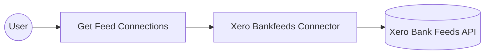

# Example

## What you'll build

This integration connects to the Xero Bank Feeds API and lists the feed connections of a Xero organisation. An automation entry point runs the operation once and logs the returned feed connections.

**Operations used:**
- **Get Feed Connections** : Searches for the feed connections of the organisation

## Architecture

## Prerequisites

- A Xero financial services partnership that grants access to the Bank Feeds API.
- An app registered in the Xero developer portal with the `bankfeeds` scope enabled, and its client ID and client secret.
- An OAuth 2.0 refresh token issued with the `offline_access` and `bankfeeds` scopes.
- The tenant ID of the Xero organisation to work with.

## Setting up the Xero Bankfeeds integration

> **New to WSO2 Integrator?** Follow the [Create a New Integration](product://integrator/develop-and-test/create-workspace) guide to set up your integration first, then return here to add the connector.

## Adding the Xero Bankfeeds connector

### Step 1: Open the connector palette

Hover over **Connections** in the project tree and select **Add Connection** (**+**).

<ThemedImage
    alt="Xero Bankfeeds connector palette open before selection"
    sources={{
        light: useBaseUrl('/img/connectors/catalog/finance-accounting/xero.bankfeeds/ballerinax_xero_bankfeeds_screenshot_01_palette.png'),
        dark: useBaseUrl('/img/connectors/catalog/finance-accounting/xero.bankfeeds/ballerinax_xero_bankfeeds_screenshot_01_palette.png'),
    }}
/>

### Step 2: Select the Xero Bankfeeds connector

1. Enter `xero.bankfeeds` in the search field.
2. Select the **Xero Bankfeeds** connector card.

## Configuring the Xero Bankfeeds connection

### Step 3: Bind the connection parameters to configurable variables

Bind each connection field to a configurable variable. Use the **Configurables** tab of the field's helper panel to create each configurable.

- **Config** : Connection settings, with the OAuth 2.0 refresh token configuration for Xero set in the `auth` record. Switch the field to **Expression** and enter `{auth: {clientId: bankfeedsClientId, clientSecret: bankfeedsClientSecret, refreshToken: bankfeedsRefreshToken, refreshUrl: bankfeedsRefreshUrl}}`.
- **Service Url** : Set it to the `bankfeedsServiceUrl` configurable.

<ThemedImage
    alt="Xero Bankfeeds connection form with all parameters bound before saving"
    sources={{
        light: useBaseUrl('/img/connectors/catalog/finance-accounting/xero.bankfeeds/ballerinax_xero_bankfeeds_screenshot_02_connection_form.png'),
        dark: useBaseUrl('/img/connectors/catalog/finance-accounting/xero.bankfeeds/ballerinax_xero_bankfeeds_screenshot_02_connection_form.png'),
    }}
/>

### Step 4: Save the connection

Select **Save Connection** and verify that **bankfeedsClient** appears under **Connections** in the project tree and on the design canvas.

<ThemedImage
    alt="Xero Bankfeeds connection visible after saving"
    sources={{
        light: useBaseUrl('/img/connectors/catalog/finance-accounting/xero.bankfeeds/ballerinax_xero_bankfeeds_screenshot_03_connections_list.png'),
        dark: useBaseUrl('/img/connectors/catalog/finance-accounting/xero.bankfeeds/ballerinax_xero_bankfeeds_screenshot_03_connections_list.png'),
    }}
/>

### Step 5: Set actual values for your configurables

1. Select **Configurations** at the bottom of the project tree.
2. Enter a value for each configurable listed below before you run the integration.

- **bankfeedsServiceUrl** (`string`) : Xero Bank Feeds API base URL. Defaults to `https://api.xero.com/bankfeeds.xro/1.0`.
- **bankfeedsClientId** (`string`) : Client ID of the Xero app.
- **bankfeedsClientSecret** (`string`) : Client secret of the Xero app.
- **bankfeedsRefreshToken** (`string`) : OAuth 2.0 refresh token issued for the Xero app.
- **bankfeedsRefreshUrl** (`string`) : Xero token endpoint. Defaults to `https://identity.xero.com/connect/token`.
- **bankfeedsTenantId** (`string`) : Tenant ID of the Xero organisation.

## Configuring the Xero Bankfeeds Get Feed Connections operation

### Step 6: Add an automation entry point

1. Select **Add Artifact** on the design canvas.
2. Select **Automation**.
3. Select **Create** to accept the settings.

### Step 7: Expand the connection and configure the Get Feed Connections operation

1. Select the **+** between **Start** and **Error Handler** in the automation flow.
2. Expand **bankfeedsClient** under **Connections** to display its operations.

<ThemedImage
    alt="Xero Bankfeeds connection expanded to display operations before selection"
    sources={{
        light: useBaseUrl('/img/connectors/catalog/finance-accounting/xero.bankfeeds/ballerinax_xero_bankfeeds_screenshot_04_operations_panel.png'),
        dark: useBaseUrl('/img/connectors/catalog/finance-accounting/xero.bankfeeds/ballerinax_xero_bankfeeds_screenshot_04_operations_panel.png'),
    }}
/>

3. Select **Get Feed Connections** and enter its required values.

- **Headers** : Switch the field to **Expression** and enter `{xeroTenantId: bankfeedsTenantId}`.
- **Result** : Set it to `feedConnections`, the variable that stores the returned feed connections.

<ThemedImage
    alt="Xero Bankfeeds Get Feed Connections operation with all values entered before saving"
    sources={{
        light: useBaseUrl('/img/connectors/catalog/finance-accounting/xero.bankfeeds/ballerinax_xero_bankfeeds_screenshot_05_operation_form.png'),
        dark: useBaseUrl('/img/connectors/catalog/finance-accounting/xero.bankfeeds/ballerinax_xero_bankfeeds_screenshot_05_operation_form.png'),
    }}
/>

4. Select **Save**.

### Step 8: Log the Get Feed Connections result

1. Select the **+** below the **Get Feed Connections** node.
2. Under **Logging**, select **Log Info**.
3. Switch **Msg** to **Expression**, enter `feedConnections.toString()`, and select **Save**.

<ThemedImage
    alt="Completed Xero Bankfeeds flow with the configured operation"
    sources={{
        light: useBaseUrl('/img/connectors/catalog/finance-accounting/xero.bankfeeds/ballerinax_xero_bankfeeds_screenshot_06_completed_flow.png'),
        dark: useBaseUrl('/img/connectors/catalog/finance-accounting/xero.bankfeeds/ballerinax_xero_bankfeeds_screenshot_06_completed_flow.png'),
    }}
/>

## Try it yourself

Try this sample in WSO2 Integration Platform.

[View source on GitHub](https://github.com/wso2/integration-samples/tree/main/integrator-default-profile/connectors/xero.bankfeeds_connector_sample)

## More code examples

The Xero Bank Feeds connector provides practical examples illustrating usage in various scenarios. Explore these [examples](https://github.com/ballerina-platform/module-ballerinax-xero.bankfeeds/tree/main/examples/), covering the following use cases:

1. [Bank feed connection lifecycle](https://github.com/ballerina-platform/module-ballerinax-xero.bankfeeds/tree/main/examples/bank_feed_connection_lifecycle) - Connects a bank account to a Xero organisation as a bank feed, confirms the connection, lists every feed connection and optionally disconnects the new feed.
2. [Deliver a daily bank statement](https://github.com/ballerina-platform/module-ballerinax-xero.bankfeeds/tree/main/examples/deliver_daily_bank_statement) - Turns one day's transactions into a bank statement, delivers it to a feed connection and checks its delivery status.
