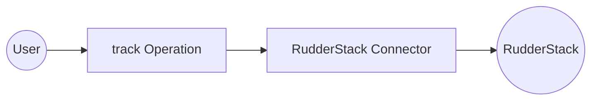

# Example

## What you'll build

Build an integration workflow that connects to RudderStack and records a customer action. The workflow sends a `track` event to the RudderStack Event Stream API and logs the response.

**Operations used:**
- **track** : Records an `Order Completed` event for a user in RudderStack, which routes it to the destinations connected to the source

## Architecture

## Prerequisites

- A RudderStack HTTP source with its write key, and the data plane URL of your workspace (see the [Setup Guide](setup-guide.md))

## Setting up the RudderStack integration

> **New to WSO2 Integrator?** Follow the [Create a New Integration](product://integrator/develop-and-test/create-workspace) guide to set up your integration first, then return here to add the connector.

## Adding the RudderStack connector

### Step 1: Open the connector palette and search for the connector

Select **Add Artifact**, then select **Connection** to open the connector palette. Search for `rudderstack` and select the **Rudderstack** connector card.

<ThemedImage
    alt="Add Connection palette open with the search field before any selection"
    sources={{
        light: useBaseUrl('/img/connectors/catalog/marketing-social/rudderstack/rudderstack_screenshot_01_palette.png'),
        dark: useBaseUrl('/img/connectors/catalog/marketing-social/rudderstack/rudderstack_screenshot_01_palette.png'),
    }}
/>

## Configuring the RudderStack connection

### Step 2: Fill in the connection parameters

Enter the connection parameters, binding each field to a configurable variable:

- **Config** : `ConnectionConfig` record with the source write key; switch to **Expression** and enter `{auth: {writeKey: rudderstackWriteKey}}`
- **Service Url** (under **Advanced Configurations**) : The data plane URL of your workspace; bind to the `rudderstackDataPlaneUrl` configurable variable
- **Connection Name** : Keep the default `rudderstackClient`

<ThemedImage
    alt="RudderStack connection form filled with configurable variables before saving"
    sources={{
        light: useBaseUrl('/img/connectors/catalog/marketing-social/rudderstack/rudderstack_screenshot_02_connection_form.png'),
        dark: useBaseUrl('/img/connectors/catalog/marketing-social/rudderstack/rudderstack_screenshot_02_connection_form.png'),
    }}
/>

### Step 3: Save the connection

Select **Save Connection**. The connection appears under **Connections** in the project tree and on the design canvas.

<ThemedImage
    alt="Design canvas showing the saved rudderstackClient connection"
    sources={{
        light: useBaseUrl('/img/connectors/catalog/marketing-social/rudderstack/rudderstack_screenshot_03_connection_saved.png'),
        dark: useBaseUrl('/img/connectors/catalog/marketing-social/rudderstack/rudderstack_screenshot_03_connection_saved.png'),
    }}
/>

### Step 4: Set actual values for your configurables

1. In the left panel, select **Configurations**.
2. Set a value for each configurable listed below:

- **rudderstackWriteKey** (string) : The write key of your RudderStack HTTP source
- **rudderstackDataPlaneUrl** (string) : The data plane URL of your workspace, for example, `https://<your-workspace>.dataplane.rudderstack.com`

## Configuring the RudderStack track operation

### Step 5: Add an automation entry point

Select **Add Artifact**, then select **Automation** and select **Create** to add the automation entry point to the canvas.

### Step 6: Select and configure the track operation

1. On the automation canvas, select the **+** button to add a step.
2. Expand the **rudderstackClient** connection under **Connections**.

<ThemedImage
    alt="rudderstackClient connection expanded in the node panel showing the available operations"
    sources={{
        light: useBaseUrl('/img/connectors/catalog/marketing-social/rudderstack/rudderstack_screenshot_04_operations.png'),
        dark: useBaseUrl('/img/connectors/catalog/marketing-social/rudderstack/rudderstack_screenshot_04_operations.png'),
    }}
/>

3. Select **Track** (`track`) and configure it:

- **Payload** : Switch to **Expression** and enter `{userId: "u-1001", event: "Order Completed", properties: {"orderId": "o-5001", "revenue": 89.99, "currency": "USD"}}`
- **Result** : Set the result variable name to `result`

<ThemedImage
    alt="track operation form with the event payload"
    sources={{
        light: useBaseUrl('/img/connectors/catalog/marketing-social/rudderstack/rudderstack_screenshot_05_operation_form.png'),
        dark: useBaseUrl('/img/connectors/catalog/marketing-social/rudderstack/rudderstack_screenshot_05_operation_form.png'),
    }}
/>

4. Select **Save** to add the operation to the flow, then add a **Log Info** step after it, switch **Msg** to **Expression** and enter `result`. RudderStack returns `ok` when it accepts the event.

<ThemedImage
    alt="Completed automation flow with the track operation and a log step"
    sources={{
        light: useBaseUrl('/img/connectors/catalog/marketing-social/rudderstack/rudderstack_screenshot_06_completed_flow.png'),
        dark: useBaseUrl('/img/connectors/catalog/marketing-social/rudderstack/rudderstack_screenshot_06_completed_flow.png'),
    }}
/>

## Try it yourself

Try this sample in WSO2 Integration Platform.

[View source on GitHub](https://github.com/wso2/integration-samples/tree/main/integrator-default-profile/connectors/rudderstack_connector_sample)

## More code examples

The RudderStack Ballerina connector provides practical examples illustrating usage in various scenarios. Explore these [examples](https://github.com/ballerina-platform/module-ballerinax-rudderstack/tree/main/examples), covering use cases like customer journey tracking, signup attribution and profile activation.

1. [Customer journey tracking](https://github.com/ballerina-platform/module-ballerinax-rudderstack/tree/main/examples/customer-journey-tracking) - Identify a customer, record the product page they view, then send their add-to-cart and order events together in one batch.

2. [B2B signup attribution](https://github.com/ballerina-platform/module-ballerinax-rudderstack/tree/main/examples/b2b-signup-attribution) - Record an anonymous visitor's landing page view with its campaign, link the visitor to the new user ID at signup, record the user's traits, and associate the user with their company.

3. [Profile refresh and activation](https://github.com/ballerina-platform/module-ballerinax-rudderstack/tree/main/examples/profile-refresh-activation) - Start a Profiles run, poll it until it finishes, then fetch the refreshed profiles of a few customers through the Activation API.
