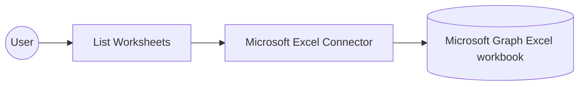

# Example

## What you'll build

This integration connects to Microsoft Excel through Microsoft Graph and lists the worksheets in a workbook stored in OneDrive for Business or SharePoint. An automation entry point runs the operation once and logs the returned worksheet list.

**Operations used:**
- **List Worksheets** : Lists the worksheets in a workbook, identified by its drive and drive item

## Architecture

## Prerequisites

- A Microsoft 365 business account, with an Excel workbook stored in OneDrive for Business or SharePoint.
- An application registered in Microsoft Entra ID with the delegated Microsoft Graph **Files.ReadWrite** (or **Files.Read**) and **offline_access** permissions, and its client ID and client secret.
- An OAuth 2.0 refresh token for that application.
- The drive ID and drive item ID of the workbook.

## Setting up the Microsoft Excel integration

> **New to WSO2 Integrator?** Follow the [Create a New Integration](../../../../develop/create-integrations/create-a-new-integration.md) guide to set up your integration first, then return here to add the connector.

## Adding the Microsoft Excel connector

### Step 1: Open the connector palette

Hover over **Connections** in the project tree and select **Add Connection** (**+**).

<ThemedImage
    alt="Microsoft Excel connector palette open before selection"
    sources={{
        light: useBaseUrl('/img/connectors/catalog/productivity-collaboration/microsoft.excel/ballerinax_microsoft_excel_screenshot_01_palette.png'),
        dark: useBaseUrl('/img/connectors/catalog/productivity-collaboration/microsoft.excel/ballerinax_microsoft_excel_screenshot_01_palette.png'),
    }}
/>

### Step 2: Select the Microsoft Excel connector

1. Enter `microsoft.excel` in the search field.
2. Select the **Microsoft Excel** connector card.

## Configuring the Microsoft Excel connection

### Step 3: Bind the connection parameters to configurable variables

Bind each connection field to a configurable variable. Use the **Configurables** tab of the field's helper panel to create each configurable.

- **Config** : Connection settings, with the OAuth 2.0 refresh token configuration for Microsoft Entra ID set in the `auth` record. Switch the field to **Expression** and enter `{auth: {clientId: excelClientId, clientSecret: excelClientSecret, refreshToken: excelRefreshToken, refreshUrl: excelRefreshUrl}}`.
- **Service Url** : Set it to the `excelServiceUrl` configurable.

<ThemedImage
    alt="Microsoft Excel connection form with all parameters bound before saving"
    sources={{
        light: useBaseUrl('/img/connectors/catalog/productivity-collaboration/microsoft.excel/ballerinax_microsoft_excel_screenshot_02_connection_form.png'),
        dark: useBaseUrl('/img/connectors/catalog/productivity-collaboration/microsoft.excel/ballerinax_microsoft_excel_screenshot_02_connection_form.png'),
    }}
/>

### Step 4: Save the connection

Select **Save Connection** and verify that **excelClient** appears under **Connections** in the project tree and on the design canvas.

<ThemedImage
    alt="Microsoft Excel connection visible after saving"
    sources={{
        light: useBaseUrl('/img/connectors/catalog/productivity-collaboration/microsoft.excel/ballerinax_microsoft_excel_screenshot_03_connections_list.png'),
        dark: useBaseUrl('/img/connectors/catalog/productivity-collaboration/microsoft.excel/ballerinax_microsoft_excel_screenshot_03_connections_list.png'),
    }}
/>

### Step 5: Set actual values for your configurables

1. Select **Configurations** at the bottom of the project tree.
2. Enter a value for each configurable listed below before you run the integration.

- **excelClientId** (`string`) : Application (client) ID of the registered application.
- **excelClientSecret** (`string`) : Client secret of the registered application.
- **excelRefreshToken** (`string`) : OAuth 2.0 refresh token issued for the Microsoft Graph scopes.
- **excelRefreshUrl** (`string`) : Token endpoint of your tenant, such as `https://login.microsoftonline.com/<tenant-id>/oauth2/v2.0/token`.
- **excelServiceUrl** (`string`) : Microsoft Graph base URL. Defaults to `https://graph.microsoft.com/v1.0`.
- **excelDriveId** (`string`) : ID of the drive that holds the workbook.
- **excelDriveItemId** (`string`) : ID of the workbook file in that drive.

## Configuring the Microsoft Excel List Worksheets operation

### Step 6: Add an automation entry point

1. Select **Add Artifact** on the design canvas.
2. Select **Automation**.
3. Select **Create** to accept the settings.

### Step 7: Expand the connection and configure the List Worksheets operation

1. Select the **+** between **Start** and **Error Handler** in the automation flow.
2. Expand **excelClient** under **Connections** to display its operations.

<ThemedImage
    alt="Microsoft Excel connection expanded to display operations before selection"
    sources={{
        light: useBaseUrl('/img/connectors/catalog/productivity-collaboration/microsoft.excel/ballerinax_microsoft_excel_screenshot_04_operations_panel.png'),
        dark: useBaseUrl('/img/connectors/catalog/productivity-collaboration/microsoft.excel/ballerinax_microsoft_excel_screenshot_04_operations_panel.png'),
    }}
/>

3. Select **List Worksheets** and enter its required values.

- **Drive Id** : Set it to the `excelDriveId` configurable.
- **Drive Item Id** : Set it to the `excelDriveItemId` configurable.
- **Result** : Set it to `worksheets`, the variable that stores the returned worksheet list.

<ThemedImage
    alt="Microsoft Excel List Worksheets operation with all values entered before saving"
    sources={{
        light: useBaseUrl('/img/connectors/catalog/productivity-collaboration/microsoft.excel/ballerinax_microsoft_excel_screenshot_05_operation_form.png'),
        dark: useBaseUrl('/img/connectors/catalog/productivity-collaboration/microsoft.excel/ballerinax_microsoft_excel_screenshot_05_operation_form.png'),
    }}
/>

4. Select **Save**.

### Step 8: Log the List Worksheets result

1. Select the **+** below the **List Worksheets** node.
2. Under **Logging**, select **Log Info**.
3. Switch **Msg** to **Expression**, enter `worksheets.toString()`, and select **Save**.

<ThemedImage
    alt="Completed Microsoft Excel flow with the configured operation"
    sources={{
        light: useBaseUrl('/img/connectors/catalog/productivity-collaboration/microsoft.excel/ballerinax_microsoft_excel_screenshot_06_completed_flow.png'),
        dark: useBaseUrl('/img/connectors/catalog/productivity-collaboration/microsoft.excel/ballerinax_microsoft_excel_screenshot_06_completed_flow.png'),
    }}
/>

## Try it yourself

Try this sample in WSO2 Integration Platform.

[View source on GitHub](https://github.com/wso2/integration-samples/tree/main/integrator-default-profile/connectors/microsoft.excel_connector_sample)

## More code examples

The `Microsoft Excel` connector provides practical examples illustrating usage in various scenarios. Explore these [examples](https://github.com/ballerina-platform/module-ballerinax-microsoft.excel/tree/master/examples/), covering the following use cases:

1. [Workbook session summary](https://github.com/ballerina-platform/module-ballerinax-microsoft.excel/tree/master/examples/workbook_session_summary) - List the worksheets in a workbook and report each one's used range, inside a single workbook session.
2. [Expense table ingestion](https://github.com/ballerina-platform/module-ballerinax-microsoft.excel/tree/master/examples/expense_table_ingestion) - Add a worksheet, define a table over its header range, and append expense rows to it.
3. [Revenue chart export](https://github.com/ballerina-platform/module-ballerinax-microsoft.excel/tree/master/examples/revenue_chart_export) - Create a chart from a range of revenue figures, position it, and export it as a base64-encoded image.
4. [Inventory table audit](https://github.com/ballerina-platform/module-ballerinax-microsoft.excel/tree/master/examples/inventory_table_audit) - List the tables on a worksheet with their columns and header/total row ranges.
