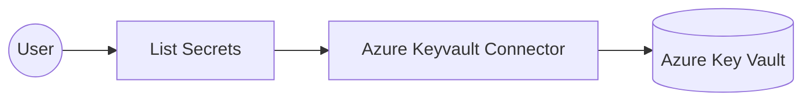

# Example

## What you'll build

This integration connects to Azure Key Vault and lists the secrets stored in a vault. An automation entry point runs the operation once and logs the returned secret list.

**Operations used:**
- **List Secrets** : Lists the secrets in the specified key vault

## Architecture

## Prerequisites

- An Azure subscription with a key vault, and the vault URI (for example, `https://<vault-name>.vault.azure.net`).
- An application registered in Microsoft Entra ID with the delegated **Azure Key Vault** `user_impersonation` permission, and its client ID and client secret.
- A signed-in user who has permission to list secrets in the vault, and an OAuth 2.0 refresh token issued for that user.

## Setting up the Azure Keyvault integration

> **New to WSO2 Integrator?** Follow the [Create a New Integration](product://integrator/develop-and-test/create-workspace) guide to set up your integration first, then return here to add the connector.

## Adding the Azure Keyvault connector

### Step 1: Open the connector palette

Hover over **Connections** in the project tree and select **Add Connection** (**+**).

<ThemedImage
    alt="Azure Keyvault connector palette open before selection"
    sources={{
        light: useBaseUrl('/img/connectors/catalog/security-identity/azure.keyvault/ballerinax_azure_keyvault_screenshot_01_palette.png'),
        dark: useBaseUrl('/img/connectors/catalog/security-identity/azure.keyvault/ballerinax_azure_keyvault_screenshot_01_palette.png'),
    }}
/>

### Step 2: Select the Azure Keyvault connector

1. Enter `azure.keyvault` in the search field.
2. Select the **Azure Key Vault** connector card.

## Configuring the Azure Keyvault connection

### Step 3: Bind the connection parameters to configurable variables

Bind each connection field to a configurable variable. Use the **Configurables** tab of the field's helper panel to create each configurable.

- **Config** : Connection settings, with the OAuth 2.0 refresh token configuration for Microsoft Entra ID set in the `auth` record. Switch the field to **Expression** and enter `{auth: {clientId: keyvaultClientId, clientSecret: keyvaultClientSecret, refreshToken: keyvaultRefreshToken, refreshUrl: keyvaultRefreshUrl, scopes: ["https://vault.azure.net/user_impersonation", "offline_access"]}}`.
- **Service Url** : Set it to the `keyvaultServiceUrl` configurable.

<ThemedImage
    alt="Azure Keyvault connection form with all parameters bound before saving"
    sources={{
        light: useBaseUrl('/img/connectors/catalog/security-identity/azure.keyvault/ballerinax_azure_keyvault_screenshot_02_connection_form.png'),
        dark: useBaseUrl('/img/connectors/catalog/security-identity/azure.keyvault/ballerinax_azure_keyvault_screenshot_02_connection_form.png'),
    }}
/>

### Step 4: Save the connection

Select **Save Connection** and verify that **keyvaultClient** appears under **Connections** in the project tree and on the design canvas.

<ThemedImage
    alt="Azure Keyvault connection visible after saving"
    sources={{
        light: useBaseUrl('/img/connectors/catalog/security-identity/azure.keyvault/ballerinax_azure_keyvault_screenshot_03_connections_list.png'),
        dark: useBaseUrl('/img/connectors/catalog/security-identity/azure.keyvault/ballerinax_azure_keyvault_screenshot_03_connections_list.png'),
    }}
/>

### Step 5: Set actual values for your configurables

1. Select **Configurations** at the bottom of the project tree.
2. Enter a value for each configurable listed below before you run the integration.

- **keyvaultServiceUrl** (`string`) : URI of your key vault, such as `https://<vault-name>.vault.azure.net`.
- **keyvaultClientId** (`string`) : Application (client) ID of the registered application.
- **keyvaultClientSecret** (`string`) : Client secret of the registered application.
- **keyvaultRefreshToken** (`string`) : OAuth 2.0 refresh token issued for the Azure Key Vault scope.
- **keyvaultRefreshUrl** (`string`) : Token endpoint of your tenant, such as `https://login.microsoftonline.com/<tenant-id>/oauth2/v2.0/token`.

## Configuring the Azure Keyvault List Secrets operation

### Step 6: Add an automation entry point

1. Select **Add Artifact** on the design canvas.
2. Select **Automation**.
3. Select **Create** to accept the settings.

### Step 7: Expand the connection and configure the List Secrets operation

1. Select the **+** between **Start** and **Error Handler** in the automation flow.
2. Expand **keyvaultClient** under **Connections** to display its operations.

<ThemedImage
    alt="Azure Keyvault connection expanded to display operations before selection"
    sources={{
        light: useBaseUrl('/img/connectors/catalog/security-identity/azure.keyvault/ballerinax_azure_keyvault_screenshot_04_operations_panel.png'),
        dark: useBaseUrl('/img/connectors/catalog/security-identity/azure.keyvault/ballerinax_azure_keyvault_screenshot_04_operations_panel.png'),
    }}
/>

3. Select **List Secrets** and enter its required values.

- **Api Version** : Set it to `7.0`, the Key Vault REST API version.
- **Result** : Set it to `secrets`, the variable that stores the returned secret list.

<ThemedImage
    alt="Azure Keyvault List Secrets operation with all values entered before saving"
    sources={{
        light: useBaseUrl('/img/connectors/catalog/security-identity/azure.keyvault/ballerinax_azure_keyvault_screenshot_05_operation_form.png'),
        dark: useBaseUrl('/img/connectors/catalog/security-identity/azure.keyvault/ballerinax_azure_keyvault_screenshot_05_operation_form.png'),
    }}
/>

4. Select **Save**.

### Step 8: Log the List Secrets result

1. Select the **+** below the **List Secrets** node.
2. Under **Logging**, select **Log Info**.
3. Switch **Msg** to **Expression**, enter `secrets.toString()`, and select **Save**.

<ThemedImage
    alt="Completed Azure Keyvault flow with the configured operation"
    sources={{
        light: useBaseUrl('/img/connectors/catalog/security-identity/azure.keyvault/ballerinax_azure_keyvault_screenshot_06_completed_flow.png'),
        dark: useBaseUrl('/img/connectors/catalog/security-identity/azure.keyvault/ballerinax_azure_keyvault_screenshot_06_completed_flow.png'),
    }}
/>

## Try it yourself

Try this sample in WSO2 Integration Platform.

[View source on GitHub](https://github.com/wso2/integration-samples/tree/main/integrator-default-profile/connectors/azure.keyvault_connector_sample)

## More code examples

The Azure Keyvault connector provides practical examples illustrating usage in various scenarios. Explore these [examples](https://github.com/ballerina-platform/module-ballerinax-azure.keyvault/tree/main/examples/), covering the following use cases:

1. [Secret rotation workflow](https://github.com/ballerina-platform/module-ballerinax-azure.keyvault/tree/main/examples/secret_rotation_workflow) - Store a new secret version and disable the older ones.
2. [Sensitive payload encryption](https://github.com/ballerina-platform/module-ballerinax-azure.keyvault/tree/main/examples/sensitive_payload_encryption) - Create an RSA key and encrypt and decrypt a payload with it.
3. [Document signing and verification](https://github.com/ballerina-platform/module-ballerinax-azure.keyvault/tree/main/examples/document_signing_verification) - Sign a document digest with a vault key and verify the signature.
4. [Self-signed certificate provisioning](https://github.com/ballerina-platform/module-ballerinax-azure.keyvault/tree/main/examples/self_signed_certificate_provisioning) - Issue a self-signed certificate and inspect its policy and versions.
