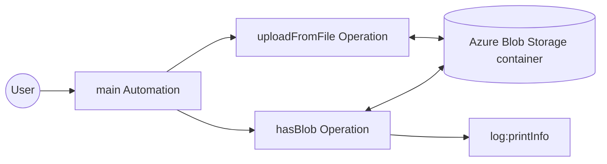
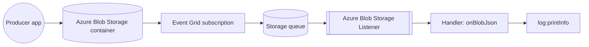

# Example

## Azure Blob Storage example

### What you'll build

Build a WSO2 Integrator automation that connects to an Azure Blob Storage container, uploads a local report with the `uploadFromFile` operation, and confirms the upload with the `hasBlob` operation. The workflow uses configurable variables to manage the Azure credentials securely.

**Operations used:**
- **uploadFromFile** : Uploads a local file to a path in the container.
- **hasBlob** : Checks whether a blob exists at a container path.

### Architecture

### Prerequisites

- An Azure storage account with a container (see the [Setup Guide](setup-guide.md))
- The storage account name and an access key

### Setting up the integration

> **New to WSO2 Integrator?** Follow the [Create a New Integration](product://integrator/develop-and-test/create-workspace) guide to set up your integration first, then return here to add the connector.

#### Step 1: Add an Automation entry point

A new integration starts with no artifacts, so the sidebar stays empty and connections cannot be added yet. Create the entry point first:

1. Select **+ Add Artifact** on the canvas toolbar.
2. Under **Automation**, select the **Automation** tile.
3. Select **Create Integration**. No additional configuration is needed.

An **Automation** entry point appears in the sidebar under **Entry Points**, and the design view shows the automation node. Selecting the node opens the automation flow editor with a **Start** node.

### Creating the configurable variables

The connection form references configurable variables for the container name and credentials, so create the variables first.

#### Step 2: Create configurable variables

1. In the sidebar, select **Configurations** to open the **Configurable Variables** view.
2. Select **+ Add Config**, enter the **Variable Name**, keep the **Variable Type** as `string`, leave **Default Value** empty, and select **Save**. Repeat for each variable listed below.

- **accountName** (string) : The Azure storage account name
- **accountKey** (string) : An access key of the storage account
- **containerName** (string) : The name of the container to bind the client to

<ThemedImage
    alt="Add Configurable Variable panel with the accountName variable"
    sources={{
        light: useBaseUrl('/img/connectors/catalog/storage-file/azure.storage.blob/azure_blob_screenshot_01_configurables_panel.png'),
        dark: useBaseUrl('/img/connectors/catalog/storage-file/azure.storage.blob/azure_blob_screenshot_01_configurables_panel.png'),
    }}
/>

### Adding the Azure Blob Storage connector

Select **Add Connection** in the WSO2 Integrator sidebar to open the connector palette.

#### Step 3: Open the connector palette and select the container client

1. In the WSO2 Integrator sidebar, expand **Connections** and select the **+** button next to it.
2. In the connector palette search box, enter `azure.storage.blob`.
3. The palette lists three cards under `ballerinax / azure.storage.blob`: **Blob** (the container-scoped client this example uses), **Blob Admin** (the account-level `AdminClient`), and **Blob Caller** (passed to trigger handlers, not used as a connection). Select the **Blob** card.

<ThemedImage
    alt="Connector palette with the azure.storage.blob search results"
    sources={{
        light: useBaseUrl('/img/connectors/catalog/storage-file/azure.storage.blob/azure_blob_screenshot_02_palette.png'),
        dark: useBaseUrl('/img/connectors/catalog/storage-file/azure.storage.blob/azure_blob_screenshot_02_palette.png'),
    }}
/>

### Configuring the Azure Blob Storage connection

#### Step 4: Bind connection parameters to the configurable variables

Selecting the **Blob** card opens the connection form (the same form reopens as **Edit Connection** when you select the connection later). Switch **Container Name** to **Expression** and enter `containerName`, switch **Auth** to **Expression** and enter `{accountName, accountKey}`, leave **Transport Config** at its default, and set **Connection Name** to `blobClient`.

<ThemedImage
    alt="Azure Blob Storage connection form with all parameters set"
    sources={{
        light: useBaseUrl('/img/connectors/catalog/storage-file/azure.storage.blob/azure_blob_screenshot_03_connection_form.png'),
        dark: useBaseUrl('/img/connectors/catalog/storage-file/azure.storage.blob/azure_blob_screenshot_03_connection_form.png'),
    }}
/>

#### Step 5: Save the connection

Select **Save Connection** to persist the connection. The form closes and `blobClient` appears in the sidebar under **Connections**.

#### Step 6: Set actual values for your configurables

1. In the left panel, select **Configurations**.
2. Set a value for each configurable listed below.

- **accountName** (string) : Your storage account name, from the [Setup Guide](setup-guide.md)
- **accountKey** (string) : An access key of the storage account
- **containerName** (string) : The container to work with (for example, `reports`)

### Configuring the uploadFromFile operation

#### Step 7: Select the uploadFromFile operation and configure its parameters

1. In the sidebar under **Entry Points**, select **Automation** to open its flow editor (selecting the automation node in the design view works too).
2. Select the **+** button on the canvas between **Start** and **Error Handler**.
3. In the right-side node panel, expand **Connections → blobClient**.

<ThemedImage
    alt="Azure Blob Storage operations panel"
    sources={{
        light: useBaseUrl('/img/connectors/catalog/storage-file/azure.storage.blob/azure_blob_screenshot_04_operations_panel.png'),
        dark: useBaseUrl('/img/connectors/catalog/storage-file/azure.storage.blob/azure_blob_screenshot_04_operations_panel.png'),
    }}
/>

4. Select **Upload From File** and fill in the operation form:

- **Source Path** : The local file to upload (for example, `./data/q1-report.pdf`)
- **Destination Path** : The container-relative path to upload to, including the blob name (for example, `2026/q1-report.pdf`). Slashes in the path form virtual folders.
- **Options** : Leave empty. It takes content headers, metadata, tags, an access tier, or a lease id when needed.

5. Select **Save**.

<ThemedImage
    alt="uploadFromFile operation configuration"
    sources={{
        light: useBaseUrl('/img/connectors/catalog/storage-file/azure.storage.blob/azure_blob_screenshot_05_uploadfromfile_form.png'),
        dark: useBaseUrl('/img/connectors/catalog/storage-file/azure.storage.blob/azure_blob_screenshot_05_uploadfromfile_form.png'),
    }}
/>

#### Step 8: Confirm the upload and log the result

1. Select the **+** below the **Upload From File** node and add the **Has Blob** operation from **Connections → blobClient**. Set **Path** to the destination path from Step 7 (`2026/q1-report.pdf`) and name the result variable `uploaded` (its type is fixed to `boolean`).
2. Add a **Log Info** statement below it with the expression ``string `${uploaded}` `` (the message must be a string, so the boolean is interpolated).

`hasBlob` returns `true` once the blob is present in the container, so the log output confirms the upload.

<ThemedImage
    alt="Completed Azure Blob Storage automation flow"
    sources={{
        light: useBaseUrl('/img/connectors/catalog/storage-file/azure.storage.blob/azure_blob_screenshot_06_completed_flow.png'),
        dark: useBaseUrl('/img/connectors/catalog/storage-file/azure.storage.blob/azure_blob_screenshot_06_completed_flow.png'),
    }}
/>

---

## Azure Blob Storage trigger example

### What you'll build

This integration reacts to blobs arriving in a container. An Event Grid subscription delivers each blob's created event to a storage queue, and a listener service consumes that queue. When a `.json` blob arrives, the `onBlobJson` handler fires with the parsed content and logs it; the message is acknowledged when the handler returns, and a blob that fails to parse moves to the service's poison queue.

### Architecture

### Prerequisites

- An Azure storage account with a container named `invoices`, a storage queue named `invoice-events`, and an Event Grid subscription that delivers the container's blob created events to that queue (see the [Setup Guide](setup-guide.md#wire-the-event-queue-listener-only))
- The storage account name and an access key

### Setting up the integration

> **New to WSO2 Integrator?** Follow the [Create a New Integration](product://integrator/develop-and-test/create-workspace) guide to set up your integration first, then return here to add the trigger.

### Configuring the Azure Blob Storage listener

#### Step 1: Create configurable variables

In the left panel, select **Configurations**. In the Configurable Variables panel, select **+ Add Config** and create each configuration listed below. If you completed the client example in the same project, the first two variables already exist; reuse them.

- **accountName** (string) : The Azure storage account name
- **accountKey** (string) : An access key of the storage account

<ThemedImage
    alt="Add Configurable Variable panel with the accountName variable"
    sources={{
        light: useBaseUrl('/img/connectors/catalog/storage-file/azure.storage.blob/azure_blob_screenshot_01_configurables_panel.png'),
        dark: useBaseUrl('/img/connectors/catalog/storage-file/azure.storage.blob/azure_blob_screenshot_01_configurables_panel.png'),
    }}
/>

### Adding the Azure Blob Storage trigger

#### Step 2: Select the Azure Blob Storage integration type

1. Select the **+** button in the WSO2 Integrator side panel header to open the **New Integration** wizard (on an empty project, the **+ Add Integration or Library** button in the project view opens the same wizard), and continue to the **Type** step.
2. Scroll to the **File Integration** category, select the **Azure Blob Storage** card, and select **Next**.

<ThemedImage
    alt="New Integration wizard with the Azure Blob Storage card selected"
    sources={{
        light: useBaseUrl('/img/connectors/catalog/storage-file/azure.storage.blob/azure_blob_trigger_screenshots_01_new_integration_wizard.png'),
        dark: useBaseUrl('/img/connectors/catalog/storage-file/azure.storage.blob/azure_blob_trigger_screenshots_01_new_integration_wizard.png'),
    }}
/>

#### Step 3: Configure the service and the listener

The **Create Azure Blob Storage Integration** form opens. Its upper part, **Listener Configurations**, creates the listener the service attaches to; the lower part holds the service's own settings. Fill it referencing the configurables:

- **Listener Name** : `blobListener`
- **Select the authentication method** : **Shared Key**
- **Account Name** : Switch to **Expression** and enter `accountName`
- **Account Key** : Switch to **Expression** and enter `accountKey`
- **Queue Name** : `invoice-events`. This is the storage queue the Event Grid subscription delivers to; the service consumes it.

The listener box has its own **Advanced Configurations** (relaxed data binding and the queue service URL), and the form ends with the service's **Advanced Configurations**: the poison queue name and the consumption settings (batch size, polling interval, redelivery delay, delivery count). Leave both at their defaults. There is no container field. The Event Grid subscription decides which container's events reach the queue, and each event carries its container and path.

<ThemedImage
    alt="Azure Blob Storage service and listener configuration form"
    sources={{
        light: useBaseUrl('/img/connectors/catalog/storage-file/azure.storage.blob/azure_blob_trigger_screenshots_02_listener_config_form.png'),
        dark: useBaseUrl('/img/connectors/catalog/storage-file/azure.storage.blob/azure_blob_trigger_screenshots_02_listener_config_form.png'),
    }}
/>

#### Step 4: Create the trigger

Select **Create** to generate the listener and the service. An **Azure Blob Storage Integration** entry appears in the sidebar under **Entry Points**, and its page header names the listener and the queue it consumes.

### Setting configuration values

#### Step 5: Set actual values for your configurations

In the left panel, select **Configurations** again, and set a value for each configuration created above:

- **accountName** (string) : Your storage account name
- **accountKey** (string) : An access key of the storage account

### Handling blob events

#### Step 6: Add a blob handler

Return to the integration service view (select the service under **Entry Points**) and select **+ Add Handler**. The **Select Handler to Add** panel offers **On Create**, which fires for blobs created or replaced in a container the subscription covers; **On Delete**, which generates `onBlobDelete`; and **On Error**, which generates `onError`. Select **On Create**. Its **Format** setting then selects how the content is delivered: **JSON**, **XML**, **CSV**, **Text**, or **Raw Bytes**, generating the `onBlobJson`, `onBlobXml`, `onBlobCsv`, `onBlobText`, or `onBlob` callback respectively.

<ThemedImage
    alt="Handler picker with the On Create handler"
    sources={{
        light: useBaseUrl('/img/connectors/catalog/storage-file/azure.storage.blob/azure_blob_trigger_screenshots_03_add_handler_panel.png'),
        dark: useBaseUrl('/img/connectors/catalog/storage-file/azure.storage.blob/azure_blob_trigger_screenshots_03_add_handler_panel.png'),
    }}
/>

#### Step 7: Configure the JSON handler

In the **Configure On Create Handler** panel, set:

- **Format** : **JSON**, so the handler receives the parsed content as `json`. To receive a record instead, create the record type first (under **Types** in the sidebar) and pick it through **Define Content Schema**.
- **Routing** : leave **Blob Name Pattern** and **Content Type Pattern** unticked, so the handler takes every `.json` blob. Ticking one writes a `@blob:FunctionConfig` annotation with that regular expression; see the [Trigger Reference](trigger-reference.md#functionconfiguration).
- **Advanced Configurations** : tick **Blob Event (event)** to receive the event alongside the content. **Azure Blob Storage Connection (caller)** adds the `Caller` parameter; this example does not need it.

<ThemedImage
    alt="On Create handler configuration with the JSON format and the event parameter"
    sources={{
        light: useBaseUrl('/img/connectors/catalog/storage-file/azure.storage.blob/azure_blob_trigger_screenshots_04_handler_config.png'),
        dark: useBaseUrl('/img/connectors/catalog/storage-file/azure.storage.blob/azure_blob_trigger_screenshots_04_handler_config.png'),
    }}
/>

Select **Save** to register the `onBlobJson` handler on the service.

#### Step 8: Add a log statement to the handler

After the handler is saved, WSO2 Integrator opens the handler's flow canvas. The handler receives the parsed blob content as an input named `content` of type `json`, and the event as `event`.

1. Select the **+** inside the handler flow and choose **Log Info** from the **Logging** section in the side panel.
2. In the expression editor, select `content` from the **Inputs** list, then append `.toJsonString()`.

<ThemedImage
    alt="onBlobJson handler flow with the log statement"
    sources={{
        light: useBaseUrl('/img/connectors/catalog/storage-file/azure.storage.blob/azure_blob_trigger_screenshots_05_handler_flow.png'),
        dark: useBaseUrl('/img/connectors/catalog/storage-file/azure.storage.blob/azure_blob_trigger_screenshots_05_handler_flow.png'),
    }}
/>

#### Step 9: Verify the design view

Navigate back to the integration's design view (select the integration name at the top of the sidebar). The diagram shows `blobListener` feeding the `blob:Service` with its registered `onBlobJson` handler.

<ThemedImage
    alt="Design view with the listener and the service's onBlobJson handler"
    sources={{
        light: useBaseUrl('/img/connectors/catalog/storage-file/azure.storage.blob/azure_blob_trigger_screenshots_06_service_view_final.png'),
        dark: useBaseUrl('/img/connectors/catalog/storage-file/azure.storage.blob/azure_blob_trigger_screenshots_06_service_view_final.png'),
    }}
/>

### Running the integration

Select **Run Integration** in the WSO2 Integrator toolbar to start the integration. To fire a test event, upload a `.json` blob into the container the subscription covers:

1. In the [Azure portal](https://portal.azure.com/), open your storage account and navigate to **Data storage** > **Containers**.
2. Open the `invoices` container and select **Upload** to add a small `.json` file.

Within a few seconds, Event Grid delivers the created event to the queue, the `onBlobJson` handler fires and logs the parsed content to the console, and the message is acknowledged. A malformed `.json` blob is logged as an error and its message moves to the `invoice-events-poison` queue, which the listener creates on first use; open **Data storage** > **Queues** in the portal to inspect it. A blob of any other type is acknowledged with a warning that names the subscription filter that would keep it out, because this service declares no handler for it.

## More code examples

The Azure Blob Storage connector provides practical examples illustrating usage in various scenarios. Explore these [examples](https://github.com/ballerina-platform/module-ballerinax-azure.storage.blob/tree/main/examples), covering archiving, SAS handouts, event-driven processing, and tag queries.

1. [Folder archive](https://github.com/ballerina-platform/module-ballerinax-azure.storage.blob/tree/main/examples/folder-archive) - Upload a local folder into a container, tier each blob by its age, and list what the archive holds.
2. [Download link](https://github.com/ballerina-platform/module-ballerinax-azure.storage.blob/tree/main/examples/download-link) - Upload a report and generate a time-limited, read-only SAS URL that can be handed to a third party.
3. [Blob event processor](https://github.com/ballerina-platform/module-ballerinax-azure.storage.blob/tree/main/examples/blob-event-processor) - React to blobs as they arrive with the listener, binding invoices to a record, tagging and moving them, parking bad ones in the poison queue, and logging everything else.
4. [Tag search](https://github.com/ballerina-platform/module-ballerinax-azure.storage.blob/tree/main/examples/tag-search) - Find blobs by their index tags with a tag query and mark the matches processed.
5. [Blob events from Service Bus](https://github.com/ballerina-platform/module-ballerinax-azure.storage.blob/tree/main/examples/blob-events-from-service-bus) - Consume blob events delivered to an Azure Service Bus queue with `parseEvent` and read each new invoice through the client.
