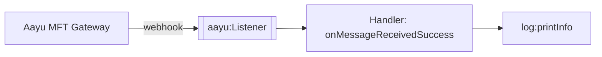

import ThemedImage from '@theme/ThemedImage';
import useBaseUrl from '@docusaurus/useBaseUrl';

# Example

## Aayu MFT Gateway Trigger Example

### What you'll build

This integration logs every AS2 message that a trading partner sends to your MFT Gateway station. Aayu MFT Gateway sends each event to the `aayu:Listener`, which verifies it and calls the `onMessageReceivedSuccess` handler of an `aayu:ReceivedMessageService`. The handler logs the partner, the subject, the message ID and the number of files.

### Architecture



### Prerequisites

- An MFT Gateway account with an AS2 station, and an AS2 webhook with **Generate Signature For Webhook Payload** turned on. See the [Setup Guide](setup-guide.md#configuring-mft-gateway-webhooks).
- A public URL for the listener, such as one from ngrok, for MFT Gateway to deliver to.

### Setting up the Aayu MFT Gateway integration

> **New to WSO2 Integrator?** Follow the [Create a New Integration](product://integrator/develop-and-test/create-workspace) guide to set up your integration first, then return here to add the trigger.

### Adding the Aayu MFT Gateway trigger

### Step 1: Open the artifacts palette

Select **Add Artifact** to open the artifacts palette. Search for `aayu.mftg.as2.trigger` and find the **aayu.mftg.as2.trigger** card under **More on Ballerina Central**.

<ThemedImage
    alt="Artifacts palette search results showing the aayu.mftg.as2.trigger package from Ballerina Central"
    sources={{
        light: useBaseUrl('/img/connectors/catalog/cloud-infrastructure/aayu.mftg.as2.trigger/aayu_trigger_screenshots_01_artifact_palette.png'),
        dark: useBaseUrl('/img/connectors/catalog/cloud-infrastructure/aayu.mftg.as2.trigger/aayu_trigger_screenshots_01_artifact_palette.png'),
    }}
/>

### Configuring the Aayu MFT Gateway listener

### Step 2: Fill in the Aayu MFTG AS2 Event Integration form

Select the **aayu.mftg.as2.trigger** card to open the **Aayu MFTG AS2 Event Integration** form, and set:

- **Event Channel**: `aayu:ReceivedMessageService`, the default.
- **Listener**: **Create New Listener**, named `aayuListener`.
- **Webhook Listener Port**: `8090`, the default.
- **Webhook Public Key**: bind it to a new configurable variable named `webhookPublicKey`.

<ThemedImage
    alt="Aayu MFTG AS2 Event Integration form with Event Channel set to ReceivedMessageService and a new listener on port 8090"
    sources={{
        light: useBaseUrl('/img/connectors/catalog/cloud-infrastructure/aayu.mftg.as2.trigger/aayu_trigger_screenshots_02_trigger_config_form.png'),
        dark: useBaseUrl('/img/connectors/catalog/cloud-infrastructure/aayu.mftg.as2.trigger/aayu_trigger_screenshots_02_trigger_config_form.png'),
    }}
/>

### Step 3: Set the configurable values

In the left panel, select **Configurations** and set **webhookPublicKey** to the whole webhook public key PEM from MFT Gateway. The listener rejects every delivery until **webhookPublicKey** is set.

<ThemedImage
    alt="Configurations panel showing the webhookPublicKey configurable"
    sources={{
        light: useBaseUrl('/img/connectors/catalog/cloud-infrastructure/aayu.mftg.as2.trigger/aayu_trigger_screenshots_03_configurations_panel.png'),
        dark: useBaseUrl('/img/connectors/catalog/cloud-infrastructure/aayu.mftg.as2.trigger/aayu_trigger_screenshots_03_configurations_panel.png'),
    }}
/>

### Step 4: Create the trigger

Select **Create**. WSO2 Integrator adds the listener and an `aayu:ReceivedMessageService` attached to it.

### Handling Aayu MFT Gateway events

### Step 5: Open the onMessageReceivedSuccess handler

Open the **aayu:ReceivedMessageService** service. It has one event handler, `onMessageReceivedSuccess`, which receives an `aayu:MessageReceivedEvent`.

<ThemedImage
    alt="ReceivedMessageService view showing the onMessageReceivedSuccess event handler attached to the listener"
    sources={{
        light: useBaseUrl('/img/connectors/catalog/cloud-infrastructure/aayu.mftg.as2.trigger/aayu_trigger_screenshots_04_add_handler_panel.png'),
        dark: useBaseUrl('/img/connectors/catalog/cloud-infrastructure/aayu.mftg.as2.trigger/aayu_trigger_screenshots_04_add_handler_panel.png'),
    }}
/>

### Step 6: Log the event

Select **onMessageReceivedSuccess** to open its flow. Select the **+** icon, choose **Log Info** from the **Logging** section, and log the partner, the subject, the message ID and the number of files. The handler's code is:

```ballerina
remote function onMessageReceivedSuccess(aayu:MessageReceivedEvent payload) returns error? {
    string[] files = payload.attachments ?: [];
    log:printInfo("AS2 message received", partner = payload.partnerName, subject = payload.messageSubject,
            messageId = payload.messageIdentifier, fileCount = files.length());
}
```

<ThemedImage
    alt="onMessageReceivedSuccess handler flow with a log:printInfo node"
    sources={{
        light: useBaseUrl('/img/connectors/catalog/cloud-infrastructure/aayu.mftg.as2.trigger/aayu_trigger_screenshots_06_handler_flow.png'),
        dark: useBaseUrl('/img/connectors/catalog/cloud-infrastructure/aayu.mftg.as2.trigger/aayu_trigger_screenshots_06_handler_flow.png'),
    }}
/>

### Running the integration

1. Run the integration from WSO2 Integrator. The listener starts on port `8090`.
2. Expose the port, for example with `ngrok http 8090`, and point Aayu MFT Gateway at it. See the [Setup Guide](setup-guide.md#configuring-mft-gateway-webhooks).
3. Have a trading partner send an AS2 message to your station, or send one to a partner set up as your own station, as the [Setup Guide](setup-guide.md#configuring-mft-gateway-webhooks) shows.
4. The `onMessageReceivedSuccess` handler logs the event in the WSO2 Integrator console.

If Aayu MFT Gateway reports `401` for a delivery, the listener rejected its signature. The console logs `WEBHOOK_SIGNATURE_REJECTED` with the reason; check that **webhookPublicKey** is the whole webhook public key PEM from MFT Gateway.

## What's next

- [Aayu MFT Gateway](product://integrator/develop-and-test/integration-artifacts/event-driven-integration/aayu-mft-gateway): every event channel and handler
- [Setup Guide](setup-guide.md#configuring-mft-gateway-webhooks): point Aayu MFT Gateway at your listener
- [Trigger Reference](triggers.md): listener configuration, callbacks and payload types
