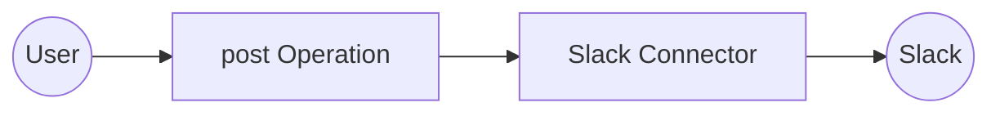
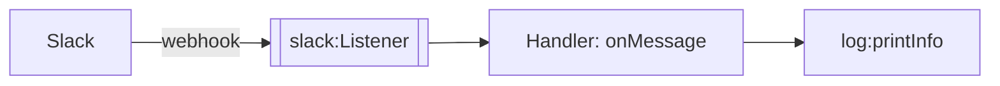

import ThemedImage from '@theme/ThemedImage';
import useBaseUrl from '@docusaurus/useBaseUrl';

# Example

## What you'll build

Build a WSO2 Integrator automation that posts a message to a Slack channel using the Slack connector. The integration connects to your Slack workspace using an OAuth token and sends a text message to a specified channel.

**Operations used:**
- **post** : Sends a message to a Slack channel with a specified payload.

## Architecture



## Prerequisites

- A Slack OAuth token (see the [Setup Guide](setup-guide.md))
- A Slack workspace with a channel to post messages to

## Setting up the Slack integration

> **New to WSO2 Integrator?** Follow the [Create a New Integration](product://integrator/develop-and-test/create-workspace) guide to set up your integration first, then return here to add the connector.

## Adding the Slack connector

### Step 1: Open the connector palette

In the WSO2 Integrator sidebar, hover over **Connections** to reveal the **Add Connection** button. Select it to open the connector palette.

<ThemedImage
    alt="Slack connector palette open with search field before any selection"
    sources={{
        light: useBaseUrl('/img/connectors/catalog/communication/slack/slack_screenshot_01_palette.png'),
        dark: useBaseUrl('/img/connectors/catalog/communication/slack/slack_screenshot_01_palette.png'),
    }}
/>

In the search box, enter `slack` to filter connectors, then select **ballerinax/slack** from the results to open the **Add Connection** form.

## Configuring the Slack connection

### Step 2: Fill in the connection parameters

In the connection configuration form, bind each field to a configurable variable:

- **connectionName** : Enter `slackClient` as the connection name
- **Config** : Switch to **Expression** mode and enter `{ auth: { token: slackAuthToken } }`, where `slackAuthToken` is a configurable variable of type `string`

<ThemedImage
    alt="Slack connection form fully filled with all parameters before saving"
    sources={{
        light: useBaseUrl('/img/connectors/catalog/communication/slack/slack_screenshot_02_connection_form.png'),
        dark: useBaseUrl('/img/connectors/catalog/communication/slack/slack_screenshot_02_connection_form.png'),
    }}
/>

### Step 3: Save the connection

Select **Save** to create the connection. The `slackClient` connection node appears on the canvas and under **Connections** in the sidebar.

<ThemedImage
    alt="Slack Connections panel showing slackClient entry after saving"
    sources={{
        light: useBaseUrl('/img/connectors/catalog/communication/slack/slack_screenshot_03_connections_list.png'),
        dark: useBaseUrl('/img/connectors/catalog/communication/slack/slack_screenshot_03_connections_list.png'),
    }}
/>

### Step 4: Set actual values for your configurables

In the left panel, select **Configurations**. Set a value for each configurable listed below:

- **slackAuthToken** (string) : Your Slack OAuth token from the [Setup Guide](setup-guide.md)

## Configuring the Slack post operation

### Step 5: Add an automation entry point

In the WSO2 Integrator sidebar, hover over **Entry Points** to reveal the **Add Entry Point** button. Select it to open the artifact type selector, then select **Automation**. Accept the default settings and select **Create**.

The automation flow opens in the canvas, showing **Start**, a placeholder node, and **Error Handler**.

### Step 6: Select and configure the post operation

Select the **+** button between the **Start** and **Error Handler** nodes to open the node selection panel. Under **Connections**, select **slackClient** to expand its available operations.

<ThemedImage
    alt="Slack connection node expanded showing all available operations before selection"
    sources={{
        light: useBaseUrl('/img/connectors/catalog/communication/slack/slack_screenshot_04_operations_panel.png'),
        dark: useBaseUrl('/img/connectors/catalog/communication/slack/slack_screenshot_04_operations_panel.png'),
    }}
/>

Select **post** from the list to open the operation configuration form, then fill in the fields:

- **Payload** : A record with the channel to post to and the message text, for example `{channel: "general", text: "Hello from WSO2 Integrator!"}`
- **result** : The variable name to store the response (default `slackChatpostmessageresponse`)

<ThemedImage
    alt="Slack post operation configuration filled with all values"
    sources={{
        light: useBaseUrl('/img/connectors/catalog/communication/slack/slack_screenshot_05_operation_filled.png'),
        dark: useBaseUrl('/img/connectors/catalog/communication/slack/slack_screenshot_05_operation_filled.png'),
    }}
/>

Select **Save** to add the step to the flow.

<ThemedImage
    alt="Completed Slack automation flow"
    sources={{
        light: useBaseUrl('/img/connectors/catalog/communication/slack/slack_screenshot_06_completed_flow.png'),
        dark: useBaseUrl('/img/connectors/catalog/communication/slack/slack_screenshot_06_completed_flow.png'),
    }}
/>

## Try it yourself

Try this sample in WSO2 Integration Platform.

[](https://console.devant.dev/new?gh=wso2/integration-samples/tree/main/integrator-default-profile/connectors/slack_connector_sample)

[View source on GitHub](https://github.com/wso2/integration-samples/tree/main/integrator-default-profile/connectors/slack_connector_sample)

## More code examples

The `Slack` connector provides practical examples illustrating usage in various scenarios. Explore these [examples](https://github.com/ballerina-platform/module-ballerinax-slack/tree/master/examples), covering the following use cases:

1. [Automated Summary Report](https://github.com/ballerina-platform/module-ballerinax-slack/tree/master/examples/automated-summary-report) - This use case demonstrates how the Slack API can be utilized to generate a summarized report of daily stand-up chats in the general channel.

2. [Survey Feedback Analysis](https://github.com/ballerina-platform/module-ballerinax-slack/tree/master/examples/survey-feedback-analysis) - This use case demonstrates how the Slack API can be utilized to perform a company-wide survey by creating a dedicated channel to receive and track feedback replies.

## Slack Trigger Example

### What you'll build

This integration logs every message posted in the Slack channels your app is in. Slack sends each event to the `slack:Listener`, which verifies it and calls the `onMessage` handler of a `slack:MessageService`. The handler logs the channel, the user and the text.

:::info
This example uses the `ballerinax/slack.trigger` package, which receives Slack events. It is separate from the `ballerinax/slack` connector, which calls the Slack API.
:::

### Architecture



### Prerequisites

- A Slack app with event subscriptions turned on and the `message.channels` bot event added. See the [Setup Guide](setup-guide.md#configuring-slack-event-subscriptions).
- A public URL for the listener, such as one from ngrok, for Slack to deliver to.

### Setting up the Slack integration

> **New to WSO2 Integrator?** Follow the [Create a New Integration](product://integrator/develop-and-test/create-workspace) guide to set up your integration first, then return here to add the trigger.

### Adding the Slack trigger

### Step 1: Open the artifacts palette

Select **Add Artifact** to open the artifacts palette. Search for `slack.trigger` and find the **slack.trigger** card under **More on Ballerina Central**.

<ThemedImage
    alt="Artifacts palette search results showing the slack.trigger package from Ballerina Central"
    sources={{
        light: useBaseUrl('/img/connectors/catalog/communication/slack/slack_trigger_screenshots_01_artifact_palette.png'),
        dark: useBaseUrl('/img/connectors/catalog/communication/slack/slack_trigger_screenshots_01_artifact_palette.png'),
    }}
/>

### Configuring the Slack listener

### Step 2: Fill in the Slack Event Integration form

Select the **slack.trigger** card to open the **Slack Event Integration** form, and set:

- **Event Channel**: `slack:MessageService`, the default.
- **Listener**: **Create New Listener**, named `slackListener`.
- **Webhook Listener Port**: `8090`, the default.
- **Signing Secret**: bind it to a new configurable variable named `signingSecret`.

<ThemedImage
    alt="Slack Event Integration form with Event Channel set to MessageService and a new listener on port 8090"
    sources={{
        light: useBaseUrl('/img/connectors/catalog/communication/slack/slack_trigger_screenshots_02_trigger_config_form.png'),
        dark: useBaseUrl('/img/connectors/catalog/communication/slack/slack_trigger_screenshots_02_trigger_config_form.png'),
    }}
/>

### Step 3: Set the configurable values

In the left panel, select **Configurations** and set **signingSecret** to your Slack app's signing secret. The listener rejects every delivery until **signingSecret** is set.

<ThemedImage
    alt="Configurations panel showing the signingSecret configurable"
    sources={{
        light: useBaseUrl('/img/connectors/catalog/communication/slack/slack_trigger_screenshots_03_configurations_panel.png'),
        dark: useBaseUrl('/img/connectors/catalog/communication/slack/slack_trigger_screenshots_03_configurations_panel.png'),
    }}
/>

### Step 4: Create the trigger

Select **Create**. WSO2 Integrator adds the listener and a `slack:MessageService` attached to it.

### Handling Slack events

### Step 5: Open the onMessage handler

Open the **slack:MessageService** service. It lists all 4 of its event handlers, including `onMessage`, which receives a `slack:MessageEventWrapper`. Leave the other handlers empty.

<ThemedImage
    alt="MessageService view showing the onMessage event handler attached to the listener"
    sources={{
        light: useBaseUrl('/img/connectors/catalog/communication/slack/slack_trigger_screenshots_04_add_handler_panel.png'),
        dark: useBaseUrl('/img/connectors/catalog/communication/slack/slack_trigger_screenshots_04_add_handler_panel.png'),
    }}
/>

### Step 6: Log the event

Select **onMessage** to open its flow. Select the **+** icon, choose **Log Info** from the **Logging** section, and log the channel, the user and the text. The handler's code is:

```ballerina
remote function onMessage(slack:MessageEventWrapper payload) returns error? {
    slack:MessageEvent message = payload.event;
    log:printInfo("Message received", channel = message.'channel, user = message.user, text = message.text);
}
```

<ThemedImage
    alt="onMessage handler flow with a log:printInfo node"
    sources={{
        light: useBaseUrl('/img/connectors/catalog/communication/slack/slack_trigger_screenshots_06_handler_flow.png'),
        dark: useBaseUrl('/img/connectors/catalog/communication/slack/slack_trigger_screenshots_06_handler_flow.png'),
    }}
/>

### Running the integration

1. Run the integration from WSO2 Integrator. The listener starts on port `8090`.
2. Expose the port, for example with `ngrok http 8090`, and point Slack at it. See the [Setup Guide](setup-guide.md#configuring-slack-event-subscriptions).
3. Invite the app to a channel with `/invite @<your app>` and post a message.
4. The `onMessage` handler logs the event in the WSO2 Integrator console.

If Slack reports `401` for a delivery, the listener rejected its signature. The console logs `WEBHOOK_SIGNATURE_REJECTED` with the reason; check that **signingSecret** is your Slack app's signing secret.
