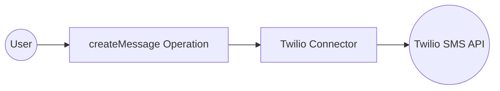

import ThemedImage from '@theme/ThemedImage';
import useBaseUrl from '@docusaurus/useBaseUrl';

# Example


## Twilio Example

### What you'll build

Build a Twilio SMS integration using the WSO2 Integrator low-code UI. The integration configures the Twilio connector with secure configurable credentials and calls the `createMessage` operation to send an SMS message.

**Operations used:**
- **createMessage** : Sends an SMS message by specifying a recipient number, sender number, and message body.

### Architecture



### Prerequisites

- Twilio account with an Account SID and Auth Token

### Setting up the Twilio integration

> **New to WSO2 Integrator?** Follow the [Create a New Integration](product://integrator/develop-and-test/create-workspace) guide to set up your integration first, then return here to add the connector.

### Adding the Twilio connector

#### Step 1: Open the add connection panel

Select **Add Connection** (the `+` icon next to **Connections**) in the WSO2 Integrator panel to open the connector palette.

<ThemedImage
    alt="Twilio connector palette open with search field before any selection"
    sources={{
        light: useBaseUrl('/img/connectors/catalog/communication/twilio/twilio_screenshot_01_palette.png'),
        dark: useBaseUrl('/img/connectors/catalog/communication/twilio/twilio_screenshot_01_palette.png'),
    }}
/>

#### Step 2: Select the Twilio connector

Search for "twilio" in the palette, then select **Twilio** from the search results to open the **Configure Twilio** form.

### Configuring the Twilio connection

#### Step 3: Fill in connection parameters

Enter the connection parameters, binding each to a configurable variable to keep credentials out of source code:

- **accountSid** : Twilio Account SID, bound to a `string` configurable variable
- **authToken** : Twilio Auth Token, bound to a `string` configurable variable
- **connectionName** : Name for this connection instance (for example, `twilioClient`)

<ThemedImage
    alt="Twilio connection form fully filled with all parameters before saving"
    sources={{
        light: useBaseUrl('/img/connectors/catalog/communication/twilio/twilio_screenshot_02_connection_form.png'),
        dark: useBaseUrl('/img/connectors/catalog/communication/twilio/twilio_screenshot_02_connection_form.png'),
    }}
/>

#### Step 4: Save the connection

Select **Save Connection** to persist the connection. The `twilioClient` connection appears in the **Connections** panel and on the design canvas.

<ThemedImage
    alt="Twilio Connections panel showing twilioClient entry after saving"
    sources={{
        light: useBaseUrl('/img/connectors/catalog/communication/twilio/twilio_screenshot_03_connections_list.png'),
        dark: useBaseUrl('/img/connectors/catalog/communication/twilio/twilio_screenshot_03_connections_list.png'),
    }}
/>

#### Step 5: Set actual values for your configurables

In the left panel, select **Configurations** to open the Configurations panel. Set a value for each configurable listed below:

- **accountSid** (string) : Your Twilio Account SID (for example, `ACxxxxxxxxxxxxxxxxxxxxxxxxxxxxxxxx`)
- **authToken** (string) : Your Twilio Auth Token

### Configuring the Twilio createMessage operation

#### Step 6: Add an automation entry point

In the integration overview, select **+ Add Artifact**, then select **Automation** from the artifact type list, and select **Create**. A new automation named `main` is added under **Entry Points** and the flow editor opens.

#### Step 7: Select and configure the createMessage operation

In the Automation flow editor, select the **+** button between **Start** and **Error Handler** to open the node panel. Expand **twilioClient** under **Connections** to reveal available operations.

<ThemedImage
    alt="Twilio connection node expanded showing all available operations before selection"
    sources={{
        light: useBaseUrl('/img/connectors/catalog/communication/twilio/twilio_screenshot_04_operations_panel.png'),
        dark: useBaseUrl('/img/connectors/catalog/communication/twilio/twilio_screenshot_04_operations_panel.png'),
    }}
/>

Select **Create Message** from the **Message** group to open the **twilioClient → createMessage** configuration form. Enter the following values in the **Payload** field:

- **To** : Recipient phone number in E.164 format
- **From** : Your Twilio-provisioned sender number
- **Body** : The SMS message text
- **Result** : Auto-named result variable (`twilioMessage`) of type `twilio:Message`

<ThemedImage
    alt="createMessage operation form filled with To, From, and Body payload"
    sources={{
        light: useBaseUrl('/img/connectors/catalog/communication/twilio/twilio_screenshot_05_operation_filled.png'),
        dark: useBaseUrl('/img/connectors/catalog/communication/twilio/twilio_screenshot_05_operation_filled.png'),
    }}
/>

Select **Save**. The `twilio : createMessage` node appears in the automation flow.

<ThemedImage
    alt="Completed automation flow showing createMessage node connected to twilioClient"
    sources={{
        light: useBaseUrl('/img/connectors/catalog/communication/twilio/twilio_screenshot_06_completed_flow.png'),
        dark: useBaseUrl('/img/connectors/catalog/communication/twilio/twilio_screenshot_06_completed_flow.png'),
    }}
/>

### Try it yourself

Try this sample in WSO2 Integration Platform.

[](https://console.devant.dev/new?gh=wso2/integration-samples/tree/main/integrator-default-profile/connectors/twilio_connector_sample)

[View source on GitHub](https://github.com/wso2/integration-samples/tree/main/integrator-default-profile/connectors/twilio_connector_sample)

### More code examples

The Twilio connector comes equipped with examples that demonstrate its usage across various scenarios. These examples are conveniently organized into three distinct groups based on the functionalities they showcase. For a more hands-on experience and a deeper understanding of these capabilities, we encourage you to experiment with the provided examples in your development environment.

1. Account management
    - [Create a sub-account](https://github.com/ballerina-platform/module-ballerinax-twilio/tree/master/examples/accounts/create-sub-account): Create a subaccount under a Twilio account
    - [Fetch an account](https://github.com/ballerina-platform/module-ballerinax-twilio/tree/master/examples/accounts/fetch-account): Get details of a Twilio account
    - [Fetch balance](https://github.com/ballerina-platform/module-ballerinax-twilio/tree/master/examples/accounts/fetch-balance): Get the balance of a Twilio account
    - [List accounts](https://github.com/ballerina-platform/module-ballerinax-twilio/tree/master/examples/accounts/list-accounts): List all subaccounts under a Twilio account
    - [Update an account](https://github.com/ballerina-platform/module-ballerinax-twilio/tree/master/examples/accounts/update-account): Update the name of a Twilio account
2. Call management
    - [Make a call](https://github.com/ballerina-platform/module-ballerinax-twilio/tree/master/examples/calls/create-call): Make a call to a phone number via Twilio
    - [Fetch call log](https://github.com/ballerina-platform/module-ballerinax-twilio/tree/master/examples/calls/fetch-call-log): Get details of a call made via Twilio
    - [List call logs](https://github.com/ballerina-platform/module-ballerinax-twilio/tree/master/examples/calls/list-call-logs): Get details of all calls made via Twilio
    - [Delete a call log](https://github.com/ballerina-platform/module-ballerinax-twilio/tree/master/examples/calls/delete-call-log): Delete the log of a call made via Twilio
3. Message management
    - [Send an SMS message](https://github.com/ballerina-platform/module-ballerinax-twilio/tree/master/examples/messages/create-sms-message): Send an SMS to a phone number via Twilio
    - [Send a WhatsApp message](https://github.com/ballerina-platform/module-ballerinax-twilio/tree/master/examples/messages/create-whatsapp-message): Send a WhatsApp message to a phone number via Twilio
    - [List message logs](https://github.com/ballerina-platform/module-ballerinax-twilio/tree/master/examples/messages/list-message-logs): Get details of all messages sent via Twilio
    - [Fetch a message log](https://github.com/ballerina-platform/module-ballerinax-twilio/tree/master/examples/messages/fetch-message-log): Get details of a message sent via Twilio
    - [Delete a message log](https://github.com/ballerina-platform/module-ballerinax-twilio/tree/master/examples/messages/delete-message-log): Delete a message log via Twilio


## Twilio Trigger Example

### What you'll build

This integration logs each message that Twilio reports as delivered. Twilio sends each event to the `twilio:Listener`, which verifies it and calls the `onDelivered` handler of a `twilio:SmsStatusService`. The handler logs the message SID and the recipient.

:::info
This example uses the `ballerinax/twilio.trigger` package, which receives Twilio events. It is separate from the `ballerinax/twilio` connector, which calls the Twilio API.
:::

### Architecture


### Prerequisites

- A Twilio account with a phone number, and its Auth Token. See the [Setup Guide](setup-guide.md#configuring-twilio-status-callbacks).
- A public URL for the listener, such as one from ngrok, for Twilio to call.

### Setting up the Twilio integration

> **New to WSO2 Integrator?** Follow the [Create a New Integration](product://integrator/develop-and-test/create-workspace) guide to set up your integration first, then return here to add the trigger.

### Adding the Twilio trigger

### Step 1: Open the artifacts palette

Select **Add Artifact** to open the artifacts palette. Search for `twilio.trigger` and find the **twilio.trigger** card under **More on Ballerina Central**. Don't use the built-in **Twilio** card under **Event Integration**; it creates the older `trigger.twilio` package.

<ThemedImage
    alt="Artifacts palette search results showing the twilio.trigger package from Ballerina Central"
    sources={{
        light: useBaseUrl('/img/connectors/catalog/communication/twilio/twilio_trigger_screenshots_01_artifact_palette.png'),
        dark: useBaseUrl('/img/connectors/catalog/communication/twilio/twilio_trigger_screenshots_01_artifact_palette.png'),
    }}
/>

### Configuring the Twilio listener

### Step 2: Fill in the Twilio Event Integration form

Select the **twilio.trigger** card to open the **Twilio Event Integration** form, and set:

- **Event Channel**: `twilio:SmsStatusService`, the default.
- **Listener**: **Create New Listener**, named `twilioListener`.
- **Webhook Listener Port**: `8090`, the default.
- **Auth Token**: bind it to a new configurable variable named `authToken`.
- **Webhook Base URL**: bind it to a new configurable variable named `webhookBaseUrl`.

<ThemedImage
    alt="Twilio Event Integration form with Event Channel set to SmsStatusService and a new listener on port 8090"
    sources={{
        light: useBaseUrl('/img/connectors/catalog/communication/twilio/twilio_trigger_screenshots_02_trigger_config_form.png'),
        dark: useBaseUrl('/img/connectors/catalog/communication/twilio/twilio_trigger_screenshots_02_trigger_config_form.png'),
    }}
/>

### Step 3: Set the configurable values

In the left panel, select **Configurations** and set **authToken** to your Twilio Auth Token, and **webhookBaseUrl** to the public base URL Twilio calls, such as the ngrok forwarding URL, without a trailing slash. The listener rejects every delivery until **authToken** is set.

<ThemedImage
    alt="Configurations panel showing the authToken configurable"
    sources={{
        light: useBaseUrl('/img/connectors/catalog/communication/twilio/twilio_trigger_screenshots_03_configurations_panel.png'),
        dark: useBaseUrl('/img/connectors/catalog/communication/twilio/twilio_trigger_screenshots_03_configurations_panel.png'),
    }}
/>

### Step 4: Create the trigger

Select **Create**. WSO2 Integrator adds the listener and a `twilio:SmsStatusService` attached to it.

### Handling Twilio events

### Step 5: Open the onDelivered handler

Open the **twilio:SmsStatusService** service. It lists all 13 of its event handlers, including `onDelivered`, which receives a `twilio:SmsStatusChangeEventWrapper`. Leave the other handlers empty.

<ThemedImage
    alt="SmsStatusService view showing the onDelivered event handler attached to the listener"
    sources={{
        light: useBaseUrl('/img/connectors/catalog/communication/twilio/twilio_trigger_screenshots_04_add_handler_panel.png'),
        dark: useBaseUrl('/img/connectors/catalog/communication/twilio/twilio_trigger_screenshots_04_add_handler_panel.png'),
    }}
/>

### Step 6: Log the event

Select **onDelivered** to open its flow. Select the **+** icon, choose **Log Info** from the **Logging** section, and log the message SID and the recipient. The handler's code is:

```ballerina
remote function onDelivered(twilio:SmsStatusChangeEventWrapper payload) returns error? {
    log:printInfo("Message delivered", messageSid = payload.MessageSid, to = payload.To);
}
```

<ThemedImage
    alt="onDelivered handler flow with a log:printInfo node"
    sources={{
        light: useBaseUrl('/img/connectors/catalog/communication/twilio/twilio_trigger_screenshots_06_handler_flow.png'),
        dark: useBaseUrl('/img/connectors/catalog/communication/twilio/twilio_trigger_screenshots_06_handler_flow.png'),
    }}
/>

### Running the integration

1. Run the integration from WSO2 Integrator. The listener starts on port `8090`.
2. Expose the port, for example with `ngrok http 8090`, and point Twilio at it. See the [Setup Guide](setup-guide.md#configuring-twilio-status-callbacks).
3. Send a message with `StatusCallback` set to `<public URL>/smsStatus`, as the [Setup Guide](setup-guide.md#configuring-twilio-status-callbacks) shows.
4. The `onDelivered` handler logs the event in the WSO2 Integrator console.

If Twilio reports `401` for a delivery, the listener rejected its signature. The console logs `WEBHOOK_SIGNATURE_REJECTED` with the reason; check that **authToken** is your Twilio Auth Token.
