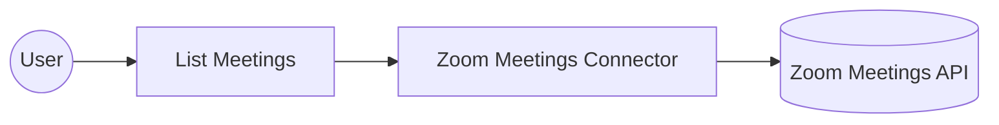

import ThemedImage from '@theme/ThemedImage';
import useBaseUrl from '@docusaurus/useBaseUrl';

# Example

## What you'll build

This integration connects to Zoom Meetings and lists the meetings of a Zoom user. An automation entry point runs the operation once and logs the returned meetings.

**Operations used:**
- **List Meetings** : Lists the meetings of a Zoom user

## Architecture

## Prerequisites

- A Zoom account.
- A general (user-managed) app in the Zoom App Marketplace with the meeting scopes, and its client ID and client secret.
- An OAuth 2.0 refresh token issued for that app.

## Setting up the Zoom Meetings integration

> **New to WSO2 Integrator?** Follow the [Create a New Integration](product://integrator/develop-and-test/create-workspace) guide to set up your integration first, then return here to add the connector.

## Adding the Zoom Meetings connector

### Step 1: Open the connector palette

Hover over **Connections** in the project tree and select **Add Connection** (**+**).

<ThemedImage
    alt="Zoom Meetings connector palette open before selection"
    sources={{
        light: useBaseUrl('/img/connectors/catalog/communication/zoom.meetings/ballerinax_zoom_meetings_screenshot_01_palette.png'),
        dark: useBaseUrl('/img/connectors/catalog/communication/zoom.meetings/ballerinax_zoom_meetings_screenshot_01_palette.png'),
    }}
/>

### Step 2: Select the Zoom Meetings connector

1. Enter `zoom.meetings` in the search field.
2. Select the **Zoom Meetings** connector card.

## Configuring the Zoom Meetings connection

### Step 3: Bind the connection parameters to configurable variables

Bind each connection field to a configurable variable. Use the **Configurables** tab of the field's helper panel to create each configurable.

- **Config** : Connection settings, with the OAuth 2.0 refresh token configuration for Zoom set in the `auth` record. Switch the field to **Expression** and enter `{auth: {clientId: meetingsClientId, clientSecret: meetingsClientSecret, refreshToken: meetingsRefreshToken}}`. The connector refreshes the access token against `https://zoom.us/oauth/token`.
- **Service Url** : Set it to the `meetingsServiceUrl` configurable.

<ThemedImage
    alt="Zoom Meetings connection form with all parameters bound before saving"
    sources={{
        light: useBaseUrl('/img/connectors/catalog/communication/zoom.meetings/ballerinax_zoom_meetings_screenshot_02_connection_form.png'),
        dark: useBaseUrl('/img/connectors/catalog/communication/zoom.meetings/ballerinax_zoom_meetings_screenshot_02_connection_form.png'),
    }}
/>

### Step 4: Save the connection

Select **Save Connection** and verify that **meetingsClient** appears under **Connections** in the project tree and on the design canvas.

<ThemedImage
    alt="Zoom Meetings connection visible after saving"
    sources={{
        light: useBaseUrl('/img/connectors/catalog/communication/zoom.meetings/ballerinax_zoom_meetings_screenshot_03_connections_list.png'),
        dark: useBaseUrl('/img/connectors/catalog/communication/zoom.meetings/ballerinax_zoom_meetings_screenshot_03_connections_list.png'),
    }}
/>

### Step 5: Set actual values for your configurables

1. Select **Configurations** at the bottom of the project tree.
2. Enter a value for each configurable listed below before you run the integration.

- **meetingsServiceUrl** (`string`) : Zoom API base URL. Defaults to `https://api.zoom.us/v2`.
- **meetingsClientId** (`string`) : Client ID of the Zoom app.
- **meetingsClientSecret** (`string`) : Client secret of the Zoom app.
- **meetingsRefreshToken** (`string`) : OAuth 2.0 refresh token issued for the Zoom app.
- **meetingsUserId** (`string`) : User ID or email address of the Zoom user. Defaults to `me`, the user who authorized the app.

## Configuring the Zoom Meetings List Meetings operation

### Step 6: Add an automation entry point

1. Select **Add Artifact** on the design canvas.
2. Select **Automation**.
3. Select **Create** to accept the settings.

### Step 7: Expand the connection and configure the List Meetings operation

1. Select the **+** between **Start** and **Error Handler** in the automation flow.
2. Expand **meetingsClient** under **Connections** to display its operations.

<ThemedImage
    alt="Zoom Meetings connection expanded to display operations before selection"
    sources={{
        light: useBaseUrl('/img/connectors/catalog/communication/zoom.meetings/ballerinax_zoom_meetings_screenshot_04_operations_panel.png'),
        dark: useBaseUrl('/img/connectors/catalog/communication/zoom.meetings/ballerinax_zoom_meetings_screenshot_04_operations_panel.png'),
    }}
/>

3. Select **List Meetings** and enter its required values.

- **User Id** : Set it to the `meetingsUserId` configurable.
- **Result** : Set it to `meetings`, the variable that stores the returned meetings.

<ThemedImage
    alt="Zoom Meetings List Meetings operation with all values entered before saving"
    sources={{
        light: useBaseUrl('/img/connectors/catalog/communication/zoom.meetings/ballerinax_zoom_meetings_screenshot_05_operation_form.png'),
        dark: useBaseUrl('/img/connectors/catalog/communication/zoom.meetings/ballerinax_zoom_meetings_screenshot_05_operation_form.png'),
    }}
/>

4. Select **Save**.

### Step 8: Log the List Meetings result

1. Select the **+** below the **List Meetings** node.
2. Under **Logging**, select **Log Info**.
3. Switch **Msg** to **Expression**, enter `meetings.toString()`, and select **Save**.

<ThemedImage
    alt="Completed Zoom Meetings flow with the configured operation"
    sources={{
        light: useBaseUrl('/img/connectors/catalog/communication/zoom.meetings/ballerinax_zoom_meetings_screenshot_06_completed_flow.png'),
        dark: useBaseUrl('/img/connectors/catalog/communication/zoom.meetings/ballerinax_zoom_meetings_screenshot_06_completed_flow.png'),
    }}
/>

## Try it yourself

Try this sample in WSO2 Integration Platform.

[View source on GitHub](https://github.com/wso2/integration-samples/tree/main/integrator-default-profile/connectors/zoom.meetings_connector_sample)

## More code examples

The Zoom Meetings connector provides practical examples illustrating usage in various scenarios. Explore these [examples](https://github.com/ballerina-platform/module-ballerinax-zoom.meetings/tree/main/examples/), covering the following use cases:

1. [Schedule a team meeting](https://github.com/ballerina-platform/module-ballerinax-zoom.meetings/tree/main/examples/schedule_team_meeting) - Create a meeting with a waiting room, attach a poll, and print the invitation to share with attendees.
2. [Cancel meetings by topic](https://github.com/ballerina-platform/module-ballerinax-zoom.meetings/tree/main/examples/cancel_meetings_by_topic) - Find every upcoming meeting whose topic contains a phrase and cancel them, with a dry run by default.
