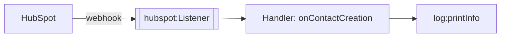

import ThemedImage from '@theme/ThemedImage';
import useBaseUrl from '@docusaurus/useBaseUrl';

# Example

## HubSpot Trigger Example

### What you'll build

This integration logs every contact created in a HubSpot account. HubSpot sends each event to the `hubspot:Listener`, which verifies it and calls the `onContactCreation` handler of a `hubspot:ContactService`. The handler logs the contact's ID and the account ID.

### Architecture



### Prerequisites

- A HubSpot app with a `contact.creation` webhook subscription, installed in a test account. See the [Setup Guide](setup-guide.md#configuring-hubspot-webhooks).
- A public URL for the listener, such as one from ngrok, for HubSpot to deliver to.

### Setting up the HubSpot integration

> **New to WSO2 Integrator?** Follow the [Create a New Integration](product://integrator/develop-and-test/create-workspace) guide to set up your integration first, then return here to add the trigger.

### Adding the HubSpot trigger

### Step 1: Open the artifacts palette

Select **Add Artifact** to open the artifacts palette. Search for `hubspot.trigger` and find the **hubspot.trigger** card under **More on Ballerina Central**. Don't use the built-in **HubSpot** card under **Event Integration**; it creates the older `trigger.hubspot` package.

<ThemedImage
    alt="Artifacts palette search results showing the hubspot.trigger package from Ballerina Central"
    sources={{
        light: useBaseUrl('/img/connectors/catalog/crm-sales/hubspot.trigger/hubspot_trigger_screenshots_01_artifact_palette.png'),
        dark: useBaseUrl('/img/connectors/catalog/crm-sales/hubspot.trigger/hubspot_trigger_screenshots_01_artifact_palette.png'),
    }}
/>

### Configuring the HubSpot listener

### Step 2: Fill in the HubSpot Event Integration form

Select the **hubspot.trigger** card to open the **HubSpot Event Integration** form, and set:

- **Event Channel**: `hubspot:ContactService`, the default.
- **Listener**: **Create New Listener**, named `hubspotListener`.
- **Webhook Listener Port**: `8090`, the default.
- **Webhook Secret**: bind it to a new configurable variable named `clientSecret`.
- **Callback URL**: under **Advanced Configurations**, bind it to a new configurable variable named `callbackUrl`.

<ThemedImage
    alt="HubSpot Event Integration form with Event Channel set to ContactService and a new listener on port 8090"
    sources={{
        light: useBaseUrl('/img/connectors/catalog/crm-sales/hubspot.trigger/hubspot_trigger_screenshots_02_trigger_config_form.png'),
        dark: useBaseUrl('/img/connectors/catalog/crm-sales/hubspot.trigger/hubspot_trigger_screenshots_02_trigger_config_form.png'),
    }}
/>

### Step 3: Set the configurable values

In the left panel, select **Configurations** and set **clientSecret** to your HubSpot app's client secret, and **callbackUrl** to the target URL set on the app's webhooks, exactly as entered there. The listener rejects every delivery until **clientSecret** is set.

<ThemedImage
    alt="Configurations panel showing the clientSecret configurable"
    sources={{
        light: useBaseUrl('/img/connectors/catalog/crm-sales/hubspot.trigger/hubspot_trigger_screenshots_03_configurations_panel.png'),
        dark: useBaseUrl('/img/connectors/catalog/crm-sales/hubspot.trigger/hubspot_trigger_screenshots_03_configurations_panel.png'),
    }}
/>

### Step 4: Create the trigger

Select **Create**. WSO2 Integrator adds the listener and a `hubspot:ContactService` attached to it.

### Handling HubSpot events

### Step 5: Open the onContactCreation handler

Open the **hubspot:ContactService** service. It lists all 7 of its event handlers, including `onContactCreation`, which receives a `hubspot:WebhookEvent`. Leave the other handlers empty.

<ThemedImage
    alt="ContactService view showing the onContactCreation event handler attached to the listener"
    sources={{
        light: useBaseUrl('/img/connectors/catalog/crm-sales/hubspot.trigger/hubspot_trigger_screenshots_04_add_handler_panel.png'),
        dark: useBaseUrl('/img/connectors/catalog/crm-sales/hubspot.trigger/hubspot_trigger_screenshots_04_add_handler_panel.png'),
    }}
/>

### Step 6: Log the event

Select **onContactCreation** to open its flow. Select the **+** icon, choose **Log Info** from the **Logging** section, and log the contact's ID and the account ID. The handler's code is:

```ballerina
remote function onContactCreation(hubspot:WebhookEvent payload) returns error? {
    log:printInfo("Contact created", id = payload.objectId ?: 0, portal = payload.portalId ?: 0);
}
```

<ThemedImage
    alt="onContactCreation handler flow with a log:printInfo node"
    sources={{
        light: useBaseUrl('/img/connectors/catalog/crm-sales/hubspot.trigger/hubspot_trigger_screenshots_06_handler_flow.png'),
        dark: useBaseUrl('/img/connectors/catalog/crm-sales/hubspot.trigger/hubspot_trigger_screenshots_06_handler_flow.png'),
    }}
/>

### Running the integration

1. Run the integration from WSO2 Integrator. The listener starts on port `8090`.
2. Expose the port, for example with `ngrok http 8090`, and point HubSpot at it. See the [Setup Guide](setup-guide.md#configuring-hubspot-webhooks).
3. Create a contact in the test account your app is installed in.
4. The `onContactCreation` handler logs the event in the WSO2 Integrator console.

If HubSpot reports `401` for a delivery, the listener rejected its signature. The console logs `WEBHOOK_SIGNATURE_REJECTED` with the reason; check that **clientSecret** is your HubSpot app's client secret.

## What's next

- [HubSpot](product://integrator/develop-and-test/integration-artifacts/event-driven-integration/hubspot): every event channel and handler
- [Setup Guide](setup-guide.md#configuring-hubspot-webhooks): point HubSpot at your listener
- [Trigger Reference](triggers.md): listener configuration, callbacks and payload types
