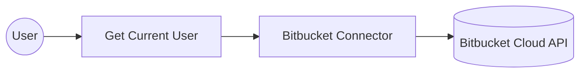

import ThemedImage from '@theme/ThemedImage';
import useBaseUrl from '@docusaurus/useBaseUrl';

# Example

## What you'll build

This integration connects to Bitbucket Cloud and retrieves the profile of the user that owns the access token. An automation entry point runs the operation once and logs the returned user.

**Operations used:**
- **Get Current User** : Retrieves the authenticated user

## Architecture

## Prerequisites

- A Bitbucket Cloud account and an access token with the scopes your integration needs.
- The access token. Follow the [Setup Guide](setup-guide.md) to create it.

## Setting up the Bitbucket integration

> **New to WSO2 Integrator?** Follow the [Create a New Integration](product://integrator/develop-and-test/create-workspace) guide to set up your integration first, then return here to add the connector.

## Adding the Bitbucket connector

### Step 1: Open the connector palette

Hover over **Connections** in the project tree and select **Add Connection** (**+**).

<ThemedImage
    alt="Bitbucket connector palette open before selection"
    sources={{
        light: useBaseUrl('/img/connectors/catalog/developer-tools/bitbucket/ballerinax_bitbucket_screenshot_01_palette.png'),
        dark: useBaseUrl('/img/connectors/catalog/developer-tools/bitbucket/ballerinax_bitbucket_screenshot_01_palette.png'),
    }}
/>

### Step 2: Select the Bitbucket connector

1. Enter `bitbucket` in the search field.
2. Select the **Bitbucket** connector card.

## Configuring the Bitbucket connection

### Step 3: Bind the connection parameters to configurable variables

Bind each connection field to a configurable variable. Use the **Configurables** tab of the field's helper panel to create each configurable.

- **Auth** : The access token. Switch the field to **Expression** and enter `{token: bitbucketAccessToken}`.
- **Service Url** : Set it to the `bitbucketServiceUrl` configurable.

<ThemedImage
    alt="Bitbucket connection form with all parameters bound before saving"
    sources={{
        light: useBaseUrl('/img/connectors/catalog/developer-tools/bitbucket/ballerinax_bitbucket_screenshot_02_connection_form.png'),
        dark: useBaseUrl('/img/connectors/catalog/developer-tools/bitbucket/ballerinax_bitbucket_screenshot_02_connection_form.png'),
    }}
/>

### Step 4: Save the connection

Select **Save Connection** and verify that **bitbucketClient** appears under **Connections** in the project tree and on the design canvas.

<ThemedImage
    alt="Bitbucket connection visible after saving"
    sources={{
        light: useBaseUrl('/img/connectors/catalog/developer-tools/bitbucket/ballerinax_bitbucket_screenshot_03_connections_list.png'),
        dark: useBaseUrl('/img/connectors/catalog/developer-tools/bitbucket/ballerinax_bitbucket_screenshot_03_connections_list.png'),
    }}
/>

### Step 5: Set actual values for your configurables

1. Select **Configurations** at the bottom of the project tree.
2. Enter a value for each configurable listed below before you run the integration.

- **bitbucketServiceUrl** (`string`) : Bitbucket Cloud API base URL. Defaults to `https://api.bitbucket.org/2.0`.
- **bitbucketAccessToken** (`string`) : The repository, project or workspace access token created in Bitbucket.

## Configuring the Bitbucket Get Current User operation

### Step 6: Add an automation entry point

1. Select **Add Artifact** on the design canvas.
2. Select **Automation**.
3. Select **Create** to accept the settings.

### Step 7: Expand the connection and configure the Get Current User operation

1. Select the **+** between **Start** and **Error Handler** in the automation flow.
2. Expand **bitbucketClient** under **Connections** to display its operations.

<ThemedImage
    alt="Bitbucket connection expanded to display operations before selection"
    sources={{
        light: useBaseUrl('/img/connectors/catalog/developer-tools/bitbucket/ballerinax_bitbucket_screenshot_04_operations_panel.png'),
        dark: useBaseUrl('/img/connectors/catalog/developer-tools/bitbucket/ballerinax_bitbucket_screenshot_04_operations_panel.png'),
    }}
/>

3. Select **Get Current User** and enter its required values.

- **Result** : Set it to `currentUser`, the variable that stores the returned user.

<ThemedImage
    alt="Bitbucket Get Current User operation with all values entered before saving"
    sources={{
        light: useBaseUrl('/img/connectors/catalog/developer-tools/bitbucket/ballerinax_bitbucket_screenshot_05_operation_form.png'),
        dark: useBaseUrl('/img/connectors/catalog/developer-tools/bitbucket/ballerinax_bitbucket_screenshot_05_operation_form.png'),
    }}
/>

4. Select **Save**.

### Step 8: Log the Get Current User result

1. Select the **+** below the **Get Current User** node.
2. Under **Logging**, select **Log Info**.
3. Switch **Msg** to **Expression**, enter `currentUser.toString()`, and select **Save**.

<ThemedImage
    alt="Completed Bitbucket flow with the configured operation"
    sources={{
        light: useBaseUrl('/img/connectors/catalog/developer-tools/bitbucket/ballerinax_bitbucket_screenshot_06_completed_flow.png'),
        dark: useBaseUrl('/img/connectors/catalog/developer-tools/bitbucket/ballerinax_bitbucket_screenshot_06_completed_flow.png'),
    }}
/>

## Try it yourself

Try this sample in WSO2 Integration Platform.

[View source on GitHub](https://github.com/wso2/integration-samples/tree/main/integrator-default-profile/connectors/bitbucket_connector_sample)

## More code examples

The Bitbucket connector provides practical examples illustrating usage in various scenarios. Explore these [examples](https://github.com/ballerina-platform/module-ballerinax-bitbucket/tree/main/examples/), covering the following use cases:

* [pull_request_review_flow](https://github.com/ballerina-platform/module-ballerinax-bitbucket/tree/main/examples/pull_request_review_flow) - Review the open pull requests of a repository, then approve and merge one.
* [release_tag_publishing](https://github.com/ballerina-platform/module-ballerinax-bitbucket/tree/main/examples/release_tag_publishing) - Tag the latest commit of a repository as a release and list the repository tags.
