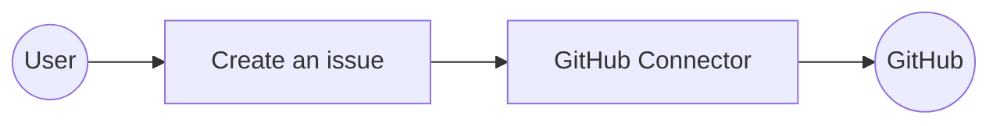
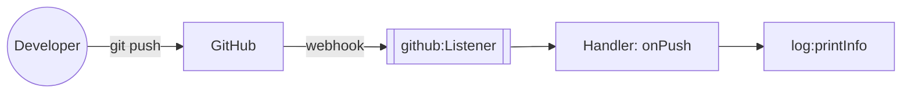

import ThemedImage from '@theme/ThemedImage';
import useBaseUrl from '@docusaurus/useBaseUrl';

# Example

## GitHub Example

### What you'll build

Build a WSO2 Integrator automation that connects to GitHub and programmatically opens an issue against any repository. The integration uses the `ballerinax/github` connector to authenticate with a personal access token and call the Create an issue operation.

**Operations used:**
- **Create an issue** : Opens a new GitHub issue on a specified repository with a title, body, and labels.

### Architecture



### Prerequisites

- A GitHub personal access token with `repo` scope

### Setting up the GitHub integration

> **New to WSO2 Integrator?** Follow the [Create a New Integration](product://integrator/develop-and-test/create-workspace) guide to set up your integration first, then return here to add the connector.

### Adding the GitHub connector

### Step 1: Open the add connection palette

Select **+ Add Artifact** on the Integration Design canvas. In the **Artifacts** panel, scroll to **Other Artifacts** and select **Connection**. The connector search palette appears with a search box and a grid of pre-built connectors.

<ThemedImage
    alt="GitHub connector palette open with search field before any selection"
    sources={{
        light: useBaseUrl('/img/connectors/catalog/developer-tools/github/github_screenshot_01_palette.png'),
        dark: useBaseUrl('/img/connectors/catalog/developer-tools/github/github_screenshot_01_palette.png'),
    }}
/>

### Configuring the GitHub connection

### Step 2: Fill in the connection parameters

Enter `github` in the search box to filter results, then select the **GitHub** connector card. In the connection configuration form, bind the connection fields to configurable variables:

- **Config** : Switch to **Expression** mode and enter `{auth: {token: githubAuthToken}}`, where `githubAuthToken` is a `string` configurable that holds the personal access token used to authenticate GitHub API requests
- **Connection Name** : Logical name for this connection (`githubClient`)

<ThemedImage
    alt="GitHub connection form fully filled with all parameters before saving"
    sources={{
        light: useBaseUrl('/img/connectors/catalog/developer-tools/github/github_screenshot_02_connection_form.png'),
        dark: useBaseUrl('/img/connectors/catalog/developer-tools/github/github_screenshot_02_connection_form.png'),
    }}
/>

### Step 3: Save the connection

Select **Save Connection**. The form closes and the canvas reloads, showing the `githubClient` node.

<ThemedImage
    alt="GitHub Connections panel showing githubClient entry after saving"
    sources={{
        light: useBaseUrl('/img/connectors/catalog/developer-tools/github/github_screenshot_03_connections_list.png'),
        dark: useBaseUrl('/img/connectors/catalog/developer-tools/github/github_screenshot_03_connections_list.png'),
    }}
/>

### Step 4: Set actual values for your configurables

1. In the left panel, select **Configurations**.
2. Set a value for each configurable listed below.

- **githubAuthToken** (string) : Your GitHub personal access token with `repo` scope

## Configuring the GitHub create an issue operation

### Step 5: Add an automation entry point

1. Select **+ Add Artifact** on the Integration Design canvas.
2. In the **Artifacts** panel, select **Automation**.
3. In the **Create New Automation** form, leave the defaults and select **Create**.

WSO2 Integrator creates a `main` automation under **Entry Points** and opens the Automation flow canvas.

### Step 6: Select the create an issue operation

On the Automation canvas, select the **+** between **Start** and **Error Handler** to open the node panel. Under the **Connections** section, expand `githubClient` to reveal all available operations.

<ThemedImage
    alt="GitHub connection node expanded showing all available operations before selection"
    sources={{
        light: useBaseUrl('/img/connectors/catalog/developer-tools/github/github_screenshot_04_operations_panel.png'),
        dark: useBaseUrl('/img/connectors/catalog/developer-tools/github/github_screenshot_04_operations_panel.png'),
    }}
/>

### Step 7: Configure the create an issue operation

Select **Create an issue** from the operations list and fill in all required fields in the configuration form:

- **owner** : Account owner of the repository (for example, `wso2`)
- **repo** : Repository name without the `.git` extension (for example, `ballerina-library`)
- **payload.title** : Title of the GitHub issue
- **payload.body** : Body text and description for the issue
- **payload.labels** : Array of label names to apply to the issue
- **Result** : Variable to store the API response (`issueResponse`)

Select **Save** to apply the configuration.

<ThemedImage
    alt="GitHub Create an issue operation configuration filled with all values"
    sources={{
        light: useBaseUrl('/img/connectors/catalog/developer-tools/github/github_screenshot_05_operation_values.png'),
        dark: useBaseUrl('/img/connectors/catalog/developer-tools/github/github_screenshot_05_operation_values.png'),
    }}
/>

<ThemedImage
    alt="Completed GitHub automation flow"
    sources={{
        light: useBaseUrl('/img/connectors/catalog/developer-tools/github/github_screenshot_06_completed_flow.png'),
        dark: useBaseUrl('/img/connectors/catalog/developer-tools/github/github_screenshot_06_completed_flow.png'),
    }}
/>

### Try it yourself

Try this sample in WSO2 Integration Platform.

[](https://console.devant.dev/new?gh=wso2/integration-samples/tree/main/integrator-default-profile/connectors/github_connector_sample)

[View source on GitHub](https://github.com/wso2/integration-samples/tree/main/integrator-default-profile/connectors/github_connector_sample)

### More code examples

The `GitHub` connector provides practical examples illustrating usage in various scenarios. Explore these [examples](https://github.com/ballerina-platform/module-ballerinax-github/tree/master/examples), covering use cases like initializing a new project, creating issues, and managing pull requests.

1. [Initialize a New GitHub Project](https://github.com/ballerina-platform/module-ballerinax-github/tree/master/examples/initialize-new-project) - Create a new repository on GitHub, initialize it with a README file, and add collaborators to the repository.

2. [Create and Assign an Issue in GitHub](https://github.com/ballerina-platform/module-ballerinax-github/tree/master/examples/create-and-assign-issue) - Create a new issue on GitHub, assign it to a specific user, and add labels.

3. [Create and Manage a PullRequest in GitHub](https://github.com/ballerina-platform/module-ballerinax-github/tree/master/examples/create-and-manage-pull-request) - Create a pull request on GitHub, and request changes as necessary.

4. [Star Ballerina-Platform Repositories](https://github.com/ballerina-platform/module-ballerinax-github/tree/master/examples/star-ballerina-repositories) - Fetch all repositories under the `ballerina-platform` organization on GitHub and star each of them

## GitHub Trigger Example

### What you'll build

This integration logs every push to a GitHub repository. When someone pushes commits, GitHub sends a webhook to the `github:Listener`, which verifies it and calls the `onPush` handler of a `github:PushService`. The handler logs the pusher, the branch and each commit.

:::info
This example uses the `ballerinax/github.trigger` package, which receives GitHub webhook events. It is separate from the `ballerinax/github` connector, which calls the GitHub API.
:::

### Architecture



### Prerequisites

- A GitHub repository you can add a webhook to. See the [Setup Guide](setup-guide.md#configuring-a-github-repository-webhook).
- A public URL for the listener, such as one from ngrok, for GitHub to deliver to.

### Setting up the GitHub integration

> **New to WSO2 Integrator?** Follow the [Create a New Integration](product://integrator/develop-and-test/create-workspace) guide to set up your integration first, then return here to add the trigger.

### Adding the GitHub trigger

### Step 1: Open the artifacts palette

Select **Add Artifact** to open the artifacts palette. Select the **Event Integration** category and locate the **GitHub** card.

<ThemedImage
    alt="Artifacts palette showing the Event Integration category with the GitHub card"
    sources={{
        light: useBaseUrl('/img/connectors/catalog/developer-tools/github/github_trigger_screenshots_01_artifact_palette.png'),
        dark: useBaseUrl('/img/connectors/catalog/developer-tools/github/github_trigger_screenshots_01_artifact_palette.png'),
    }}
/>

### Configuring the GitHub listener

### Step 2: Fill in the GitHub Event Integration form

Select the **GitHub** card to open the **GitHub Event Integration** form, and set:

- **Event Channel**: `github:PushService`, the default.
- **Listener**: **Create New Listener**, named `githubListener`.
- **Webhook Listener Port**: `8090`, the default.
- **Webhook Secret**: bind it to a new configurable variable named `webhookSecret`.

<ThemedImage
    alt="GitHub Event Integration form with Event Channel set to github:PushService, a new listener on port 8090, and Webhook Secret bound to the webhookSecret configurable"
    sources={{
        light: useBaseUrl('/img/connectors/catalog/developer-tools/github/github_trigger_screenshots_02_trigger_config_form.png'),
        dark: useBaseUrl('/img/connectors/catalog/developer-tools/github/github_trigger_screenshots_02_trigger_config_form.png'),
    }}
/>

### Step 3: Set the webhook secret

In the left panel, select **Configurations** and set **webhookSecret** to the secret you set on the GitHub webhook. The listener rejects every delivery until it is set.

<ThemedImage
    alt="Configurations panel showing the webhookSecret configurable"
    sources={{
        light: useBaseUrl('/img/connectors/catalog/developer-tools/github/github_trigger_screenshots_03_configurations_panel.png'),
        dark: useBaseUrl('/img/connectors/catalog/developer-tools/github/github_trigger_screenshots_03_configurations_panel.png'),
    }}
/>

### Step 4: Create the trigger

Select **Create**. WSO2 Integrator adds the listener and a `github:PushService` attached to it.

### Handling GitHub events

### Step 5: Open the onPush handler

Open the **github:PushService** service. It has one event handler, `onPush`, which receives a `github:PushPayload`.

<ThemedImage
    alt="github:PushService view showing the onPush event handler attached to githubListener"
    sources={{
        light: useBaseUrl('/img/connectors/catalog/developer-tools/github/github_trigger_screenshots_04_add_handler_panel.png'),
        dark: useBaseUrl('/img/connectors/catalog/developer-tools/github/github_trigger_screenshots_04_add_handler_panel.png'),
    }}
/>

### Step 6: Log the push

Select **onPush** to open its flow. Select the **+** icon, choose **Log Info** from the **Logging** section, and log the branch and the number of commits. The handler's code is:

```ballerina
remote function onPush(github:PushPayload payload) returns error? {
    log:printInfo("Push received", ref = payload.ref, commitCount = payload.commits.length(),
            repository = payload.repository.fullName);
}
```

<ThemedImage
    alt="onPush handler flow with a log:printInfo node logging the ref and commit count"
    sources={{
        light: useBaseUrl('/img/connectors/catalog/developer-tools/github/github_trigger_screenshots_06_handler_flow.png'),
        dark: useBaseUrl('/img/connectors/catalog/developer-tools/github/github_trigger_screenshots_06_handler_flow.png'),
    }}
/>

### Running the integration

1. Run the integration from WSO2 Integrator. The listener starts on port `8090`.
2. Expose the port, for example with `ngrok http 8090`, and add a webhook to your repository with that URL as the **Payload URL**, content type `application/json`, the **Push** event, and the same secret as `webhookSecret`. See the [Setup Guide](setup-guide.md#configuring-a-github-repository-webhook).
3. GitHub sends a `ping` when the webhook is saved. A green check under the webhook's **Recent Deliveries** shows that the listener verified it.
4. Push a commit to the repository. The `onPush` handler logs the push in the WSO2 Integrator console.

If a delivery shows `401` under **Recent Deliveries**, the secret on the webhook and `webhookSecret` don't match. The console logs `WEBHOOK_SIGNATURE_REJECTED` with the reason.

## What's next

- [GitHub Webhooks](product://integrator/develop-and-test/integration-artifacts/event-driven-integration/github-webhooks): full reference for all event channels and handlers
- [Setup Guide](setup-guide.md): create a GitHub Personal Access Token and configure a repository webhook
- [Action Reference](actions.md): full list of REST API operations and sample code

