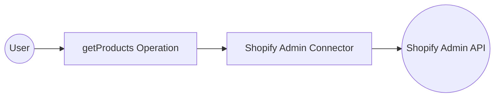
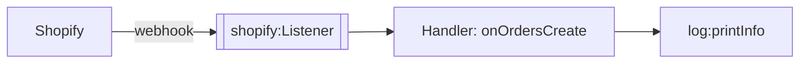

import ThemedImage from '@theme/ThemedImage';
import useBaseUrl from '@docusaurus/useBaseUrl';

# Example

## Table of Contents

- [Shopify Connector Example](#shopify-connector-example)
- [Shopify Trigger Example](#shopify-trigger-example)

## Shopify Connector Example

### What you'll build

Create a WSO2 Integrator automation that connects to the Shopify Admin API using the **ballerinax/shopify.admin** connector. The integration is triggered on a scheduled interval and calls the `getProducts` operation to retrieve a list of products from your Shopify store's Admin API. The complete flow, Automation trigger → Shopify Admin connector call → End, is assembled entirely in the WSO2 Integrator low-code canvas.

**Operations used:**
- **getProducts** : Retrieves a list of products from the Shopify store's Admin API

### Architecture



### Prerequisites

- A Shopify store with Admin API access enabled (a Shopify Partner account or development store is sufficient).
- A Shopify Admin API access token with the necessary permissions for the operation being called (e.g., `read_products`).
- The Shopify store's base URL in the format `https://{your-store}.myshopify.com/admin/api/{api-version}`.

### Setting up the Shopify admin integration

> **New to WSO2 Integrator?** Follow the [Create a New Integration](product://integrator/develop-and-test/create-workspace) guide to set up your integration first, then return here to add the connector.

### Adding the Shopify admin connector

### Step 1: Open the add connection palette

Select the **+ Add Connection** button in the **Connections** section of the low-code canvas sidebar to open the connector search palette.

<ThemedImage
    alt="Connector palette open showing the search field and available connectors"
    sources={{
        light: useBaseUrl('/img/connectors/catalog/ecommerce/shopify.admin/shopify_admin_screenshot_01_palette.png'),
        dark: useBaseUrl('/img/connectors/catalog/ecommerce/shopify.admin/shopify_admin_screenshot_01_palette.png'),
    }}
/>

### Step 2: Search for and select the shopify.admin connector

1. In the search box, enter **shopify** to filter the connector list.
2. Locate the **Admin** connector card (labelled `ballerinax / shopify.admin`) in the search results.
3. Select the connector card to open the connection configuration form.

### Configuring the Shopify admin connection

### Step 3: Bind Shopify admin connection parameters to configurables

For each connection field, use the **Configurables** tab to create a new configurable variable and auto-inject the reference into the field.

- **Api Key Config** : API keys for authorization. Contains the `xShopifyAccessToken` field, which represents the Shopify Admin API access token (`X-Shopify-Access-Token` header).
- **Service Url** : The base URL of the Shopify Admin API endpoint for your store.

<ThemedImage
    alt="Connection form with all Shopify Admin parameters bound to configurable variables"
    sources={{
        light: useBaseUrl('/img/connectors/catalog/ecommerce/shopify.admin/shopify_admin_screenshot_02_connection_form.png'),
        dark: useBaseUrl('/img/connectors/catalog/ecommerce/shopify.admin/shopify_admin_screenshot_02_connection_form.png'),
    }}
/>

### Step 4: Save the shopify.admin connection

Select **Save Connection** to persist the connection configuration. The shopify.admin connector now appears as a named connection entry (`adminClient`) in the **Connections** panel on the low-code canvas.

<ThemedImage
    alt="Low-code canvas showing the saved shopify.admin connection entry"
    sources={{
        light: useBaseUrl('/img/connectors/catalog/ecommerce/shopify.admin/shopify_admin_screenshot_03_connections_list.png'),
        dark: useBaseUrl('/img/connectors/catalog/ecommerce/shopify.admin/shopify_admin_screenshot_03_connections_list.png'),
    }}
/>

### Step 5: Set actual values for your configurables

1. In the left panel of WSO2 Integrator, select **Configurations** (listed at the bottom of the project tree, under **Data Mappers**).
2. Set a value for each configurable listed below.

- **shopifyAccessToken** (string) : Your Shopify Admin API access token (found in your Shopify Partner dashboard or app settings)
- **shopifyServiceUrl** (string) : The full base URL of your Shopify Admin API, e.g., `https://your-store.myshopify.com/admin/api/2024-01`

### Configuring the Shopify admin getProducts operation

### Step 6: Add an automation entry point

1. In the left sidebar, hover over **Entry Points** and select **Add Entry Point**.
2. Select **Automation** in the artifact selection panel.
3. Select **Create** to confirm and create the automation entry point.

### Step 7: Select the getProducts operation and configure its parameters

1. Select the **+** (Add Step) button in the automation flow between the **Start** and **Error Handler** nodes to open the step-addition panel.
2. Under **Connections** in the node panel, select the **adminClient** connection node to expand it and reveal all available Shopify Admin API operations.

<ThemedImage
    alt="shopify.admin connection node expanded showing all available operations before selection"
    sources={{
        light: useBaseUrl('/img/connectors/catalog/ecommerce/shopify.admin/shopify_admin_screenshot_04_operations_panel.png'),
        dark: useBaseUrl('/img/connectors/catalog/ecommerce/shopify.admin/shopify_admin_screenshot_04_operations_panel.png'),
    }}
/>

3. Select **Get Products** from the list of operations, then verify the operation fields:
   - **Result** : The variable name that will hold the Shopify API response (auto-filled as `adminProductlist`)
   - **Result Type** : The type of the result variable (`admin:ProductList`)
4. Select **Save** to add the Shopify Admin operation step to the automation flow.

<ThemedImage
    alt="Operation configuration panel showing all filled values for the Shopify Admin operation"
    sources={{
        light: useBaseUrl('/img/connectors/catalog/ecommerce/shopify.admin/shopify_admin_screenshot_05_operation_filled.png'),
        dark: useBaseUrl('/img/connectors/catalog/ecommerce/shopify.admin/shopify_admin_screenshot_05_operation_filled.png'),
    }}
/>

<ThemedImage
    alt="Completed automation flow showing the Shopify Admin operation connected end-to-end"
    sources={{
        light: useBaseUrl('/img/connectors/catalog/ecommerce/shopify.admin/shopify_admin_screenshot_06_completed_flow.png'),
        dark: useBaseUrl('/img/connectors/catalog/ecommerce/shopify.admin/shopify_admin_screenshot_06_completed_flow.png'),
    }}
/>

### Try it yourself

Try this sample in WSO2 Integration Platform.

[](https://console.devant.dev/new?gh=wso2/integration-samples/tree/main/integrator-default-profile/connectors/shopify.admin_connector_sample)

[View source on GitHub](https://github.com/wso2/integration-samples/tree/main/integrator-default-profile/connectors/shopify.admin_connector_sample)


---
## Shopify Trigger Example

### What you'll build

This integration logs every new order in a Shopify store. Shopify sends each event to the `shopify:Listener`, which verifies it and calls the `onOrdersCreate` handler of a `shopify:OrdersService`. The handler logs the order's ID and name.

:::info
This example uses the `ballerinax/shopify.trigger` package, which receives Shopify events. It is separate from the `ballerinax/shopify.admin` connector, which calls the Shopify API.
:::

### Architecture



### Prerequisites

- A Shopify app subscribed to the `orders/create` topic. See the [Setup Guide](setup-guide.md#configuring-shopify-webhooks).
- A public URL for the listener, such as one from ngrok, for Shopify to deliver to.

### Setting up the Shopify integration

> **New to WSO2 Integrator?** Follow the [Create a New Integration](product://integrator/develop-and-test/create-workspace) guide to set up your integration first, then return here to add the trigger.

### Adding the Shopify trigger

### Step 1: Open the artifacts palette

Select **Add Artifact** to open the artifacts palette. Search for `shopify.trigger` and find the **shopify.trigger** card under **More on Ballerina Central**. Don't use the built-in **Shopify** card under **Event Integration**; it creates the older `trigger.shopify` package.

<ThemedImage
    alt="Artifacts palette search results showing the shopify.trigger package from Ballerina Central"
    sources={{
        light: useBaseUrl('/img/connectors/catalog/ecommerce/shopify.admin/shopify_screenshot_01_artifact_palette.png'),
        dark: useBaseUrl('/img/connectors/catalog/ecommerce/shopify.admin/shopify_screenshot_01_artifact_palette.png'),
    }}
/>

### Configuring the Shopify listener

### Step 2: Fill in the Shopify Event Integration form

Select the **shopify.trigger** card to open the **Shopify Event Integration** form, and set:

- **Event Type**: `shopify:OrdersService`, the default.
- **Listener**: **Create New Listener**, named `shopifyListener`.
- **Webhook Listener Port**: `8090`, the default.
- **Webhook Secret**: bind it to a new configurable variable named `webhookSecret`.

<ThemedImage
    alt="Shopify Event Integration form with Event Type set to OrdersService and a new listener on port 8090"
    sources={{
        light: useBaseUrl('/img/connectors/catalog/ecommerce/shopify.admin/shopify_screenshot_02_trigger_config_form.png'),
        dark: useBaseUrl('/img/connectors/catalog/ecommerce/shopify.admin/shopify_screenshot_02_trigger_config_form.png'),
    }}
/>

### Step 3: Set the configurable values

In the left panel, select **Configurations** and set **webhookSecret** to your Shopify app's client secret. The listener rejects every delivery until **webhookSecret** is set.

<ThemedImage
    alt="Configurations panel showing the webhookSecret configurable"
    sources={{
        light: useBaseUrl('/img/connectors/catalog/ecommerce/shopify.admin/shopify_screenshot_03_configurations_panel.png'),
        dark: useBaseUrl('/img/connectors/catalog/ecommerce/shopify.admin/shopify_screenshot_03_configurations_panel.png'),
    }}
/>

### Step 4: Create the trigger

Select **Create**. WSO2 Integrator adds the listener and a `shopify:OrdersService` attached to it.

### Handling Shopify events

### Step 5: Open the onOrdersCreate handler

Open the **shopify:OrdersService** service. It lists all 6 of its event handlers, including `onOrdersCreate`, which receives a `shopify:OrderEvent`. Leave the other handlers empty.

<ThemedImage
    alt="OrdersService view showing the onOrdersCreate event handler attached to the listener"
    sources={{
        light: useBaseUrl('/img/connectors/catalog/ecommerce/shopify.admin/shopify_screenshot_04_add_handler_panel.png'),
        dark: useBaseUrl('/img/connectors/catalog/ecommerce/shopify.admin/shopify_screenshot_04_add_handler_panel.png'),
    }}
/>

### Step 6: Log the event

Select **onOrdersCreate** to open its flow. Select the **+** icon, choose **Log Info** from the **Logging** section, and log the order's ID and name. The handler's code is:

```ballerina
remote function onOrdersCreate(shopify:OrderEvent payload) returns error? {
    log:printInfo("Order created", id = payload.id, name = payload.name);
}
```

<ThemedImage
    alt="onOrdersCreate handler flow with a log:printInfo node"
    sources={{
        light: useBaseUrl('/img/connectors/catalog/ecommerce/shopify.admin/shopify_screenshot_06_handler_flow.png'),
        dark: useBaseUrl('/img/connectors/catalog/ecommerce/shopify.admin/shopify_screenshot_06_handler_flow.png'),
    }}
/>

### Running the integration

1. Run the integration from WSO2 Integrator. The listener starts on port `8090`.
2. Expose the port, for example with `ngrok http 8090`, and point Shopify at it. See the [Setup Guide](setup-guide.md#configuring-shopify-webhooks).
3. Create an order in your development store, for example from **Orders**, then **Create order** in the Shopify admin.
4. The `onOrdersCreate` handler logs the event in the WSO2 Integrator console.

If Shopify reports `401` for a delivery, the listener rejected its signature. The console logs `WEBHOOK_SIGNATURE_REJECTED` with the reason; check that **webhookSecret** is your Shopify app's client secret.
