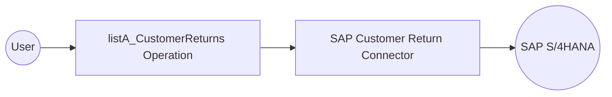

import ThemedImage from '@theme/ThemedImage';
import useBaseUrl from '@docusaurus/useBaseUrl';

# Example

## What you'll build

Build an integration workflow that connects to an SAP S/4HANA system and retrieves customer returns. The workflow calls the Customer Return (A2X) API and logs the result as JSON.

**Operations used:**
- **listA_CustomerReturns** : Reads customer return (returns order) headers from the SAP S/4HANA system, returning the first 10 results

## Architecture

## Prerequisites

- Access to an SAP S/4HANA Cloud system with a communication user assigned to the communication arrangement this connector needs (see the [Setup Guide](setup-guide.md))

## Setting up the SAP Customer Return integration

> **New to WSO2 Integrator?** Follow the [Create a New Integration](product://integrator/develop-and-test/create-workspace) guide to set up your integration first, then return here to add the connector.

## Adding the SAP Customer Return connector

### Step 1: Open the connector palette and search for the connector

Select **Add Artifact**, then select **Connection** to open the connector palette. Search for `api_customer_return_srv` and select the **Api_customer_return_srv** connector card.

<ThemedImage
    alt="Add Connection palette open with the search field before any selection"
    sources={{
        light: useBaseUrl('/img/connectors/catalog/erp-business/sap.s4hana.api_customer_return_srv/sap_s4hana_apicustomerreturnsrv_screenshot_01_palette.png'),
        dark: useBaseUrl('/img/connectors/catalog/erp-business/sap.s4hana.api_customer_return_srv/sap_s4hana_apicustomerreturnsrv_screenshot_01_palette.png'),
    }}
/>

## Configuring the SAP Customer Return connection

### Step 2: Fill in the connection parameters

Enter the connection parameters, binding each field to a configurable variable:

- **Config** : `ConnectionConfig` record with Basic Authentication credentials; switch to **Expression** and enter `{auth: {username: sapS4HanaUsername, password: sapS4HanaPassword}}`
- **Hostname** : SAP S/4HANA API hostname; bind to the `sapS4HanaHostname` configurable variable
- **Port** : Leave empty to use the default port `443`
- **Connection Name** : Keep the default `apiCustomerReturnSrvClient`

<ThemedImage
    alt="SAP Customer Return connection form filled with configurable variables before saving"
    sources={{
        light: useBaseUrl('/img/connectors/catalog/erp-business/sap.s4hana.api_customer_return_srv/sap_s4hana_apicustomerreturnsrv_screenshot_02_connection_form.png'),
        dark: useBaseUrl('/img/connectors/catalog/erp-business/sap.s4hana.api_customer_return_srv/sap_s4hana_apicustomerreturnsrv_screenshot_02_connection_form.png'),
    }}
/>

### Step 3: Save the connection

Select **Save Connection**. The connection appears under **Connections** in the project tree and on the design canvas.

<ThemedImage
    alt="Design canvas showing the saved apiCustomerReturnSrvClient connection"
    sources={{
        light: useBaseUrl('/img/connectors/catalog/erp-business/sap.s4hana.api_customer_return_srv/sap_s4hana_apicustomerreturnsrv_screenshot_03_connection_saved.png'),
        dark: useBaseUrl('/img/connectors/catalog/erp-business/sap.s4hana.api_customer_return_srv/sap_s4hana_apicustomerreturnsrv_screenshot_03_connection_saved.png'),
    }}
/>

### Step 4: Set actual values for your configurables

1. In the left panel, select **Configurations**.
2. Set a value for each configurable listed below:

- **sapS4HanaHostname** (string) : The API hostname of your SAP S/4HANA Cloud system, for example, `my123456-api.s4hana.cloud.sap`
- **sapS4HanaUsername** (string) : The communication user name
- **sapS4HanaPassword** (string) : The communication user password

## Configuring the SAP Customer Return listA_CustomerReturns operation

### Step 5: Add an automation entry point

Select **Add Artifact**, then select **Automation** and select **Create** to add the automation entry point to the canvas.

### Step 6: Select and configure the listA_CustomerReturns operation

1. On the automation canvas, select the **+** button to add a step.
2. Expand the **apiCustomerReturnSrvClient** connection under **Connections**.

<ThemedImage
    alt="apiCustomerReturnSrvClient connection expanded in the node panel showing the available operations"
    sources={{
        light: useBaseUrl('/img/connectors/catalog/erp-business/sap.s4hana.api_customer_return_srv/sap_s4hana_apicustomerreturnsrv_screenshot_04_operations.png'),
        dark: useBaseUrl('/img/connectors/catalog/erp-business/sap.s4hana.api_customer_return_srv/sap_s4hana_apicustomerreturnsrv_screenshot_04_operations.png'),
    }}
/>

3. Select **List A Customer Returns** (`listA_CustomerReturns`) and configure it:

- **$top** : Under **Advanced Configurations**, set to `10` to limit the results to the first 10 records
- **Result** : Set the result variable name to `result`

<ThemedImage
    alt="listA_CustomerReturns operation form with $top set to 10"
    sources={{
        light: useBaseUrl('/img/connectors/catalog/erp-business/sap.s4hana.api_customer_return_srv/sap_s4hana_apicustomerreturnsrv_screenshot_05_operation_form.png'),
        dark: useBaseUrl('/img/connectors/catalog/erp-business/sap.s4hana.api_customer_return_srv/sap_s4hana_apicustomerreturnsrv_screenshot_05_operation_form.png'),
    }}
/>

4. Select **Save** to add the operation to the flow, then add a **Log Info** step after it that logs `result.toJsonString()` in **Expression** mode.

<ThemedImage
    alt="Completed automation flow with the listA_CustomerReturns operation and a log step"
    sources={{
        light: useBaseUrl('/img/connectors/catalog/erp-business/sap.s4hana.api_customer_return_srv/sap_s4hana_apicustomerreturnsrv_screenshot_06_completed_flow.png'),
        dark: useBaseUrl('/img/connectors/catalog/erp-business/sap.s4hana.api_customer_return_srv/sap_s4hana_apicustomerreturnsrv_screenshot_06_completed_flow.png'),
    }}
/>

## Try it yourself

Try this sample in WSO2 Integration Platform.

[View source on GitHub](https://github.com/wso2/integration-samples/tree/main/integrator-default-profile/connectors/sap.s4hana.api_customer_return_srv_connector_sample)

## More code examples

The S/4 HANA Sales and Distribution Ballerina connectors provide practical examples illustrating usage in various
scenarios. Explore
these [examples](https://github.com/ballerina-platform/module-ballerinax-sap.s4hana.sales/tree/main/examples), covering
use cases like accessing S/4HANA Sales Order (A2X) API.

1. [Salesforce to S/4HANA Integration](https://github.com/ballerina-platform/module-ballerinax-sap.s4hana.sales/tree/main/examples/salesforce-to-sap) -
   Demonstrates leveraging the `sap.s4hana.api_sales_order_srv:Client` in Ballerina for S/4HANA API interactions. It
   specifically showcases how to respond to a Salesforce Opportunity Close Event by automatically generating a Sales
   Order in the S/4HANA SD module.

2. [Shopify to S/4HANA Integration](https://github.com/ballerina-platform/module-ballerinax-sap.s4hana.sales/tree/main/examples/shopify-to-sap) -
   Details the integration process between [Shopify](https://admin.shopify.com/), a leading e-commerce platform,
   and [SAP S/4HANA](https://www.sap.com/products/erp/s4hana.html), a comprehensive ERP system. The objective is to
   automate SAP sales order creation for new orders placed on Shopify, enhancing efficiency and accuracy in order
   management.
