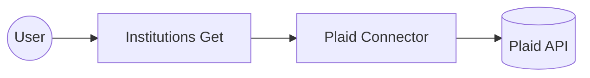

import ThemedImage from '@theme/ThemedImage';
import useBaseUrl from '@docusaurus/useBaseUrl';

# Example

## What you'll build

This integration connects to Plaid and lists the institutions that Plaid supports in the United States. An automation entry point runs the operation once and logs the returned institutions.

**Operations used:**
- **Institutions Get** : Gets details of the institutions that Plaid supports

## Architecture

## Prerequisites

- A Plaid account. A new account has immediate access to the Sandbox environment.
- The `client_id` and the Sandbox secret from the Plaid Dashboard (**Developers**, then **Keys**).

## Setting up the Plaid integration

> **New to WSO2 Integrator?** Follow the [Create a New Integration](product://integrator/develop-and-test/create-workspace) guide to set up your integration first, then return here to add the connector.

## Adding the Plaid connector

### Step 1: Open the connector palette

Hover over **Connections** in the project tree and select **Add Connection** (**+**).

<ThemedImage
    alt="Plaid connector palette open before selection"
    sources={{
        light: useBaseUrl('/img/connectors/catalog/finance-accounting/plaid/ballerinax_plaid_screenshot_01_palette.png'),
        dark: useBaseUrl('/img/connectors/catalog/finance-accounting/plaid/ballerinax_plaid_screenshot_01_palette.png'),
    }}
/>

### Step 2: Select the Plaid connector

1. Enter `plaid` in the search field.
2. Select the **Plaid** connector card.

## Configuring the Plaid connection

### Step 3: Bind the connection parameters to configurable variables

Bind each connection field to a configurable variable. Use the **Configurables** tab of the field's helper panel to create each configurable.

- **Config** : Connection settings, with the Plaid API keys set in the `auth` record. Switch the field to **Expression** and enter `{auth: {plaidClientId: plaidClientId, plaidSecret: plaidSecret, plaidVersion: plaidVersion}}`.
- **Service Url** : Set it to the `plaidServiceUrl` configurable.

<ThemedImage
    alt="Plaid connection form with all parameters bound before saving"
    sources={{
        light: useBaseUrl('/img/connectors/catalog/finance-accounting/plaid/ballerinax_plaid_screenshot_02_connection_form.png'),
        dark: useBaseUrl('/img/connectors/catalog/finance-accounting/plaid/ballerinax_plaid_screenshot_02_connection_form.png'),
    }}
/>

### Step 4: Save the connection

Select **Save Connection** and verify that **plaidClient** appears under **Connections** in the project tree and on the design canvas.

<ThemedImage
    alt="Plaid connection visible after saving"
    sources={{
        light: useBaseUrl('/img/connectors/catalog/finance-accounting/plaid/ballerinax_plaid_screenshot_03_connections_list.png'),
        dark: useBaseUrl('/img/connectors/catalog/finance-accounting/plaid/ballerinax_plaid_screenshot_03_connections_list.png'),
    }}
/>

### Step 5: Set actual values for your configurables

1. Select **Configurations** at the bottom of the project tree.
2. Enter a value for each configurable listed below before you run the integration.

- **plaidServiceUrl** (`string`) : Plaid API base URL. Defaults to `https://sandbox.plaid.com`; use `https://production.plaid.com` for Production.
- **plaidClientId** (`string`) : Your Plaid `client_id`.
- **plaidSecret** (`string`) : The Plaid secret for the environment you call.
- **plaidVersion** (`string`) : Plaid API version. Defaults to `2020-09-14`.

## Configuring the Plaid Institutions Get operation

### Step 6: Add an automation entry point

1. Select **Add Artifact** on the design canvas.
2. Select **Automation**.
3. Select **Create** to accept the settings.

### Step 7: Expand the connection and configure the Institutions Get operation

1. Select the **+** between **Start** and **Error Handler** in the automation flow.
2. Expand **plaidClient** under **Connections** to display its operations.

<ThemedImage
    alt="Plaid connection expanded to display operations before selection"
    sources={{
        light: useBaseUrl('/img/connectors/catalog/finance-accounting/plaid/ballerinax_plaid_screenshot_04_operations_panel.png'),
        dark: useBaseUrl('/img/connectors/catalog/finance-accounting/plaid/ballerinax_plaid_screenshot_04_operations_panel.png'),
    }}
/>

3. Select **Institutions Get** and enter its required values.

- **Payload** : Switch the field to **Expression** and enter `{offset: 0, count: 10, countryCodes: ["US"]}`.
- **Result** : Set it to `institutions`, the variable that stores the returned institutions.

<ThemedImage
    alt="Plaid Institutions Get operation with all values entered before saving"
    sources={{
        light: useBaseUrl('/img/connectors/catalog/finance-accounting/plaid/ballerinax_plaid_screenshot_05_operation_form.png'),
        dark: useBaseUrl('/img/connectors/catalog/finance-accounting/plaid/ballerinax_plaid_screenshot_05_operation_form.png'),
    }}
/>

4. Select **Save**.

### Step 8: Log the Institutions Get result

1. Select the **+** below the **Institutions Get** node.
2. Under **Logging**, select **Log Info**.
3. Switch **Msg** to **Expression**, enter `institutions.toString()`, and select **Save**.

<ThemedImage
    alt="Completed Plaid flow with the configured operation"
    sources={{
        light: useBaseUrl('/img/connectors/catalog/finance-accounting/plaid/ballerinax_plaid_screenshot_06_completed_flow.png'),
        dark: useBaseUrl('/img/connectors/catalog/finance-accounting/plaid/ballerinax_plaid_screenshot_06_completed_flow.png'),
    }}
/>

## Try it yourself

Try this sample in WSO2 Integration Platform.

[View source on GitHub](https://github.com/wso2/integration-samples/tree/main/integrator-default-profile/connectors/plaid_connector_sample)

## More code examples

The Plaid connector provides practical examples illustrating usage in various scenarios. Explore these [examples](https://github.com/ballerina-platform/module-ballerinax-plaid/tree/main/examples/), covering the following use cases:

1. [Sandbox account balance check](https://github.com/ballerina-platform/module-ballerinax-plaid/tree/main/examples/sandbox_account_balance_check) - Link a Sandbox test institution, then list each account's real-time balance with its ACH numbers.
2. [Category spending summary](https://github.com/ballerina-platform/module-ballerinax-plaid/tree/main/examples/category_spending_summary) - Page through an Item's transactions with `/transactions/sync` and total the outflows by spending category.
