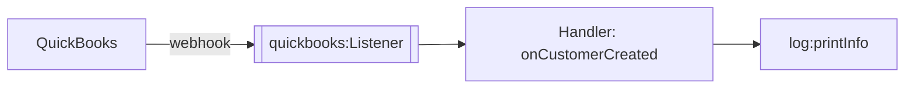

import ThemedImage from '@theme/ThemedImage';
import useBaseUrl from '@docusaurus/useBaseUrl';

# Example

## QuickBooks Trigger Example

### What you'll build

This integration logs every customer created in a QuickBooks Online company. QuickBooks sends each event to the `quickbooks:Listener`, which verifies it and calls the `onCustomerCreated` handler of a `quickbooks:CustomerService`. The handler logs the customer's ID and the company ID.

### Architecture



### Prerequisites

- An Intuit app whose webhooks send **Customer** events, in the CloudEvents format, to the listener. See the [Setup Guide](setup-guide.md#configuring-quickbooks-webhooks).
- A public URL for the listener, such as one from ngrok, for QuickBooks to deliver to.

### Setting up the QuickBooks integration

> **New to WSO2 Integrator?** Follow the [Create a New Integration](product://integrator/develop-and-test/create-workspace) guide to set up your integration first, then return here to add the trigger.

### Adding the QuickBooks trigger

### Step 1: Open the artifacts palette

Select **Add Artifact** to open the artifacts palette. Search for `quickbooks.trigger` and find the **quickbooks.trigger** card under **More on Ballerina Central**.

<ThemedImage
    alt="Artifacts palette search results showing the quickbooks.trigger package from Ballerina Central"
    sources={{
        light: useBaseUrl('/img/connectors/catalog/finance-accounting/quickbooks.trigger/quickbooks_trigger_screenshots_01_artifact_palette.png'),
        dark: useBaseUrl('/img/connectors/catalog/finance-accounting/quickbooks.trigger/quickbooks_trigger_screenshots_01_artifact_palette.png'),
    }}
/>

### Configuring the QuickBooks listener

### Step 2: Fill in the QuickBooks Event Integration form

Select the **quickbooks.trigger** card to open the **QuickBooks Event Integration** form, and set:

- **Event Channel**: `quickbooks:CustomerService`, the default.
- **Listener**: **Create New Listener**, named `quickbooksListener`.
- **Webhook Listener Port**: `8090`, the default.
- **Webhook Secret**: bind it to a new configurable variable named `verifierToken`.

<ThemedImage
    alt="QuickBooks Event Integration form with Event Channel set to CustomerService and a new listener on port 8090"
    sources={{
        light: useBaseUrl('/img/connectors/catalog/finance-accounting/quickbooks.trigger/quickbooks_trigger_screenshots_02_trigger_config_form.png'),
        dark: useBaseUrl('/img/connectors/catalog/finance-accounting/quickbooks.trigger/quickbooks_trigger_screenshots_02_trigger_config_form.png'),
    }}
/>

### Step 3: Set the configurable values

In the left panel, select **Configurations** and set **verifierToken** to your Intuit app's webhook verifier token. The listener rejects every delivery until **verifierToken** is set.

<ThemedImage
    alt="Configurations panel showing the verifierToken configurable"
    sources={{
        light: useBaseUrl('/img/connectors/catalog/finance-accounting/quickbooks.trigger/quickbooks_trigger_screenshots_03_configurations_panel.png'),
        dark: useBaseUrl('/img/connectors/catalog/finance-accounting/quickbooks.trigger/quickbooks_trigger_screenshots_03_configurations_panel.png'),
    }}
/>

### Step 4: Create the trigger

Select **Create**. WSO2 Integrator adds the listener and a `quickbooks:CustomerService` attached to it.

### Handling QuickBooks events

### Step 5: Open the onCustomerCreated handler

Open the **quickbooks:CustomerService** service. It lists all 4 of its event handlers, including `onCustomerCreated`, which receives a `quickbooks:QuickBookEvent`. Leave the other handlers empty.

<ThemedImage
    alt="CustomerService view showing the onCustomerCreated event handler attached to the listener"
    sources={{
        light: useBaseUrl('/img/connectors/catalog/finance-accounting/quickbooks.trigger/quickbooks_trigger_screenshots_04_add_handler_panel.png'),
        dark: useBaseUrl('/img/connectors/catalog/finance-accounting/quickbooks.trigger/quickbooks_trigger_screenshots_04_add_handler_panel.png'),
    }}
/>

### Step 6: Log the event

Select **onCustomerCreated** to open its flow. Select the **+** icon, choose **Log Info** from the **Logging** section, and log the customer's ID and the company ID. The handler's code is:

```ballerina
remote function onCustomerCreated(quickbooks:QuickBookEvent payload) returns error? {
    log:printInfo("Customer created", id = payload.intuitentityid, realm = payload.intuitaccountid);
}
```

<ThemedImage
    alt="onCustomerCreated handler flow with a log:printInfo node"
    sources={{
        light: useBaseUrl('/img/connectors/catalog/finance-accounting/quickbooks.trigger/quickbooks_trigger_screenshots_06_handler_flow.png'),
        dark: useBaseUrl('/img/connectors/catalog/finance-accounting/quickbooks.trigger/quickbooks_trigger_screenshots_06_handler_flow.png'),
    }}
/>

### Running the integration

1. Run the integration from WSO2 Integrator. The listener starts on port `8090`.
2. Expose the port, for example with `ngrok http 8090`, and point QuickBooks at it. See the [Setup Guide](setup-guide.md#configuring-quickbooks-webhooks).
3. Create a customer in your sandbox company.
4. The `onCustomerCreated` handler logs the event in the WSO2 Integrator console.

If QuickBooks reports `401` for a delivery, the listener rejected its signature. The console logs `WEBHOOK_SIGNATURE_REJECTED` with the reason; check that **verifierToken** is your Intuit app's webhook verifier token.

## What's next

- [QuickBooks](product://integrator/develop-and-test/integration-artifacts/event-driven-integration/quickbooks): every event channel and handler
- [Setup Guide](setup-guide.md#configuring-quickbooks-webhooks): point QuickBooks at your listener
- [Trigger Reference](triggers.md): listener configuration, callbacks and payload types
