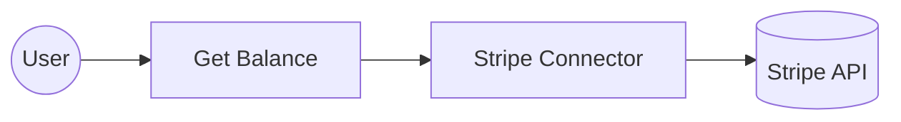

import ThemedImage from '@theme/ThemedImage';
import useBaseUrl from '@docusaurus/useBaseUrl';

# Example

## What you'll build

This integration connects to Stripe and retrieves the balance of the Stripe account. An automation entry point runs the operation once and logs the returned balance.

**Operations used:**
- **Get Balance** : Retrieves the current account balance

## Architecture

## Prerequisites

- A Stripe account. A test-mode account is enough.
- The secret key from the Stripe dashboard (**Developers**, then **API keys**). Follow the [Setup Guide](setup-guide.md) to get it.

## Setting up the Stripe integration

> **New to WSO2 Integrator?** Follow the [Create a New Integration](product://integrator/develop-and-test/create-workspace) guide to set up your integration first, then return here to add the connector.

## Adding the Stripe connector

### Step 1: Open the connector palette

Hover over **Connections** in the project tree and select **Add Connection** (**+**).

<ThemedImage
    alt="Stripe connector palette open before selection"
    sources={{
        light: useBaseUrl('/img/connectors/catalog/finance-accounting/stripe/ballerinax_stripe_screenshot_01_palette.png'),
        dark: useBaseUrl('/img/connectors/catalog/finance-accounting/stripe/ballerinax_stripe_screenshot_01_palette.png'),
    }}
/>

### Step 2: Select the Stripe connector

1. Enter `stripe` in the search field.
2. Select the **Stripe** connector card.

## Configuring the Stripe connection

### Step 3: Bind the connection parameters to configurable variables

Bind each connection field to a configurable variable. Use the **Configurables** tab of the field's helper panel to create each configurable.

- **Config** : Connection settings, with the secret key set in the `auth` record. Switch the field to **Expression** and enter `{auth: {token: stripeSecretKey}}`.
- **Service Url** : Set it to the `stripeServiceUrl` configurable.

<ThemedImage
    alt="Stripe connection form with all parameters bound before saving"
    sources={{
        light: useBaseUrl('/img/connectors/catalog/finance-accounting/stripe/ballerinax_stripe_screenshot_02_connection_form.png'),
        dark: useBaseUrl('/img/connectors/catalog/finance-accounting/stripe/ballerinax_stripe_screenshot_02_connection_form.png'),
    }}
/>

### Step 4: Save the connection

Select **Save Connection** and verify that **stripeClient** appears under **Connections** in the project tree and on the design canvas.

<ThemedImage
    alt="Stripe connection visible after saving"
    sources={{
        light: useBaseUrl('/img/connectors/catalog/finance-accounting/stripe/ballerinax_stripe_screenshot_03_connections_list.png'),
        dark: useBaseUrl('/img/connectors/catalog/finance-accounting/stripe/ballerinax_stripe_screenshot_03_connections_list.png'),
    }}
/>

### Step 5: Set actual values for your configurables

1. Select **Configurations** at the bottom of the project tree.
2. Enter a value for each configurable listed below before you run the integration.

- **stripeServiceUrl** (`string`) : Stripe API base URL. Defaults to `https://api.stripe.com/v1`.
- **stripeSecretKey** (`string`) : Your Stripe secret key. Use a test-mode key (starting with `sk_test_`) while you experiment.

## Configuring the Stripe Get Balance operation

### Step 6: Add an automation entry point

1. Select **Add Artifact** on the design canvas.
2. Select **Automation**.
3. Select **Create** to accept the settings.

### Step 7: Expand the connection and configure the Get Balance operation

1. Select the **+** between **Start** and **Error Handler** in the automation flow.
2. Expand **stripeClient** under **Connections** to display its operations.

<ThemedImage
    alt="Stripe connection expanded to display operations before selection"
    sources={{
        light: useBaseUrl('/img/connectors/catalog/finance-accounting/stripe/ballerinax_stripe_screenshot_04_operations_panel.png'),
        dark: useBaseUrl('/img/connectors/catalog/finance-accounting/stripe/ballerinax_stripe_screenshot_04_operations_panel.png'),
    }}
/>

3. Select **Get Balance**. The operation has no required parameters.

- **Result** : Set it to `balance`, the variable that stores the returned balance.

<ThemedImage
    alt="Stripe Get Balance operation with all values entered before saving"
    sources={{
        light: useBaseUrl('/img/connectors/catalog/finance-accounting/stripe/ballerinax_stripe_screenshot_05_operation_form.png'),
        dark: useBaseUrl('/img/connectors/catalog/finance-accounting/stripe/ballerinax_stripe_screenshot_05_operation_form.png'),
    }}
/>

4. Select **Save**.

### Step 8: Log the Get Balance result

1. Select the **+** below the **Get Balance** node.
2. Under **Logging**, select **Log Info**.
3. Switch **Msg** to **Expression**, enter `balance.toString()`, and select **Save**.

<ThemedImage
    alt="Completed Stripe flow with the configured operation"
    sources={{
        light: useBaseUrl('/img/connectors/catalog/finance-accounting/stripe/ballerinax_stripe_screenshot_06_completed_flow.png'),
        dark: useBaseUrl('/img/connectors/catalog/finance-accounting/stripe/ballerinax_stripe_screenshot_06_completed_flow.png'),
    }}
/>

## Try it yourself

Try this sample in WSO2 Integration Platform.

[View source on GitHub](https://github.com/wso2/integration-samples/tree/main/integrator-default-profile/connectors/stripe_connector_sample)

## More code examples

The Stripe connector provides practical examples illustrating usage in various scenarios. Explore these [examples](https://github.com/ballerina-platform/module-ballerinax-stripe/tree/main/examples).

1. [Manage Stripe payments](https://github.com/ballerina-platform/module-ballerinax-stripe/tree/main/examples/manage_payments) - Create a customer, take a payment with a payment intent, confirm it and refund it.
2. [Manage one-time charges](https://github.com/ballerina-platform/module-ballerinax-stripe/tree/main/examples/manage_one_time_charges) - Create, retrieve and refund a one-time charge.
