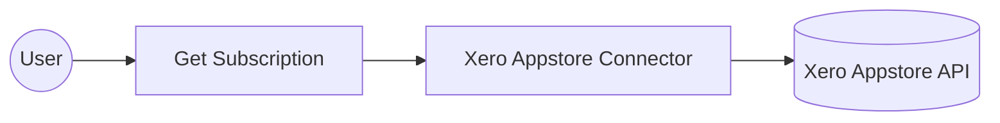

import ThemedImage from '@theme/ThemedImage';
import useBaseUrl from '@docusaurus/useBaseUrl';

# Example

## What you'll build

This integration connects to Xero Appstore and retrieves a customer subscription for an app that was set up for Xero App Store Subscriptions (XASS) billing. An automation entry point runs the operation once and logs the returned subscription.

**Operations used:**
- **Get Subscription** : Retrieves a subscription with its plans, subscription items, products and prices

## Architecture

## Prerequisites

- A Xero developer account with an existing app that was set up for XASS billing. XASS is retired and no longer accepts new apps.
- The ID of a subscription held for that app. Follow the [Setup Guide](setup-guide.md) to get the client ID, client secret and subscription details.

## Setting up the Xero Appstore integration

> **New to WSO2 Integrator?** Follow the [Create a New Integration](product://integrator/develop-and-test/create-workspace) guide to set up your integration first, then return here to add the connector.

## Adding the Xero Appstore connector

### Step 1: Open the connector palette

Hover over **Connections** in the project tree and select **Add Connection** (**+**).

<ThemedImage
    alt="Xero Appstore connector palette open before selection"
    sources={{
        light: useBaseUrl('/img/connectors/catalog/finance-accounting/xero.appstore/ballerinax_xero_appstore_screenshot_01_palette.png'),
        dark: useBaseUrl('/img/connectors/catalog/finance-accounting/xero.appstore/ballerinax_xero_appstore_screenshot_01_palette.png'),
    }}
/>

### Step 2: Select the Xero Appstore connector

1. Enter `xero.appstore` in the search field.
2. Select the **Xero Appstore** connector card.

## Configuring the Xero Appstore connection

### Step 3: Bind the connection parameters to configurable variables

Bind each connection field to a configurable variable. Use the **Configurables** tab of the field's helper panel to create each configurable.

- **Config** : Connection settings, with the OAuth 2.0 client credentials set in the `auth` record. Switch the field to **Expression** and enter `{auth: {clientId: appstoreClientId, clientSecret: appstoreClientSecret, tokenUrl: appstoreTokenUrl, scopes: ["marketplace.billing"]}}`.
- **Service Url** : Set it to the `appstoreServiceUrl` configurable.

<ThemedImage
    alt="Xero Appstore connection form with all parameters bound before saving"
    sources={{
        light: useBaseUrl('/img/connectors/catalog/finance-accounting/xero.appstore/ballerinax_xero_appstore_screenshot_02_connection_form.png'),
        dark: useBaseUrl('/img/connectors/catalog/finance-accounting/xero.appstore/ballerinax_xero_appstore_screenshot_02_connection_form.png'),
    }}
/>

### Step 4: Save the connection

Select **Save Connection** and verify that **appstoreClient** appears under **Connections** in the project tree and on the design canvas.

<ThemedImage
    alt="Xero Appstore connection visible after saving"
    sources={{
        light: useBaseUrl('/img/connectors/catalog/finance-accounting/xero.appstore/ballerinax_xero_appstore_screenshot_03_connections_list.png'),
        dark: useBaseUrl('/img/connectors/catalog/finance-accounting/xero.appstore/ballerinax_xero_appstore_screenshot_03_connections_list.png'),
    }}
/>

### Step 5: Set actual values for your configurables

1. Select **Configurations** at the bottom of the project tree.
2. Enter a value for each configurable listed below before you run the integration.

- **appstoreServiceUrl** (`string`) : Xero App Store Billing API base URL. Defaults to `https://api.xero.com/appstore/2.0/subscriptions`.
- **appstoreClientId** (`string`) : The client ID of your Xero app.
- **appstoreClientSecret** (`string`) : The client secret of your Xero app.
- **appstoreTokenUrl** (`string`) : Xero token endpoint. Defaults to `https://identity.xero.com/connect/token`.
- **appstoreSubscriptionId** (`string`) : The ID of the subscription to retrieve.

## Configuring the Xero Appstore Get Subscription operation

### Step 6: Add an automation entry point

1. Select **Add Artifact** on the design canvas.
2. Select **Automation**.
3. Select **Create** to accept the settings.

### Step 7: Expand the connection and configure the Get Subscription operation

1. Select the **+** between **Start** and **Error Handler** in the automation flow.
2. Expand **appstoreClient** under **Connections** to display its operations.

<ThemedImage
    alt="Xero Appstore connection expanded to display operations before selection"
    sources={{
        light: useBaseUrl('/img/connectors/catalog/finance-accounting/xero.appstore/ballerinax_xero_appstore_screenshot_04_operations_panel.png'),
        dark: useBaseUrl('/img/connectors/catalog/finance-accounting/xero.appstore/ballerinax_xero_appstore_screenshot_04_operations_panel.png'),
    }}
/>

3. Select **Get Subscription** and enter its required values.

- **Subscription Id** : Set it to the `appstoreSubscriptionId` configurable from the **Configurables** tab of the field's helper panel.
- **Result** : Set it to `subscription`, the variable that stores the returned subscription.

<ThemedImage
    alt="Xero Appstore Get Subscription operation with all values entered before saving"
    sources={{
        light: useBaseUrl('/img/connectors/catalog/finance-accounting/xero.appstore/ballerinax_xero_appstore_screenshot_05_operation_form.png'),
        dark: useBaseUrl('/img/connectors/catalog/finance-accounting/xero.appstore/ballerinax_xero_appstore_screenshot_05_operation_form.png'),
    }}
/>

4. Select **Save**.

### Step 8: Log the Get Subscription result

1. Select the **+** below the **Get Subscription** node.
2. Under **Logging**, select **Log Info**.
3. Switch **Msg** to **Expression**, enter `subscription.toString()`, and select **Save**.

<ThemedImage
    alt="Completed Xero Appstore flow with the configured operation"
    sources={{
        light: useBaseUrl('/img/connectors/catalog/finance-accounting/xero.appstore/ballerinax_xero_appstore_screenshot_06_completed_flow.png'),
        dark: useBaseUrl('/img/connectors/catalog/finance-accounting/xero.appstore/ballerinax_xero_appstore_screenshot_06_completed_flow.png'),
    }}
/>

## Try it yourself

Try this sample in WSO2 Integration Platform.

[View source on GitHub](https://github.com/wso2/integration-samples/tree/main/integrator-default-profile/connectors/xero.appstore_connector_sample)

## More code examples

The Xero Appstore connector provides practical examples illustrating usage in various scenarios. Explore these [examples](https://github.com/ballerina-platform/module-ballerinax-xero.appstore/tree/main/examples/), covering the following use cases:

1. [Metered usage reporting](https://github.com/ballerina-platform/module-ballerinax-xero.appstore/tree/main/examples/metered_usage_reporting) - Find a subscription's metered item, submit a usage record for it and optionally correct the quantity.
2. [Subscription usage audit](https://github.com/ballerina-platform/module-ballerinax-xero.appstore/tree/main/examples/subscription_usage_audit) - Retrieve a subscription and total the quantity of its usage records per subscription item.
