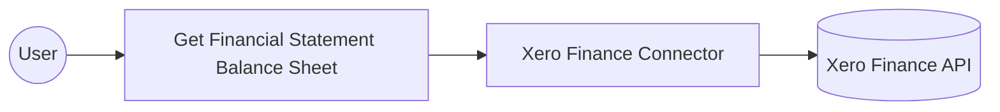

import ThemedImage from '@theme/ThemedImage';
import useBaseUrl from '@docusaurus/useBaseUrl';

# Example

## What you'll build

This integration connects to Xero Finance and retrieves the balance sheet report for a Xero organisation. An automation entry point runs the operation once and logs the returned report.

**Operations used:**
- **Get Financial Statement Balance Sheet** : Gets the balance sheet report for the organisation

## Architecture

## Prerequisites

- A Xero account with access to the Finance API, which is available to Xero partners.
- A Xero app with the `finance.statements.read` and `offline_access` scopes. Follow the [Setup Guide](setup-guide.md) to get the client ID, client secret, refresh token and tenant ID.

## Setting up the Xero Finance integration

> **New to WSO2 Integrator?** Follow the [Create a New Integration](product://integrator/develop-and-test/create-workspace) guide to set up your integration first, then return here to add the connector.

## Adding the Xero Finance connector

### Step 1: Open the connector palette

Hover over **Connections** in the project tree and select **Add Connection** (**+**).

<ThemedImage
    alt="Xero Finance connector palette open before selection"
    sources={{
        light: useBaseUrl('/img/connectors/catalog/finance-accounting/xero.finance/ballerinax_xero_finance_screenshot_01_palette.png'),
        dark: useBaseUrl('/img/connectors/catalog/finance-accounting/xero.finance/ballerinax_xero_finance_screenshot_01_palette.png'),
    }}
/>

### Step 2: Select the Xero Finance connector

1. Enter `xero.finance` in the search field.
2. Select the **Xero Finance** connector card.

## Configuring the Xero Finance connection

### Step 3: Bind the connection parameters to configurable variables

Bind each connection field to a configurable variable. Use the **Configurables** tab of the field's helper panel to create each configurable.

- **Config** : Connection settings, with the OAuth 2.0 refresh token credentials set in the `auth` record. Switch the field to **Expression** and enter `{auth: {clientId: financeClientId, clientSecret: financeClientSecret, refreshToken: financeRefreshToken, refreshUrl: financeRefreshUrl}}`.
- **Service Url** : Set it to the `financeServiceUrl` configurable.

<ThemedImage
    alt="Xero Finance connection form with all parameters bound before saving"
    sources={{
        light: useBaseUrl('/img/connectors/catalog/finance-accounting/xero.finance/ballerinax_xero_finance_screenshot_02_connection_form.png'),
        dark: useBaseUrl('/img/connectors/catalog/finance-accounting/xero.finance/ballerinax_xero_finance_screenshot_02_connection_form.png'),
    }}
/>

### Step 4: Save the connection

Select **Save Connection** and verify that **financeClient** appears under **Connections** in the project tree and on the design canvas.

<ThemedImage
    alt="Xero Finance connection visible after saving"
    sources={{
        light: useBaseUrl('/img/connectors/catalog/finance-accounting/xero.finance/ballerinax_xero_finance_screenshot_03_connections_list.png'),
        dark: useBaseUrl('/img/connectors/catalog/finance-accounting/xero.finance/ballerinax_xero_finance_screenshot_03_connections_list.png'),
    }}
/>

### Step 5: Set actual values for your configurables

1. Select **Configurations** at the bottom of the project tree.
2. Enter a value for each configurable listed below before you run the integration.

- **financeServiceUrl** (`string`) : Xero Finance API base URL. Defaults to `https://api.xero.com/finance.xro/1.0`.
- **financeClientId** (`string`) : The client ID of your Xero app.
- **financeClientSecret** (`string`) : The client secret of your Xero app.
- **financeRefreshToken** (`string`) : The OAuth 2.0 refresh token that grants the finance scopes.
- **financeRefreshUrl** (`string`) : Xero token endpoint. Defaults to `https://identity.xero.com/connect/token`.
- **financeTenantId** (`string`) : The ID of the Xero organisation to query.

## Configuring the Xero Finance Get Financial Statement Balance Sheet operation

### Step 6: Add an automation entry point

1. Select **Add Artifact** on the design canvas.
2. Select **Automation**.
3. Select **Create** to accept the settings.

### Step 7: Expand the connection and configure the Get Financial Statement Balance Sheet operation

1. Select the **+** between **Start** and **Error Handler** in the automation flow.
2. Expand **financeClient** under **Connections** to display its operations.

<ThemedImage
    alt="Xero Finance connection expanded to display operations before selection"
    sources={{
        light: useBaseUrl('/img/connectors/catalog/finance-accounting/xero.finance/ballerinax_xero_finance_screenshot_04_operations_panel.png'),
        dark: useBaseUrl('/img/connectors/catalog/finance-accounting/xero.finance/ballerinax_xero_finance_screenshot_04_operations_panel.png'),
    }}
/>

3. Select **Get Financial Statement Balance Sheet** and enter its required values.

- **Headers** : Switch the field to **Expression** and enter `{xeroTenantId: financeTenantId}`.
- **Result** : Set it to `balanceSheet`, the variable that stores the returned report.

<ThemedImage
    alt="Xero Finance Get Financial Statement Balance Sheet operation with all values entered before saving"
    sources={{
        light: useBaseUrl('/img/connectors/catalog/finance-accounting/xero.finance/ballerinax_xero_finance_screenshot_05_operation_form.png'),
        dark: useBaseUrl('/img/connectors/catalog/finance-accounting/xero.finance/ballerinax_xero_finance_screenshot_05_operation_form.png'),
    }}
/>

4. Select **Save**.

### Step 8: Log the Get Financial Statement Balance Sheet result

1. Select the **+** below the **Get Financial Statement Balance Sheet** node.
2. Under **Logging**, select **Log Info**.
3. Switch **Msg** to **Expression**, enter `balanceSheet.toString()`, and select **Save**.

<ThemedImage
    alt="Completed Xero Finance flow with the configured operation"
    sources={{
        light: useBaseUrl('/img/connectors/catalog/finance-accounting/xero.finance/ballerinax_xero_finance_screenshot_06_completed_flow.png'),
        dark: useBaseUrl('/img/connectors/catalog/finance-accounting/xero.finance/ballerinax_xero_finance_screenshot_06_completed_flow.png'),
    }}
/>

## Try it yourself

Try this sample in WSO2 Integration Platform.

[View source on GitHub](https://github.com/wso2/integration-samples/tree/main/integrator-default-profile/connectors/xero.finance_connector_sample)

## More code examples

The Xero Finance connector provides practical examples illustrating usage in various scenarios. Explore these [examples](https://github.com/ballerina-platform/module-ballerinax-xero.finance/blob/main/examples), covering the following use cases:

1. [Period-end financial review](https://github.com/ballerina-platform/module-ballerinax-xero.finance/tree/main/examples/period_end_financial_review) - Summarise the balance sheet, profit and loss and trial balance for a reporting period.
2. [Contact revenue and expense analysis](https://github.com/ballerina-platform/module-ballerinax-xero.finance/tree/main/examples/contact_revenue_expense_analysis) - Compare revenue and expense by contact and check the cash validation position.
