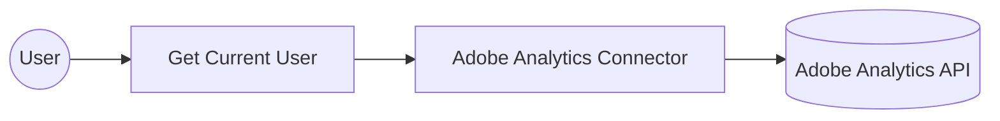

import ThemedImage from '@theme/ThemedImage';
import useBaseUrl from '@docusaurus/useBaseUrl';

# Example

## What you'll build

This integration connects to Adobe Analytics and retrieves the profile of the user that owns the access token. An automation entry point runs the operation once and logs the returned user.

**Operations used:**
- **Get Current User** : Retrieves the current user for a company

## Architecture

## Prerequisites

- An Adobe Analytics product profile and a project in the Adobe Developer Console with the Adobe Analytics API added.
- The access token, the API key (client ID) and the global company ID. Follow the [Setup Guide](setup-guide.md) to get them.

## Setting up the Adobe Analytics integration

> **New to WSO2 Integrator?** Follow the [Create a New Integration](product://integrator/develop-and-test/create-workspace) guide to set up your integration first, then return here to add the connector.

## Adding the Adobe Analytics connector

### Step 1: Open the connector palette

Hover over **Connections** in the project tree and select **Add Connection** (**+**).

<ThemedImage
    alt="Adobe Analytics connector palette open before selection"
    sources={{
        light: useBaseUrl('/img/connectors/catalog/marketing-social/adobe.analytics/ballerinax_adobe_analytics_screenshot_01_palette.png'),
        dark: useBaseUrl('/img/connectors/catalog/marketing-social/adobe.analytics/ballerinax_adobe_analytics_screenshot_01_palette.png'),
    }}
/>

### Step 2: Select the Adobe Analytics connector

1. Enter `adobe.analytics` in the search field.
2. Select the **Adobe Analytics** connector card.

## Configuring the Adobe Analytics connection

### Step 3: Bind the connection parameters to configurable variables

Bind each connection field to a configurable variable. Use the **Configurables** tab of the field's helper panel to create each configurable.

- **Api Key Config** : The access token and API key. Switch the field to **Expression** and enter `{authorization: "Bearer " + analyticsAccessToken, xApiKey: analyticsApiKey}`.
- **Service Url** : Set it to the `analyticsServiceUrl` configurable.

<ThemedImage
    alt="Adobe Analytics connection form with all parameters bound before saving"
    sources={{
        light: useBaseUrl('/img/connectors/catalog/marketing-social/adobe.analytics/ballerinax_adobe_analytics_screenshot_02_connection_form.png'),
        dark: useBaseUrl('/img/connectors/catalog/marketing-social/adobe.analytics/ballerinax_adobe_analytics_screenshot_02_connection_form.png'),
    }}
/>

### Step 4: Save the connection

Select **Save Connection** and verify that **analyticsClient** appears under **Connections** in the project tree and on the design canvas.

<ThemedImage
    alt="Adobe Analytics connection visible after saving"
    sources={{
        light: useBaseUrl('/img/connectors/catalog/marketing-social/adobe.analytics/ballerinax_adobe_analytics_screenshot_03_connections_list.png'),
        dark: useBaseUrl('/img/connectors/catalog/marketing-social/adobe.analytics/ballerinax_adobe_analytics_screenshot_03_connections_list.png'),
    }}
/>

### Step 5: Set actual values for your configurables

1. Select **Configurations** at the bottom of the project tree.
2. Enter a value for each configurable listed below before you run the integration.

- **analyticsServiceUrl** (`string`) : Adobe Analytics API base URL. Defaults to `https://analytics.adobe.io/api`.
- **analyticsAccessToken** (`string`) : The access token from Adobe IMS. It expires after 24 hours.
- **analyticsApiKey** (`string`) : The client ID of the Adobe Developer Console credential.
- **analyticsCompanyId** (`string`) : Your global company ID.

## Configuring the Adobe Analytics Get Current User operation

### Step 6: Add an automation entry point

1. Select **Add Artifact** on the design canvas.
2. Select **Automation**.
3. Select **Create** to accept the settings.

### Step 7: Expand the connection and configure the Get Current User operation

1. Select the **+** between **Start** and **Error Handler** in the automation flow.
2. Expand **analyticsClient** under **Connections** to display its operations.

<ThemedImage
    alt="Adobe Analytics connection expanded to display operations before selection"
    sources={{
        light: useBaseUrl('/img/connectors/catalog/marketing-social/adobe.analytics/ballerinax_adobe_analytics_screenshot_04_operations_panel.png'),
        dark: useBaseUrl('/img/connectors/catalog/marketing-social/adobe.analytics/ballerinax_adobe_analytics_screenshot_04_operations_panel.png'),
    }}
/>

3. Select **Get Current User** and enter its required values.

- **Global Company Id** : Set it to the `analyticsCompanyId` configurable.
- **Result** : Set it to `currentUser`, the variable that stores the returned user.

<ThemedImage
    alt="Adobe Analytics Get Current User operation with all values entered before saving"
    sources={{
        light: useBaseUrl('/img/connectors/catalog/marketing-social/adobe.analytics/ballerinax_adobe_analytics_screenshot_05_operation_form.png'),
        dark: useBaseUrl('/img/connectors/catalog/marketing-social/adobe.analytics/ballerinax_adobe_analytics_screenshot_05_operation_form.png'),
    }}
/>

4. Select **Save**.

### Step 8: Log the Get Current User result

1. Select the **+** below the **Get Current User** node.
2. Under **Logging**, select **Log Info**.
3. Switch **Msg** to **Expression**, enter `currentUser.toString()`, and select **Save**.

<ThemedImage
    alt="Completed Adobe Analytics flow with the configured operation"
    sources={{
        light: useBaseUrl('/img/connectors/catalog/marketing-social/adobe.analytics/ballerinax_adobe_analytics_screenshot_06_completed_flow.png'),
        dark: useBaseUrl('/img/connectors/catalog/marketing-social/adobe.analytics/ballerinax_adobe_analytics_screenshot_06_completed_flow.png'),
    }}
/>

## Try it yourself

Try this sample in WSO2 Integration Platform.

[View source on GitHub](https://github.com/wso2/integration-samples/tree/main/integrator-default-profile/connectors/adobe.analytics_connector_sample)

## More code examples

The Adobe Analytics connector provides practical examples illustrating usage in various scenarios. Explore these [examples](https://github.com/ballerina-platform/module-ballerinax-adobe.analytics/tree/main/examples/), covering the following use cases:

1. [Page traffic report](https://github.com/ballerina-platform/module-ballerinax-adobe.analytics/tree/main/examples/page_traffic_report) - Check that the page dimension and visits metric are available for a report suite, then run a ranked report of the most visited pages for a date range.
2. [Workspace asset audit](https://github.com/ballerina-platform/module-ballerinax-adobe.analytics/tree/main/examples/workspace_asset_audit) - Identify the authenticated user, collect all company users page by page, count visible projects and list calculated metrics.
