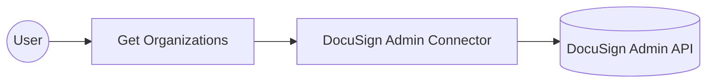

import ThemedImage from '@theme/ThemedImage';
import useBaseUrl from '@docusaurus/useBaseUrl';

# Example

## What you'll build

This integration connects to the DocuSign Admin API and lists the organizations that the authenticated user belongs to. An automation entry point runs the operation once and logs the returned organizations.

**Operations used:**
- **Get Organizations** : Returns a list of organizations that the authenticated user belongs to

## Architecture

## Prerequisites

- A DocuSign developer account with organization administration access.
- An app (integration key) in the DocuSign Apps and Keys page, with a secret key and a redirect URI.
- An OAuth 2.0 refresh token issued for that app with the `organization_read` scope.

## Setting up the DocuSign Admin integration

> **New to WSO2 Integrator?** Follow the [Create a New Integration](product://integrator/develop-and-test/create-workspace) guide to set up your integration first, then return here to add the connector.

## Adding the DocuSign Admin connector

### Step 1: Open the connector palette

Hover over **Connections** in the project tree and select **Add Connection** (**+**).

<ThemedImage
    alt="DocuSign Admin connector palette open before selection"
    sources={{
        light: useBaseUrl('/img/connectors/catalog/productivity-collaboration/docusign.dsadmin/ballerinax_docusign_dsadmin_screenshot_01_palette.png'),
        dark: useBaseUrl('/img/connectors/catalog/productivity-collaboration/docusign.dsadmin/ballerinax_docusign_dsadmin_screenshot_01_palette.png'),
    }}
/>

### Step 2: Select the DocuSign Admin connector

1. Enter `docusign.dsadmin` in the search field.
2. Select the **DS Admin** connector card.

## Configuring the DocuSign Admin connection

### Step 3: Bind the connection parameters to configurable variables

Bind each connection field to a configurable variable. Use the **Configurables** tab of the field's helper panel to create each configurable.

- **Config** : Connection settings, with the OAuth 2.0 refresh token configuration for DocuSign set in the `auth` record. Switch the field to **Expression** and enter `{auth: {clientId: dsadminClientId, clientSecret: dsadminClientSecret, refreshToken: dsadminRefreshToken, refreshUrl: dsadminRefreshUrl}}`.
- **Service Url** : Set it to the `dsadminServiceUrl` configurable.

<ThemedImage
    alt="DocuSign Admin connection form with all parameters bound before saving"
    sources={{
        light: useBaseUrl('/img/connectors/catalog/productivity-collaboration/docusign.dsadmin/ballerinax_docusign_dsadmin_screenshot_02_connection_form.png'),
        dark: useBaseUrl('/img/connectors/catalog/productivity-collaboration/docusign.dsadmin/ballerinax_docusign_dsadmin_screenshot_02_connection_form.png'),
    }}
/>

### Step 4: Save the connection

Select **Save Connection** and verify that **dsadminClient** appears under **Connections** in the project tree and on the design canvas.

<ThemedImage
    alt="DocuSign Admin connection visible after saving"
    sources={{
        light: useBaseUrl('/img/connectors/catalog/productivity-collaboration/docusign.dsadmin/ballerinax_docusign_dsadmin_screenshot_03_connections_list.png'),
        dark: useBaseUrl('/img/connectors/catalog/productivity-collaboration/docusign.dsadmin/ballerinax_docusign_dsadmin_screenshot_03_connections_list.png'),
    }}
/>

### Step 5: Set actual values for your configurables

1. Select **Configurations** at the bottom of the project tree.
2. Enter a value for each configurable listed below before you run the integration.

- **dsadminServiceUrl** (`string`) : DocuSign Admin API base URL. Defaults to `https://api.docusign.net/Management`.
- **dsadminClientId** (`string`) : Integration key of the DocuSign app.
- **dsadminClientSecret** (`string`) : Secret key of the DocuSign app.
- **dsadminRefreshToken** (`string`) : OAuth 2.0 refresh token issued for the DocuSign app.
- **dsadminRefreshUrl** (`string`) : DocuSign token endpoint. Defaults to `https://account-d.docusign.com/oauth/token`.

## Configuring the DocuSign Admin Get Organizations operation

### Step 6: Add an automation entry point

1. Select **Add Artifact** on the design canvas.
2. Select **Automation**.
3. Select **Create** to accept the settings.

### Step 7: Expand the connection and configure the Get Organizations operation

1. Select the **+** between **Start** and **Error Handler** in the automation flow.
2. Expand **dsadminClient** under **Connections** to display its operations.

<ThemedImage
    alt="DocuSign Admin connection expanded to display operations before selection"
    sources={{
        light: useBaseUrl('/img/connectors/catalog/productivity-collaboration/docusign.dsadmin/ballerinax_docusign_dsadmin_screenshot_04_operations_panel.png'),
        dark: useBaseUrl('/img/connectors/catalog/productivity-collaboration/docusign.dsadmin/ballerinax_docusign_dsadmin_screenshot_04_operations_panel.png'),
    }}
/>

3. Select **Returns a list of organizations that the authenticated user belongs to.** The operation has no required parameters.

- **Result** : Set it to `organizations`, the variable that stores the returned organizations.

<ThemedImage
    alt="DocuSign Admin Get Organizations operation with all values entered before saving"
    sources={{
        light: useBaseUrl('/img/connectors/catalog/productivity-collaboration/docusign.dsadmin/ballerinax_docusign_dsadmin_screenshot_05_operation_form.png'),
        dark: useBaseUrl('/img/connectors/catalog/productivity-collaboration/docusign.dsadmin/ballerinax_docusign_dsadmin_screenshot_05_operation_form.png'),
    }}
/>

4. Select **Save**.

### Step 8: Log the Get Organizations result

1. Select the **+** below the **dsadmin : get** node.
2. Under **Logging**, select **Log Info**.
3. Switch **Msg** to **Expression**, enter `organizations.toString()`, and select **Save**.

<ThemedImage
    alt="Completed DocuSign Admin flow with the configured operation"
    sources={{
        light: useBaseUrl('/img/connectors/catalog/productivity-collaboration/docusign.dsadmin/ballerinax_docusign_dsadmin_screenshot_06_completed_flow.png'),
        dark: useBaseUrl('/img/connectors/catalog/productivity-collaboration/docusign.dsadmin/ballerinax_docusign_dsadmin_screenshot_06_completed_flow.png'),
    }}
/>

## Try it yourself

Try this sample in WSO2 Integration Platform.

[View source on GitHub](https://github.com/wso2/integration-samples/tree/main/integrator-default-profile/connectors/docusign.dsadmin_connector_sample)

## More code examples

The DocuSign Admin connector provides practical examples illustrating usage in various scenarios. Explore these [examples](https://github.com/ballerina-platform/module-ballerinax-docusign.dsadmin/tree/main/examples/), covering the following use cases:

1. [Manage user information with DocuSign Admin](https://github.com/ballerina-platform/module-ballerinax-docusign.dsadmin/tree/main/examples/manage-user-information) - This example shows how to use DocuSign Admin API to to create users and retrieve user informations related to eSignature tasks.
2. [Access permissions in user accounts](https://github.com/ballerina-platform/module-ballerinax-docusign.dsadmin/tree/main/examples/permissions-in-organizations) - This example shows how to use DocuSign Admin API to to view permission details of the user accounts.
