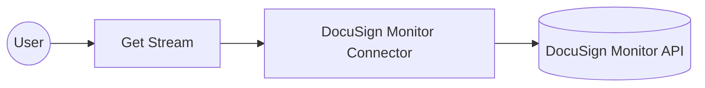

import ThemedImage from '@theme/ThemedImage';
import useBaseUrl from '@docusaurus/useBaseUrl';

# Example

## What you'll build

This integration connects to the DocuSign Monitor API and reads one page of the event stream of a Docusign organization. An automation entry point runs the operation once and logs the returned page of events.

**Operations used:**
- **Get Stream** : Gets the monitoring event stream of an organization

## Architecture

## Prerequisites

- A Docusign organization with DocuSign Monitor enabled.
- An app (integration key) with a secret key and a redirect URI. Follow the [Setup Guide](setup-guide.md) to get the client ID, client secret, refresh token and organization ID.

## Setting up the DocuSign Monitor integration

> **New to WSO2 Integrator?** Follow the [Create a New Integration](product://integrator/develop-and-test/create-workspace) guide to set up your integration first, then return here to add the connector.

## Adding the DocuSign Monitor connector

### Step 1: Open the connector palette

Hover over **Connections** in the project tree and select **Add Connection** (**+**).

<ThemedImage
    alt="DocuSign Monitor connector palette open before selection"
    sources={{
        light: useBaseUrl('/img/connectors/catalog/productivity-collaboration/docusign.monitor/ballerinax_docusign_monitor_screenshot_01_palette.png'),
        dark: useBaseUrl('/img/connectors/catalog/productivity-collaboration/docusign.monitor/ballerinax_docusign_monitor_screenshot_01_palette.png'),
    }}
/>

### Step 2: Select the DocuSign Monitor connector

1. Enter `docusign.monitor` in the search field.
2. Select the **DocuSign Monitor** connector card.

## Configuring the DocuSign Monitor connection

### Step 3: Bind the connection parameters to configurable variables

Bind each connection field to a configurable variable. Use the **Configurables** tab of the field's helper panel to create each configurable.

- **Config** : Connection settings, with the OAuth 2.0 refresh token credentials set in the `auth` record. Switch the field to **Expression** and enter `{auth: {clientId: monitorClientId, clientSecret: monitorClientSecret, refreshToken: monitorRefreshToken}}`.
- **Service Url** : Set it to the `monitorServiceUrl` configurable.

<ThemedImage
    alt="DocuSign Monitor connection form with all parameters bound before saving"
    sources={{
        light: useBaseUrl('/img/connectors/catalog/productivity-collaboration/docusign.monitor/ballerinax_docusign_monitor_screenshot_02_connection_form.png'),
        dark: useBaseUrl('/img/connectors/catalog/productivity-collaboration/docusign.monitor/ballerinax_docusign_monitor_screenshot_02_connection_form.png'),
    }}
/>

### Step 4: Save the connection

Select **Save Connection** and verify that **monitorClient** appears under **Connections** in the project tree and on the design canvas.

<ThemedImage
    alt="DocuSign Monitor connection visible after saving"
    sources={{
        light: useBaseUrl('/img/connectors/catalog/productivity-collaboration/docusign.monitor/ballerinax_docusign_monitor_screenshot_03_connections_list.png'),
        dark: useBaseUrl('/img/connectors/catalog/productivity-collaboration/docusign.monitor/ballerinax_docusign_monitor_screenshot_03_connections_list.png'),
    }}
/>

### Step 5: Set actual values for your configurables

1. Select **Configurations** at the bottom of the project tree.
2. Enter a value for each configurable listed below before you run the integration.

- **monitorServiceUrl** (`string`) : DocuSign Monitor API base URL. Defaults to `https://api.docusign.com`.
- **monitorClientId** (`string`) : Integration key of the Docusign app.
- **monitorClientSecret** (`string`) : Secret key of the Docusign app.
- **monitorRefreshToken** (`string`) : OAuth 2.0 refresh token issued for the Docusign app.
- **monitorOrganizationId** (`string`) : The ID of the Docusign organization whose events you read.

## Configuring the DocuSign Monitor Get Stream operation

### Step 6: Add an automation entry point

1. Select **Add Artifact** on the design canvas.
2. Select **Automation**.
3. Select **Create** to accept the settings.

### Step 7: Expand the connection and configure the Get Stream operation

1. Select the **+** between **Start** and **Error Handler** in the automation flow.
2. Expand **monitorClient** under **Connections** to display its operations.

<ThemedImage
    alt="DocuSign Monitor connection expanded to display operations before selection"
    sources={{
        light: useBaseUrl('/img/connectors/catalog/productivity-collaboration/docusign.monitor/ballerinax_docusign_monitor_screenshot_04_operations_panel.png'),
        dark: useBaseUrl('/img/connectors/catalog/productivity-collaboration/docusign.monitor/ballerinax_docusign_monitor_screenshot_04_operations_panel.png'),
    }}
/>

3. Select **Get Stream** and enter its required values.

- **Organization Id** : Set it to the `monitorOrganizationId` configurable.
- **Result** : Set it to `eventPage`, the variable that stores the returned page of events.

<ThemedImage
    alt="DocuSign Monitor Get Stream operation with all values entered before saving"
    sources={{
        light: useBaseUrl('/img/connectors/catalog/productivity-collaboration/docusign.monitor/ballerinax_docusign_monitor_screenshot_05_operation_form.png'),
        dark: useBaseUrl('/img/connectors/catalog/productivity-collaboration/docusign.monitor/ballerinax_docusign_monitor_screenshot_05_operation_form.png'),
    }}
/>

4. Select **Save**.

### Step 8: Log the Get Stream result

1. Select the **+** below the **Get Stream** node.
2. Under **Logging**, select **Log Info**.
3. Switch **Msg** to **Expression**, enter `eventPage.toString()`, and select **Save**.

<ThemedImage
    alt="Completed DocuSign Monitor flow with the configured operation"
    sources={{
        light: useBaseUrl('/img/connectors/catalog/productivity-collaboration/docusign.monitor/ballerinax_docusign_monitor_screenshot_06_completed_flow.png'),
        dark: useBaseUrl('/img/connectors/catalog/productivity-collaboration/docusign.monitor/ballerinax_docusign_monitor_screenshot_06_completed_flow.png'),
    }}
/>

## Try it yourself

Try this sample in WSO2 Integration Platform.

[View source on GitHub](https://github.com/wso2/integration-samples/tree/main/integrator-default-profile/connectors/docusign.monitor_connector_sample)

## More code examples

The DocuSign Monitor connector provides practical examples illustrating usage in various scenarios. Explore these [examples](https://github.com/ballerina-platform/module-ballerinax-docusign.monitor/tree/main/examples/), covering the following use cases:

1. [User activity audit](https://github.com/ballerina-platform/module-ballerinax-docusign.monitor/tree/main/examples/user_activity_audit) - Page through the organization event stream, collect the events of one user and count them by action.
2. [Event location summary](https://github.com/ballerina-platform/module-ballerinax-docusign.monitor/tree/main/examples/event_location_summary) - Page through the organization event stream and summarize events and distinct IP addresses by country.
