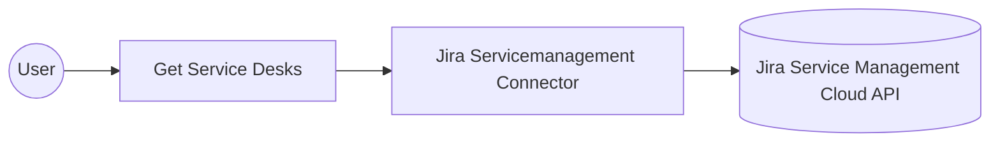

import ThemedImage from '@theme/ThemedImage';
import useBaseUrl from '@docusaurus/useBaseUrl';

# Example

## What you'll build

This integration connects to Jira Service Management Cloud and lists the service desks that the authenticated account can see. An automation entry point runs the operation once and logs the returned service desks.

**Operations used:**
- **Get Service Desks** : Returns the service desks visible to the authenticated account

## Architecture

## Prerequisites

- A Jira Service Management Cloud site, such as `https://your-domain.atlassian.net`, and an Atlassian account on it.
- An Atlassian API token for that account.

## Setting up the Jira Servicemanagement integration

> **New to WSO2 Integrator?** Follow the [Create a New Integration](product://integrator/develop-and-test/create-workspace) guide to set up your integration first, then return here to add the connector.

## Adding the Jira Servicemanagement connector

### Step 1: Open the connector palette

Hover over **Connections** in the project tree and select **Add Connection** (**+**).

<ThemedImage
    alt="Jira Servicemanagement connector palette open before selection"
    sources={{
        light: useBaseUrl('/img/connectors/catalog/productivity-collaboration/jira.servicemanagement/ballerinax_jira_servicemanagement_screenshot_01_palette.png'),
        dark: useBaseUrl('/img/connectors/catalog/productivity-collaboration/jira.servicemanagement/ballerinax_jira_servicemanagement_screenshot_01_palette.png'),
    }}
/>

### Step 2: Select the Jira Servicemanagement connector

1. Enter `jira.servicemanagement` in the search field.
2. Select the **Jira Service Mgmt** connector card (`ballerinax / jira.servicemanagement`).

## Configuring the Jira Servicemanagement connection

### Step 3: Bind the connection parameters to configurable variables

Bind each connection field to a configurable variable. Use the **Configurables** tab of the field's helper panel to create each configurable.

- **Config** : Connection settings, with the Atlassian account email and API token set as the username and password of the `auth` record. Switch the field to **Expression** and enter `{auth: {username: servicemanagementEmail, password: servicemanagementApiToken}}`.
- **Service Url** : Set it to the `servicemanagementServiceUrl` configurable.

<ThemedImage
    alt="Jira Servicemanagement connection form with all parameters bound before saving"
    sources={{
        light: useBaseUrl('/img/connectors/catalog/productivity-collaboration/jira.servicemanagement/ballerinax_jira_servicemanagement_screenshot_02_connection_form.png'),
        dark: useBaseUrl('/img/connectors/catalog/productivity-collaboration/jira.servicemanagement/ballerinax_jira_servicemanagement_screenshot_02_connection_form.png'),
    }}
/>

### Step 4: Save the connection

Select **Save Connection** and verify that **servicemanagementClient** appears under **Connections** in the project tree and on the design canvas.

<ThemedImage
    alt="Jira Servicemanagement connection visible after saving"
    sources={{
        light: useBaseUrl('/img/connectors/catalog/productivity-collaboration/jira.servicemanagement/ballerinax_jira_servicemanagement_screenshot_03_connections_list.png'),
        dark: useBaseUrl('/img/connectors/catalog/productivity-collaboration/jira.servicemanagement/ballerinax_jira_servicemanagement_screenshot_03_connections_list.png'),
    }}
/>

### Step 5: Set actual values for your configurables

1. Select **Configurations** at the bottom of the project tree.
2. Enter a value for each configurable listed below before you run the integration.

- **servicemanagementServiceUrl** (`string`) : Your site URL, for example `https://your-domain.atlassian.net`.
- **servicemanagementEmail** (`string`) : Email address of the Atlassian account.
- **servicemanagementApiToken** (`string`) : Atlassian API token created for the account.

## Configuring the Jira Servicemanagement Get Service Desks operation

### Step 6: Add an automation entry point

1. Select **Add Artifact** on the design canvas.
2. Select **Automation**.
3. Select **Create** to accept the settings.

### Step 7: Expand the connection and configure the Get Service Desks operation

1. Select the **+** between **Start** and **Error Handler** in the automation flow.
2. Expand **servicemanagementClient** under **Connections** to display its operations.

<ThemedImage
    alt="Jira Servicemanagement connection expanded to display operations before selection"
    sources={{
        light: useBaseUrl('/img/connectors/catalog/productivity-collaboration/jira.servicemanagement/ballerinax_jira_servicemanagement_screenshot_04_operations_panel.png'),
        dark: useBaseUrl('/img/connectors/catalog/productivity-collaboration/jira.servicemanagement/ballerinax_jira_servicemanagement_screenshot_04_operations_panel.png'),
    }}
/>

3. Select **Get Service Desks**. The operation has no required parameters.

- **Result** : Set it to `serviceDesks`, the variable that stores the returned service desks.

<ThemedImage
    alt="Jira Servicemanagement Get Service Desks operation with all values entered before saving"
    sources={{
        light: useBaseUrl('/img/connectors/catalog/productivity-collaboration/jira.servicemanagement/ballerinax_jira_servicemanagement_screenshot_05_operation_form.png'),
        dark: useBaseUrl('/img/connectors/catalog/productivity-collaboration/jira.servicemanagement/ballerinax_jira_servicemanagement_screenshot_05_operation_form.png'),
    }}
/>

4. Select **Save**.

### Step 8: Log the Get Service Desks result

1. Select the **+** below the **Get Service Desks** node.
2. Under **Logging**, select **Log Info**.
3. Switch **Msg** to **Expression**, enter `serviceDesks.toString()`, and select **Save**.

<ThemedImage
    alt="Completed Jira Servicemanagement flow with the configured operation"
    sources={{
        light: useBaseUrl('/img/connectors/catalog/productivity-collaboration/jira.servicemanagement/ballerinax_jira_servicemanagement_screenshot_06_completed_flow.png'),
        dark: useBaseUrl('/img/connectors/catalog/productivity-collaboration/jira.servicemanagement/ballerinax_jira_servicemanagement_screenshot_06_completed_flow.png'),
    }}
/>

## Try it yourself

Try this sample in WSO2 Integration Platform.

[View source on GitHub](https://github.com/wso2/integration-samples/tree/main/integrator-default-profile/connectors/jira.servicemanagement_connector_sample)

## More code examples

The Jira Service Management connector provides practical examples illustrating usage in various scenarios. Explore these [examples](https://github.com/ballerina-platform/module-ballerinax-jira.servicemanagement/tree/main/examples/), covering the following use cases:

1. [Service request intake](https://github.com/ballerina-platform/module-ballerinax-jira.servicemanagement/tree/main/examples/service_request_intake) - Find a request type by name, check its fields, raise a customer request and attach a supporting file to it.
2. [Customer organization onboarding](https://github.com/ballerina-platform/module-ballerinax-jira.servicemanagement/tree/main/examples/customer_organization_onboarding) - Create an organization for a new client company, give it access to a service desk, create its first customer and add them to the organization.
