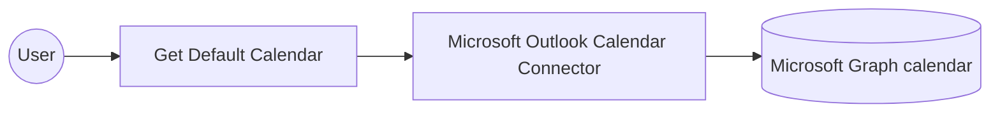

import ThemedImage from '@theme/ThemedImage';
import useBaseUrl from '@docusaurus/useBaseUrl';

# Example

## What you'll build

This integration connects to Microsoft Outlook Calendar through Microsoft Graph and retrieves the signed-in user's default calendar. An automation entry point runs the operation once and logs the returned calendar.

**Operations used:**
- **Get Default Calendar** : Retrieves the signed-in user's default calendar

## Architecture

## Prerequisites

- A Microsoft 365 account with an Outlook calendar.
- An application registered in Microsoft Entra ID with the delegated Microsoft Graph **Calendars.ReadWrite** and **offline_access** permissions, and its client ID and client secret.
- An OAuth 2.0 refresh token for that application.

## Setting up the Microsoft Outlook Calendar integration

> **New to WSO2 Integrator?** Follow the [Create a New Integration](product://integrator/develop-and-test/create-workspace) guide to set up your integration first, then return here to add the connector.

## Adding the Microsoft Outlook Calendar connector

### Step 1: Open the connector palette

Hover over **Connections** in the project tree and select **Add Connection** (**+**).

<ThemedImage
    alt="Microsoft Outlook Calendar connector palette open before selection"
    sources={{
        light: useBaseUrl('/img/connectors/catalog/productivity-collaboration/microsoft.outlook.calendar/ballerinax_microsoft_outlook_calendar_screenshot_01_palette.png'),
        dark: useBaseUrl('/img/connectors/catalog/productivity-collaboration/microsoft.outlook.calendar/ballerinax_microsoft_outlook_calendar_screenshot_01_palette.png'),
    }}
/>

### Step 2: Select the Microsoft Outlook Calendar connector

1. Enter `microsoft.outlook.calendar` in the search field.
2. Select the **Microsoft Outlook Calendar** connector card.

## Configuring the Microsoft Outlook Calendar connection

### Step 3: Bind the connection parameters to configurable variables

Bind each connection field to a configurable variable. Use the **Configurables** tab of the field's helper panel to create each configurable.

- **Config** : Connection settings, with the OAuth 2.0 refresh token configuration for Microsoft Entra ID set in the `auth` record. Switch the field to **Expression** and enter `{auth: {clientId: calendarClientId, clientSecret: calendarClientSecret, refreshToken: calendarRefreshToken, refreshUrl: calendarRefreshUrl}}`.
- **Service Url** : Set it to the `calendarServiceUrl` configurable.

<ThemedImage
    alt="Microsoft Outlook Calendar connection form with all parameters bound before saving"
    sources={{
        light: useBaseUrl('/img/connectors/catalog/productivity-collaboration/microsoft.outlook.calendar/ballerinax_microsoft_outlook_calendar_screenshot_02_connection_form.png'),
        dark: useBaseUrl('/img/connectors/catalog/productivity-collaboration/microsoft.outlook.calendar/ballerinax_microsoft_outlook_calendar_screenshot_02_connection_form.png'),
    }}
/>

### Step 4: Save the connection

Select **Save Connection** and verify that **calendarClient** appears under **Connections** in the project tree and on the design canvas.

<ThemedImage
    alt="Microsoft Outlook Calendar connection visible after saving"
    sources={{
        light: useBaseUrl('/img/connectors/catalog/productivity-collaboration/microsoft.outlook.calendar/ballerinax_microsoft_outlook_calendar_screenshot_03_connections_list.png'),
        dark: useBaseUrl('/img/connectors/catalog/productivity-collaboration/microsoft.outlook.calendar/ballerinax_microsoft_outlook_calendar_screenshot_03_connections_list.png'),
    }}
/>

### Step 5: Set actual values for your configurables

1. Select **Configurations** at the bottom of the project tree.
2. Enter a value for each configurable listed below before you run the integration.

- **calendarClientId** (`string`) : Application (client) ID of the registered application.
- **calendarClientSecret** (`string`) : Client secret of the registered application.
- **calendarRefreshToken** (`string`) : OAuth 2.0 refresh token issued for the Microsoft Graph scopes.
- **calendarRefreshUrl** (`string`) : Token endpoint, such as `https://login.microsoftonline.com/common/oauth2/v2.0/token`.
- **calendarServiceUrl** (`string`) : Microsoft Graph base URL. Defaults to `https://graph.microsoft.com/v1.0`.

## Configuring the Microsoft Outlook Calendar Get Default Calendar operation

### Step 6: Add an automation entry point

1. Select **Add Artifact** on the design canvas.
2. Select **Automation**.
3. Select **Create** to accept the settings.

### Step 7: Expand the connection and configure the Get Default Calendar operation

1. Select the **+** between **Start** and **Error Handler** in the automation flow.
2. Expand **calendarClient** under **Connections** to display its operations.

<ThemedImage
    alt="Microsoft Outlook Calendar connection expanded to display operations before selection"
    sources={{
        light: useBaseUrl('/img/connectors/catalog/productivity-collaboration/microsoft.outlook.calendar/ballerinax_microsoft_outlook_calendar_screenshot_04_operations_panel.png'),
        dark: useBaseUrl('/img/connectors/catalog/productivity-collaboration/microsoft.outlook.calendar/ballerinax_microsoft_outlook_calendar_screenshot_04_operations_panel.png'),
    }}
/>

3. Select **Get Default Calendar**. The operation has no required parameters.

- **Result** : Set it to `defaultCalendar`, the variable that stores the returned calendar.

<ThemedImage
    alt="Microsoft Outlook Calendar Get Default Calendar operation with all values entered before saving"
    sources={{
        light: useBaseUrl('/img/connectors/catalog/productivity-collaboration/microsoft.outlook.calendar/ballerinax_microsoft_outlook_calendar_screenshot_05_operation_form.png'),
        dark: useBaseUrl('/img/connectors/catalog/productivity-collaboration/microsoft.outlook.calendar/ballerinax_microsoft_outlook_calendar_screenshot_05_operation_form.png'),
    }}
/>

4. Select **Save**.

### Step 8: Log the Get Default Calendar result

1. Select the **+** below the **Get Default Calendar** node.
2. Under **Logging**, select **Log Info**.
3. Switch **Msg** to **Expression**, enter `defaultCalendar.toString()`, and select **Save**.

<ThemedImage
    alt="Completed Microsoft Outlook Calendar flow with the configured operation"
    sources={{
        light: useBaseUrl('/img/connectors/catalog/productivity-collaboration/microsoft.outlook.calendar/ballerinax_microsoft_outlook_calendar_screenshot_06_completed_flow.png'),
        dark: useBaseUrl('/img/connectors/catalog/productivity-collaboration/microsoft.outlook.calendar/ballerinax_microsoft_outlook_calendar_screenshot_06_completed_flow.png'),
    }}
/>

## Try it yourself

Try this sample in WSO2 Integration Platform.

[View source on GitHub](https://github.com/wso2/integration-samples/tree/main/integrator-default-profile/connectors/microsoft.outlook.calendar_connector_sample)

## More code examples

The Microsoft Outlook Calendar connector provides practical examples illustrating usage in various scenarios. Explore these [examples](https://github.com/ballerina-platform/module-ballerinax-microsoft.outlook.calendar/tree/main/examples/), covering the following use cases:

1. [Team meeting scheduler](https://github.com/ballerina-platform/module-ballerinax-microsoft.outlook.calendar/tree/main/examples/team_meeting_scheduler) - Find a time when every attendee is free, book it as a Teams meeting and list the resulting schedule.
2. [Project calendar setup](https://github.com/ballerina-platform/module-ballerinax-microsoft.outlook.calendar/tree/main/examples/project_calendar_setup) - Create a project calendar inside a calendar group and schedule the project milestones on it.
