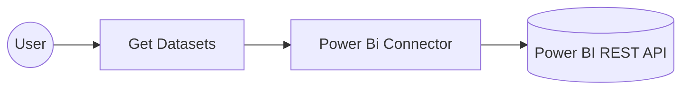

import ThemedImage from '@theme/ThemedImage';
import useBaseUrl from '@docusaurus/useBaseUrl';

# Example

## What you'll build

This integration connects to Power BI and lists the datasets in the signed-in user's My workspace. An automation entry point runs the operation once and logs the returned datasets.

**Operations used:**
- **Get Datasets** : Returns a list of datasets from My workspace

## Architecture

## Prerequisites

- A Power BI account in a Microsoft 365 organization.
- An application registered in Microsoft Entra ID with the Power BI Service `Dataset.Read.All` delegated permission.
- A Microsoft Entra ID access token for the Power BI service.

## Setting up the Power Bi integration

> **New to WSO2 Integrator?** Follow the [Create a New Integration](product://integrator/develop-and-test/create-workspace) guide to set up your integration first, then return here to add the connector.

## Adding the Power Bi connector

### Step 1: Open the connector palette

Hover over **Connections** in the project tree and select **Add Connection** (**+**).

<ThemedImage
    alt="Power Bi connector palette open before selection"
    sources={{
        light: useBaseUrl('/img/connectors/catalog/productivity-collaboration/power.bi/ballerinax_power_bi_screenshot_01_palette.png'),
        dark: useBaseUrl('/img/connectors/catalog/productivity-collaboration/power.bi/ballerinax_power_bi_screenshot_01_palette.png'),
    }}
/>

### Step 2: Select the Power Bi connector

1. Enter `power.bi` in the search field.
2. Select the **Power Bi** connector card.

## Configuring the Power Bi connection

### Step 3: Bind the connection parameters to configurable variables

Bind each connection field to a configurable variable. Use the **Configurables** tab of the field's helper panel to create each configurable.

- **Config** : Connection settings, with the Microsoft Entra ID access token set in the `auth` record. Switch the field to **Expression** and enter `{auth: {token: biToken}}`.
- **Service Url** : Set it to the `biServiceUrl` configurable.

<ThemedImage
    alt="Power Bi connection form with all parameters bound before saving"
    sources={{
        light: useBaseUrl('/img/connectors/catalog/productivity-collaboration/power.bi/ballerinax_power_bi_screenshot_02_connection_form.png'),
        dark: useBaseUrl('/img/connectors/catalog/productivity-collaboration/power.bi/ballerinax_power_bi_screenshot_02_connection_form.png'),
    }}
/>

### Step 4: Save the connection

Select **Save Connection** and verify that **biClient** appears under **Connections** in the project tree and on the design canvas.

<ThemedImage
    alt="Power Bi connection visible after saving"
    sources={{
        light: useBaseUrl('/img/connectors/catalog/productivity-collaboration/power.bi/ballerinax_power_bi_screenshot_03_connections_list.png'),
        dark: useBaseUrl('/img/connectors/catalog/productivity-collaboration/power.bi/ballerinax_power_bi_screenshot_03_connections_list.png'),
    }}
/>

### Step 5: Set actual values for your configurables

1. Select **Configurations** at the bottom of the project tree.
2. Enter a value for each configurable listed below before you run the integration.

- **biServiceUrl** (`string`) : Power BI REST API base URL. Defaults to `https://api.powerbi.com/v1.0/myorg`.
- **biToken** (`string`) : Microsoft Entra ID access token for the Power BI service. The token expires after about an hour.

## Configuring the Power Bi Get Datasets operation

### Step 6: Add an automation entry point

1. Select **Add Artifact** on the design canvas.
2. Select **Automation**.
3. Select **Create** to accept the settings.

### Step 7: Expand the connection and configure the Get Datasets operation

1. Select the **+** between **Start** and **Error Handler** in the automation flow.
2. Expand **biClient** under **Connections** to display its operations.

<ThemedImage
    alt="Power Bi connection expanded to display operations before selection"
    sources={{
        light: useBaseUrl('/img/connectors/catalog/productivity-collaboration/power.bi/ballerinax_power_bi_screenshot_04_operations_panel.png'),
        dark: useBaseUrl('/img/connectors/catalog/productivity-collaboration/power.bi/ballerinax_power_bi_screenshot_04_operations_panel.png'),
    }}
/>

3. Select **Get Datasets**. The operation has no required parameters.

- **Result** : Set it to `datasets`, the variable that stores the returned datasets.

<ThemedImage
    alt="Power Bi Get Datasets operation with all values entered before saving"
    sources={{
        light: useBaseUrl('/img/connectors/catalog/productivity-collaboration/power.bi/ballerinax_power_bi_screenshot_05_operation_form.png'),
        dark: useBaseUrl('/img/connectors/catalog/productivity-collaboration/power.bi/ballerinax_power_bi_screenshot_05_operation_form.png'),
    }}
/>

4. Select **Save**.

### Step 8: Log the Get Datasets result

1. Select the **+** below the **Get Datasets** node.
2. Under **Logging**, select **Log Info**.
3. Switch **Msg** to **Expression**, enter `datasets.toString()`, and select **Save**.

<ThemedImage
    alt="Completed Power Bi flow with the configured operation"
    sources={{
        light: useBaseUrl('/img/connectors/catalog/productivity-collaboration/power.bi/ballerinax_power_bi_screenshot_06_completed_flow.png'),
        dark: useBaseUrl('/img/connectors/catalog/productivity-collaboration/power.bi/ballerinax_power_bi_screenshot_06_completed_flow.png'),
    }}
/>

## Try it yourself

Try this sample in WSO2 Integration Platform.

[View source on GitHub](https://github.com/wso2/integration-samples/tree/main/integrator-default-profile/connectors/power.bi_connector_sample)

## More code examples

The Power Bi connector provides practical examples illustrating usage in various scenarios. Explore these [examples](https://github.com/ballerina-platform/module-ballerinax-power.bi/tree/main/examples/), covering the following use cases:

1. [Push dataset sales feed](https://github.com/ballerina-platform/module-ballerinax-power.bi/tree/main/examples/push_dataset_sales_feed) - Create a push dataset in a workspace if it is missing, push sales rows into it and read per-region totals back with a DAX query.
2. [Dataset refresh monitoring](https://github.com/ballerina-platform/module-ballerinax-power.bi/tree/main/examples/dataset_refresh_monitoring) - Review the refresh schedule and recent refresh history of every refreshable dataset in a workspace, and optionally re-run refreshes that failed.
