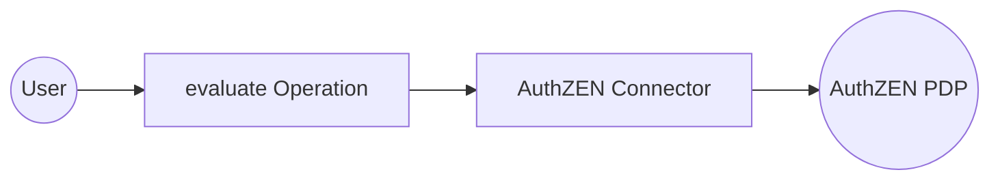

import ThemedImage from '@theme/ThemedImage';
import useBaseUrl from '@docusaurus/useBaseUrl';

# Example

## What you'll build

Build an integration workflow that asks an AuthZEN Policy Decision Point (PDP) whether a user may perform an action on a resource, and logs the decision. The workflow uses the public Cerbos PDP of the AuthZEN interoperability tests, so it needs no credentials.

**Operations used:**
- **evaluate** : Asks the PDP whether a user may create a todo in a shared todo app, and returns the decision

## Architecture

## Prerequisites

- The URL of an AuthZEN PDP and the credentials it expects, if any (see the [Setup Guide](setup-guide.md)). This example uses the public PDP `https://authzen-proxy-demo.cerbos.dev`, which needs no credentials.

## Setting up the AuthZEN integration

> **New to WSO2 Integrator?** Follow the [Create a New Integration](product://integrator/develop-and-test/create-workspace) guide to set up your integration first, then return here to add the connector.

## Adding the AuthZEN connector

### Step 1: Open the connector palette and search for the connector

Select **Add Artifact**, then select **Connection** to open the connector palette. Search for `authzen` and select the **Authzen** connector card.

<ThemedImage
    alt="Add Connection palette open with the search field before any selection"
    sources={{
        light: useBaseUrl('/img/connectors/catalog/security-identity/authzen/authzen_screenshot_01_palette.png'),
        dark: useBaseUrl('/img/connectors/catalog/security-identity/authzen/authzen_screenshot_01_palette.png'),
    }}
/>

## Configuring the AuthZEN connection

### Step 2: Fill in the connection parameters

Enter the connection parameters, binding each field to a configurable variable:

- **Service Url** : The PDP URL; bind to the `authzenPdpUrl` configurable variable
- **Connection Name** : Keep the default `authzenClient`

The public PDP of this example needs no credentials. For a PDP that authenticates its callers, set **Auth** under **Advanced Configurations**, for example `{token: authzenAccessToken}` for a Bearer token.

<ThemedImage
    alt="AuthZEN connection form filled with configurable variables before saving"
    sources={{
        light: useBaseUrl('/img/connectors/catalog/security-identity/authzen/authzen_screenshot_02_connection_form.png'),
        dark: useBaseUrl('/img/connectors/catalog/security-identity/authzen/authzen_screenshot_02_connection_form.png'),
    }}
/>

### Step 3: Save the connection

Select **Save Connection**. The connection appears under **Connections** in the project tree and on the design canvas.

<ThemedImage
    alt="Design canvas showing the saved authzenClient connection"
    sources={{
        light: useBaseUrl('/img/connectors/catalog/security-identity/authzen/authzen_screenshot_03_connection_saved.png'),
        dark: useBaseUrl('/img/connectors/catalog/security-identity/authzen/authzen_screenshot_03_connection_saved.png'),
    }}
/>

### Step 4: Set actual values for your configurables

1. In the left panel, select **Configurations**.
2. Set a value for each configurable listed below:

- **authzenPdpUrl** (string) : The PDP URL, for example, `https://authzen-proxy-demo.cerbos.dev`

## Configuring the AuthZEN evaluate operation

### Step 5: Add an automation entry point

Select **Add Artifact**, then select **Automation** and select **Create** to add the automation entry point to the canvas.

### Step 6: Select and configure the evaluate operation

1. On the automation canvas, select the **+** button to add a step.
2. Expand the **authzenClient** connection under **Connections**.

<ThemedImage
    alt="authzenClient connection expanded in the node panel showing the available operations"
    sources={{
        light: useBaseUrl('/img/connectors/catalog/security-identity/authzen/authzen_screenshot_04_operations.png'),
        dark: useBaseUrl('/img/connectors/catalog/security-identity/authzen/authzen_screenshot_04_operations.png'),
    }}
/>

3. Select **Evaluate** (`evaluate`) and configure it:

- **Request** : Switch to **Expression** and enter `{subject: {'type: "user", id: "CiRmZDA2MTRkMy1jMzlhLTQ3ODEtYjdiZC04Yjk2ZjVhNTEwMGQSBWxvY2Fs"}, action: {name: "can_create_todo"}, 'resource: {'type: "todo", id: "todo-1"}}`. The subject ID is the user Rick of the AuthZEN interop "todo" scenario, who is an admin.
- **Result** : Keep the default result variable name `authzenDecision`

<ThemedImage
    alt="evaluate operation form with the access request"
    sources={{
        light: useBaseUrl('/img/connectors/catalog/security-identity/authzen/authzen_screenshot_05_operation_form.png'),
        dark: useBaseUrl('/img/connectors/catalog/security-identity/authzen/authzen_screenshot_05_operation_form.png'),
    }}
/>

4. Select **Save** to add the operation to the flow, then add a **Log Info** step after it, switch **Msg** to **Expression** and enter `authzenDecision.toJsonString()`. The PDP returns `{"decision":true}` with the reasons for the decision in `context`.

<ThemedImage
    alt="Completed automation flow with the evaluate operation and a log step"
    sources={{
        light: useBaseUrl('/img/connectors/catalog/security-identity/authzen/authzen_screenshot_06_completed_flow.png'),
        dark: useBaseUrl('/img/connectors/catalog/security-identity/authzen/authzen_screenshot_06_completed_flow.png'),
    }}
/>

## Try it yourself

Try this sample in WSO2 Integration Platform.

[View source on GitHub](https://github.com/wso2/integration-samples/tree/main/integrator-default-profile/connectors/authzen_connector_sample)

## More code examples

The AuthZEN Ballerina connector provides practical examples illustrating usage in various scenarios. Explore these [examples](https://github.com/ballerina-platform/module-ballerina-authzen/tree/main/examples), covering use cases like checking access in an application and reviewing who can access records.

1. [Check access in a todo app](https://github.com/ballerina-platform/module-ballerina-authzen/tree/main/examples/todo-access-check) - Check one access request, then every user and action of a todo app in one batch call.

2. [Review who can access records](https://github.com/ballerina-platform/module-ballerina-authzen/tree/main/examples/access-review) - Find who may delete a record, which records a user may delete (page by page), and what a user may do on a record.
