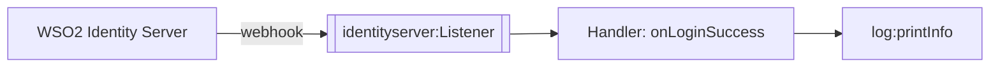

import ThemedImage from '@theme/ThemedImage';
import useBaseUrl from '@docusaurus/useBaseUrl';

# Example

## WSO2 Identity Server Trigger Example

### What you'll build

This integration logs every successful sign-in to a WSO2 Identity Server or Asgardeo organization. WSO2 Identity Server sends each event to the `identityserver:Listener`, which verifies it and calls the `onLoginSuccess` handler of an `identityserver:LoginService`. The handler logs the user ID and the organization.

### Architecture



### Prerequisites

- A WSO2 Identity Server (7.2 or later) or Asgardeo organization with a webhook subscribed to **Logins**. See the [Setup Guide](setup-guide.md#configuring-identity-server-webhooks).
- A URL for the listener that the server can reach, such as one from ngrok.

### Setting up the WSO2 Identity Server integration

> **New to WSO2 Integrator?** Follow the [Create a New Integration](product://integrator/develop-and-test/create-workspace) guide to set up your integration first, then return here to add the trigger.

### Adding the WSO2 Identity Server trigger

### Step 1: Open the artifacts palette

Select **Add Artifact** to open the artifacts palette. Search for `identityserver.trigger` and find the **identityserver.trigger** card under **More on Ballerina Central**.

<!-- TODO: Add visual designer screenshot img/connectors/catalog/security-identity/identityserver.trigger/identityserver_trigger_screenshots_01_artifact_palette.png: Artifacts palette showing the Event Integration category with the WSO2 Identity Server card -->

### Configuring the WSO2 Identity Server listener

### Step 2: Fill in the WSO2 Identity Server Event Integration form

Select the **identityserver.trigger** card to open the **WSO2 Identity Server Event Integration** form, and set:

- **Event Channel**: `identityserver:LoginService`, the default.
- **Listener**: **Create New Listener**, named `identityserverListener`.
- **Webhook Listener Port**: `8090`, the default.
- **Webhook Secret**: bind it to a new configurable variable named `webhookSecret`.

<!-- TODO: Add visual designer screenshot img/connectors/catalog/security-identity/identityserver.trigger/identityserver_trigger_screenshots_02_trigger_config_form.png: WSO2 Identity Server Event Integration form with Event Channel set to identityserver:LoginService and a new listener on port 8090 -->

### Step 3: Set the configurable values

In the left panel, select **Configurations** and set **webhookSecret** to the secret set on the webhook. The listener rejects every delivery until **webhookSecret** is set.

<ThemedImage
    alt="Configurations panel showing the webhookSecret configurable"
    sources={{
        light: useBaseUrl('/img/connectors/catalog/security-identity/identityserver.trigger/identityserver_trigger_screenshots_03_configurations_panel.png'),
        dark: useBaseUrl('/img/connectors/catalog/security-identity/identityserver.trigger/identityserver_trigger_screenshots_03_configurations_panel.png'),
    }}
/>

### Step 4: Create the trigger

Select **Create**. WSO2 Integrator adds the listener and an `identityserver:LoginService` attached to it.

### Handling WSO2 Identity Server events

### Step 5: Open the onLoginSuccess handler

Open the **identityserver:LoginService** service. It lists all 2 of its event handlers, including `onLoginSuccess`, which receives an `identityserver:LoginSuccessEvent`. Leave the other handlers empty.

<!-- TODO: Add visual designer screenshot img/connectors/catalog/security-identity/identityserver.trigger/identityserver_trigger_screenshots_04_add_handler_panel.png: identityserver:LoginService view showing the onLoginSuccess event handler attached to identityserverListener -->

### Step 6: Log the event

Select **onLoginSuccess** to open its flow. Select the **+** icon, choose **Log Info** from the **Logging** section, and log the user ID and the organization. The handler's code is:

```ballerina
remote function onLoginSuccess(identityserver:LoginSuccessEvent payload) returns error? {
    identityserver:LoginSuccessPayload login = payload.events.loginSuccess;
    log:printInfo("Login succeeded", userId = login.user?.id, organization = login.organization?.name);
}
```

<ThemedImage
    alt="onLoginSuccess handler flow with a log:printInfo node"
    sources={{
        light: useBaseUrl('/img/connectors/catalog/security-identity/identityserver.trigger/identityserver_trigger_screenshots_06_handler_flow.png'),
        dark: useBaseUrl('/img/connectors/catalog/security-identity/identityserver.trigger/identityserver_trigger_screenshots_06_handler_flow.png'),
    }}
/>

### Running the integration

1. Run the integration from WSO2 Integrator. The listener starts on port `8090`.
2. Expose the port, for example with `ngrok http 8090`, and point WSO2 Identity Server at it. See the [Setup Guide](setup-guide.md#configuring-identity-server-webhooks).
3. Sign in to an application in the organization.
4. The `onLoginSuccess` handler logs the event in the WSO2 Integrator console.

If WSO2 Identity Server reports `401` for a delivery, the listener rejected its signature. The console logs `WEBHOOK_SIGNATURE_REJECTED` with the reason; check that **webhookSecret** is the secret set on the webhook.

## What's next

- [WSO2 Identity Server](product://integrator/develop-and-test/integration-artifacts/event-driven-integration/wso2-identity-server): every event channel and handler
- [Setup Guide](setup-guide.md#configuring-identity-server-webhooks): point WSO2 Identity Server at your listener
- [Trigger Reference](triggers.md): listener configuration, callbacks and payload types
