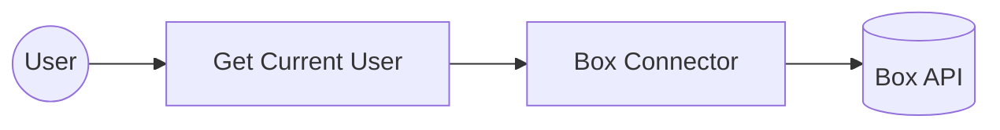

import ThemedImage from '@theme/ThemedImage';
import useBaseUrl from '@docusaurus/useBaseUrl';

# Example

## What you'll build

This integration connects to Box and retrieves the profile of the user who authorized the connector. An automation entry point runs the operation once and logs the returned user.

**Operations used:**
- **Get Current User** : Retrieves information about the user who is currently authenticated

## Architecture

## Prerequisites

- A Box account and a Box Platform application with OAuth 2.0 user authentication. Follow the [Setup Guide](setup-guide.md) to get the client ID, client secret and refresh token.

## Setting up the Box integration

> **New to WSO2 Integrator?** Follow the [Create a New Integration](product://integrator/develop-and-test/create-workspace) guide to set up your integration first, then return here to add the connector.

## Adding the Box connector

### Step 1: Open the connector palette

Hover over **Connections** in the project tree and select **Add Connection** (**+**).

<ThemedImage
    alt="Box connector palette open before selection"
    sources={{
        light: useBaseUrl('/img/connectors/catalog/storage-file/box/ballerinax_box_screenshot_01_palette.png'),
        dark: useBaseUrl('/img/connectors/catalog/storage-file/box/ballerinax_box_screenshot_01_palette.png'),
    }}
/>

### Step 2: Select the Box connector

1. Enter `box` in the search field.
2. Select the **Box** connector card.

## Configuring the Box connection

### Step 3: Bind the connection parameters to configurable variables

Bind each connection field to a configurable variable. Use the **Configurables** tab of the field's helper panel to create each configurable.

- **Config** : Connection settings, with the OAuth 2.0 refresh token credentials set in the `auth` record. Switch the field to **Expression** and enter `{auth: {clientId: boxClientId, clientSecret: boxClientSecret, refreshToken: boxRefreshToken, refreshUrl: boxRefreshUrl}}`.
- **Service Url** : Set it to the `boxServiceUrl` configurable.

<ThemedImage
    alt="Box connection form with all parameters bound before saving"
    sources={{
        light: useBaseUrl('/img/connectors/catalog/storage-file/box/ballerinax_box_screenshot_02_connection_form.png'),
        dark: useBaseUrl('/img/connectors/catalog/storage-file/box/ballerinax_box_screenshot_02_connection_form.png'),
    }}
/>

### Step 4: Save the connection

Select **Save Connection** and verify that **boxClient** appears under **Connections** in the project tree and on the design canvas.

<ThemedImage
    alt="Box connection visible after saving"
    sources={{
        light: useBaseUrl('/img/connectors/catalog/storage-file/box/ballerinax_box_screenshot_03_connections_list.png'),
        dark: useBaseUrl('/img/connectors/catalog/storage-file/box/ballerinax_box_screenshot_03_connections_list.png'),
    }}
/>

### Step 5: Set actual values for your configurables

1. Select **Configurations** at the bottom of the project tree.
2. Enter a value for each configurable listed below before you run the integration.

- **boxServiceUrl** (`string`) : Box API base URL. Defaults to `https://api.box.com/2.0`.
- **boxClientId** (`string`) : The client ID of your Box application.
- **boxClientSecret** (`string`) : The client secret of your Box application.
- **boxRefreshToken** (`string`) : The OAuth 2.0 refresh token obtained for the authorizing user.
- **boxRefreshUrl** (`string`) : Box token endpoint. Defaults to `https://api.box.com/oauth2/token`.

## Configuring the Box Get Current User operation

### Step 6: Add an automation entry point

1. Select **Add Artifact** on the design canvas.
2. Select **Automation**.
3. Select **Create** to accept the settings.

### Step 7: Expand the connection and configure the Get Current User operation

1. Select the **+** between **Start** and **Error Handler** in the automation flow.
2. Expand **boxClient** under **Connections** to display its operations.

<ThemedImage
    alt="Box connection expanded to display operations before selection"
    sources={{
        light: useBaseUrl('/img/connectors/catalog/storage-file/box/ballerinax_box_screenshot_04_operations_panel.png'),
        dark: useBaseUrl('/img/connectors/catalog/storage-file/box/ballerinax_box_screenshot_04_operations_panel.png'),
    }}
/>

3. Select **Get Current User**. It has no required values.
4. Set **Result** to `currentUser`, the variable that stores the returned user.

<ThemedImage
    alt="Box Get Current User operation with all values entered before saving"
    sources={{
        light: useBaseUrl('/img/connectors/catalog/storage-file/box/ballerinax_box_screenshot_05_operation_form.png'),
        dark: useBaseUrl('/img/connectors/catalog/storage-file/box/ballerinax_box_screenshot_05_operation_form.png'),
    }}
/>

5. Select **Save**.

### Step 8: Log the Get Current User result

1. Select the **+** below the **Get Current User** node.
2. Under **Logging**, select **Log Info**.
3. Switch **Msg** to **Expression**, enter `currentUser.toString()`, and select **Save**.

<ThemedImage
    alt="Completed Box flow with the configured operation"
    sources={{
        light: useBaseUrl('/img/connectors/catalog/storage-file/box/ballerinax_box_screenshot_06_completed_flow.png'),
        dark: useBaseUrl('/img/connectors/catalog/storage-file/box/ballerinax_box_screenshot_06_completed_flow.png'),
    }}
/>

## Try it yourself

Try this sample in WSO2 Integration Platform.

[View source on GitHub](https://github.com/wso2/integration-samples/tree/main/integrator-default-profile/connectors/box_connector_sample)

## More code examples

The Box connector provides practical examples illustrating usage in various scenarios. Explore these [examples](https://github.com/ballerina-platform/module-ballerinax-box/tree/main/examples/), covering the following use cases:

1. [Project workspace setup](https://github.com/ballerina-platform/module-ballerinax-box/tree/main/examples/project_workspace_setup) - Create a project folder, add a reference web link, optionally invite a collaborator and list the folder contents.
2. [File review workflow](https://github.com/ballerina-platform/module-ballerinax-box/tree/main/examples/file_review_workflow) - Read a file, leave a review comment, optionally create a review task and list the file's comments.
